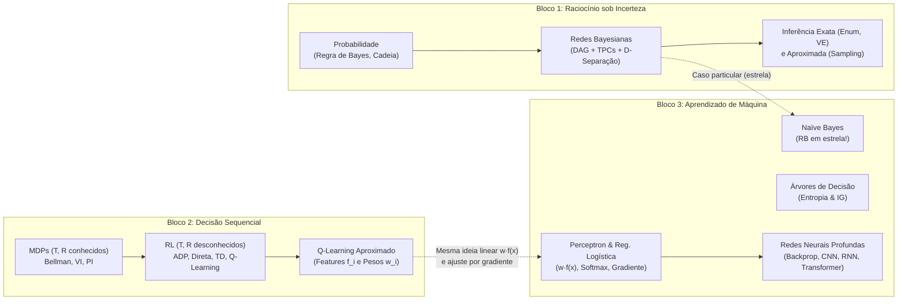

# Guia Completo de Estudo — Prova 2 de Inteligência Artificial (UFPR — Prof. Aurora Pozo)

> **Data da prova:** Amanhã, **23/11/2026 às 17:00** (aprox. 31 horas a partir de agora).
> **Cobertura:** **100% dos 14 arquivos** da disciplina (todos os 443 slides/páginas lidos integralmente, incluindo fórmulas em imagem, 5 slides ocultos recuperados via XML, notas do apresentador, provas anteriores e lista resolvida).
> **Fidelidade:** Mesma notação dos slides (CS188 + Russell & Norvig + provas da Prof. Aurora) e resoluções no padrão exigido: ***"formal e detalhada"***.

---

## 1. Índice dos 6 Arquivos do Guia

| Arquivo | Conteúdo | Quando Usar |
| :--- | :--- | :--- |
| **[`00_INDICE_E_PLANO_DE_ESTUDO.md`](file:///home/dcr/repos/trabAI/prova/guia_prova2/00_INDICE_E_PLANO_DE_ESTUDO.md)** *(este arquivo)* | Mapa conceitual, cronograma hora a hora até amanhã às 17h, Glossário Unificado de Notação e Checklist de Auditoria dos 14 arquivos | Comece por aqui para organizar seu tempo |
| **[`01_INCERTEZA_E_REDES_BAYESIANAS.md`](file:///home/dcr/repos/trabAI/prova/guia_prova2/01_INCERTEZA_E_REDES_BAYESIANAS.md)** | Probabilidade, Independência, Redes Bayesianas, **D-Separação completa** (de `naivebayes.pdf` pp. 19–52), Noisy-OR, Enumeração, Eliminação de Variáveis, NP-Hardness/Poli-árvores e 4 Métodos de Amostragem | Bloco 1 (Maior peso em provas anteriores!) |
| **[`02_MDPS_E_APRENDIZADO_POR_REFORCO.md`](file:///home/dcr/repos/trabAI/prova/guia_prova2/02_MDPS_E_APRENDIZADO_POR_REFORCO.md)** | Recap completo de MDPs (VI, PI, série geométrica), RL Passivo (ADP, Avaliação Direta, TD Learning), RL Ativo (Q-Learning Tabular), Exploração ($\epsilon$-greedy e Funções de Exploração) e Q-Learning Aproximado | Bloco 2 |
| **[`03_APRENDIZADO_DE_MAQUINA_NB_PERCEPTRON_RN.md`](file:///home/dcr/repos/trabAI/prova/guia_prova2/03_APRENDIZADO_DE_MAQUINA_NB_PERCEPTRON_RN.md)** | Fundamentos de AM, **Árvores de Decisão (DTL / Entropia / IG)**, **Naïve Bayes** (Nominal, Laplace, $\mu$, Missing Values, Gaussiano), Perceptrons Binário/Multiclasse, Regressão Logística/Linear, Gradiente Ascendente, **Redes Neurais**, Hornik, Backpropagation, CNN/RNN/Transformer | Bloco 3 |
| **[`04_PROVAS_E_EXERCICIOS_RESOLVIDOS.md`](file:///home/dcr/repos/trabAI/prova/guia_prova2/04_PROVAS_E_EXERCICIOS_RESOLVIDOS.md)** | Resolução **formal, detalhada e 100% verificada** de TODAS as questões de `prova2.pdf`, `Documento sem título.pdf`, `CS_188_Su26_Discussion_5_SOLUTION.pdf` + ponteiro para questões extras de `RL.pptx` | Treino ativo após cada bloco + simulado amanhã |
| **[`05_FOLHA_DE_FORMULAS_E_PEGADINHAS.md`](file:///home/dcr/repos/trabAI/prova/guia_prova2/05_FOLHA_DE_FORMULAS_E_PEGADINHAS.md)** | Folha condensada com todas as fórmulas, algoritmos em 3 linhas, tabela de decisão rápida e Top 15 pegadinhas + erratas dos slides | Revisão final amanhã (14h–16h30) |

---

## 2. Mapa Geral: Como Todos os Tópicos da Prova 2 se Conectam

**O que caiu nas provas anteriores (seu termômetro de prioridade máxima!):**
1. **Redes Bayesianas (caiu nas DUAS provas!):** Inferência por Enumeração + *Rejection Sampling* (`prova2.pdf` Q3) e **Eliminação de Variáveis** com frações exatas (`Documento sem título.pdf` Q1).
2. **MDPs / RL (caiu em `Documento sem título.pdf` Q2 + questões em `RL.pptx` + `Discussion 5`):** Avaliação de políticas com série geométrica, **Iteração de Valor**, **Iteração de Política**, **Q-Learning Tabular** (Táxi 5×5 / `disc5`) e **Q-Learning Aproximado** (Pacman 2×3 / `disc5`).
3. **Aprendizado de Máquina (caiu em ambas!):** **Naïve Bayes** (`prova2.pdf` Q1), **Perceptron Binário + Separabilidade Linear** (`prova2.pdf` Q2), **Árvore de Decisão / Entropia / Ganho de Informação** (`prova2.pdf` Q4) e **Derivação / Backpropagation matricial em Rede Neural** (`Documento sem título.pdf` Q3).

---

## 3. Cronograma Realista de Estudo do Zero (Hoje 22/11 → Amanhã 23/11 às 17:00)

> Projetado para alguém que **ainda não estudou nada**, intercalando teoria + prática manual (sempre fazendo as contas à mão!) e preservando **8 horas de sono** (crucial para não errar aritmética na Eliminação de Variáveis e no Backprop!).

### Hoje — Domingo, 22/11 (Foco: Construir toda a base + 1ª rodada de exercícios)

| Horário | Duração | Meta Exata | Material |
| :--- | :---: | :--- | :--- |
| **10:30 – 12:30** | 2h00 | **Bloco 1 (Parte 1):** Probabilidade, Regras do Produto/Cadeia/Bayes, Independência, Semântica de RBs, Cobertura de Markov, **D-Separação** (fazer os 3 exemplos!), Noisy-OR | [`01_INCERTEZA_E_REDES_BAYESIANAS.md`](file:///home/dcr/repos/trabAI/prova/guia_prova2/01_INCERTEZA_E_REDES_BAYESIANAS.md) §§1–3 |
| **12:30 – 13:30** | 1h00 | *Almoço e descanso* | — |
| **13:30 – 16:00** | 2h30 | **Bloco 1 (Parte 2 — ALTÍSSIMA PRIORIDADE):** Enumeração, *Factor Zoo*, **Eliminação de Variáveis** (refazer $R\to T\to L$ e Alarme à mão!), NP-Hardness/Poli-árvores e os **4 Métodos de Amostragem**. Fazer **Questão 3 de `prova2.pdf`** e **Questão 1 (Miles) de `Documento sem título.pdf`** sem olhar! | [`01_...`](file:///home/dcr/repos/trabAI/prova/guia_prova2/01_INCERTEZA_E_REDES_BAYESIANAS.md) §§4–6 + [`04_...`](file:///home/dcr/repos/trabAI/prova/guia_prova2/04_PROVAS_E_EXERCICIOS_RESOLVIDOS.md) |
| **16:00 – 16:30** | 0h30 | *Pausa* | — |
| **16:30 – 19:00** | 2h30 | **Bloco 2 Completo (MDPs e RL):** Recap de MDPs (Bellman, série geométrica, VI, PI), RL Passivo (ADP, Direta, TD), Q-Learning Tabular, Exploração ($\epsilon$-greedy + Funções $f(u,n)$), Q-Learning Aproximado. Resolver à mão **Q2 (Jim e Pam)**, **Táxi 5×5**, **Pacman 2×3** e **Discussion 5 (Q1 e Q2)**! | [`02_MDPS_E_APRENDIZADO_POR_REFORCO.md`](file:///home/dcr/repos/trabAI/prova/guia_prova2/02_MDPS_E_APRENDIZADO_POR_REFORCO.md) + [`04_...`](file:///home/dcr/repos/trabAI/prova/guia_prova2/04_PROVAS_E_EXERCICIOS_RESOLVIDOS.md) |
| **19:00 – 20:00** | 1h00 | *Jantar e descanso* | — |
| **20:00 – 22:30** | 2h30 | **Bloco 3 (Parte 1):** Fundamentos AM, **Árvores de Decisão** (Entropia, `remainder`, `IG`), **Naïve Bayes** (Nominal, Laplace, $\mu$, Missing Values, Gaussiano) e **Perceptrons** (Binário, Multiclasse, Geometria, Separabilidade). Resolver à mão **Q1, Q2 e Q4 de `prova2.pdf`**! | [`03_APRENDIZADO_DE_MAQUINA_NB_PERCEPTRON_RN.md`](file:///home/dcr/repos/trabAI/prova/guia_prova2/03_APRENDIZADO_DE_MAQUINA_NB_PERCEPTRON_RN.md) §§1–4 + [`04_...`](file:///home/dcr/repos/trabAI/prova/guia_prova2/04_PROVAS_E_EXERCICIOS_RESOLVIDOS.md) |
| **22:30 – 23:00** | 0h30 | Revisão leve das autoavaliações dos Módulos 01 e 02. **Dormir bem!** | Mini-autoavaliações |

### Amanhã — Segunda, 23/11 (Foco: Redes Neurais + Simulado Cronometrado + Revisão Cirúrgica)

| Horário | Duração | Meta Exata | Material |
| :--- | :---: | :--- | :--- |
| **08:00 – 10:30** | 2h30 | **Bloco 3 (Parte 2):** Regressão Logística (Sigmoid/Softmax/MLE), Regressão Linear (Equações Normais), Gradiente Ascendente (Prova Taylor/Cauchy–Schwarz, Batch/SGA/Mini-Lote), **Redes Neurais**, Ativações & Derivadas, Teorema de Hornik, **Backpropagation** (refazer grafo $w_1^4 w_2 + 5w_3$ à mão!), CNN (Convolução/MaxPool), RNN, Transformer. Resolver à mão **Q3 de `Documento sem título.pdf`** (derivadas matriciais de $g(z)=z\odot z$)! | [`03_...`](file:///home/dcr/repos/trabAI/prova/guia_prova2/03_APRENDIZADO_DE_MAQUINA_NB_PERCEPTRON_RN.md) §§5–7 + [`04_...`](file:///home/dcr/repos/trabAI/prova/guia_prova2/04_PROVAS_E_EXERCICIOS_RESOLVIDOS.md) |
| **10:30 – 11:00** | 0h30 | *Pausa* | — |
| **11:00 – 13:00** | 2h00 | **Simulado Real Cronometrado (sem consulta!):** Refaça no papel, do zero, 1 questão de cada grande tema: VE (Miles), MDP (Jim e Pam), Q-Learning Aproximado (`disc5` Q2b), Naïve Bayes + Perceptron (`prova2` Q1–Q2), Árvore (`prova2` Q4) e Backprop (`doc` Q3). Corrija conferindo rigor formal! | [`04_PROVAS_E_EXERCICIOS_RESOLVIDOS.md`](file:///home/dcr/repos/trabAI/prova/guia_prova2/04_PROVAS_E_EXERCICIOS_RESOLVIDOS.md) |
| **13:00 – 14:00** | 1h00 | *Almoço e descanso* | — |
| **14:00 – 16:00** | 2h00 | **Revisão Final + Reforço dos Pontos Fracos:** Estude integralmente a **Folha de Fórmulas e Top 15 Pegadinhas**; refaça apenas os tipos de exercício em que errou ou hesitou no simulado. | [`05_FOLHA_DE_FORMULAS_E_PEGADINHAS.md`](file:///home/dcr/repos/trabAI/prova/guia_prova2/05_FOLHA_DE_FORMULAS_E_PEGADINHAS.md) |
| **16:00 – 17:00** | 1h00 | *Desligar dos cálculos, respirar e ir para a prova com cabeça fresca!* | — |

---

## 4. Glossário Unificado de Notação (Todos os 14 Arquivos)

| Símbolo / Termo | Significado Exato | Onde Aparece | Equivalências / Colisões para Atenção |
| :--- | :--- | :--- | :--- |
| $X, Y, Q, E, H$ (maiúsc.) vs. $x, y, q, e, h$ (minúsc.) | Variável aleatória livre (dimensão de tabela) vs. valor observado/fixo | `incerteza`, `lec13`, `RB4`, `RB5`, `naivebayes` Pt B | Em `Bayes.pptx`: $\mathbf{P}(\cdot)$ negrito = tabela; em `RB4`: nº de maiúsculas = dimensionalidade do fator. |
| $+x, -x$ vs. $x, \neg x$ vs. `T`/`F` | Valores booleanos verdadeiro/falso | Provas UFPR, `incerteza`, `lec13`, `RB4`/`5`, `Bayes` | $+b \equiv b \equiv (B=\text{T})$; $-b \equiv \neg b \equiv (B=\text{F})$. |
| $Z$ vs. $\alpha$ vs. $\propto_Q$ | Constante de normalização ($Z = P(\mathbf{e})$, $\alpha = 1/Z$) | `incerteza`, `Bayes`, `RB4` | **Colisão:** $\alpha$ também é **taxa de aprendizado** em RL e Perceptrons/Gradiente! |
| $X \perp\!\!\!\perp Y$, $X \perp\!\!\!\perp Y \mid Z$, $\not\perp\!\!\!\perp$ | Independência absoluta, condicional, e não-garantida | `lec13`, `naivebayes` Pt B | Testado graficamente via **d-separação**. |
| `TPC` / `CPT`, `Pais(X_i)` / `parents(X_i)` / `Pa(Y)` | Tabela de Probabilidade Condicional e conjunto de pais | `Bayes`, `lec13`, `RB4`, `RB5`, `naivebayes` Pt B | Em `naivebayes.pdf` pp. 35–38, `CPTs` foi mal traduzido como *"tubos de raios catódicos"*. |
| $S_{PS}, N_{PS}, S_{WS}, w(\mathbf{z}, \mathbf{e})$ | Distribuições e pesos de amostragem (Prior vs. Likelihood Weighting) | `RB5` | **Colisão:** $w$ também é vetor de **pesos** em Q-Learning Aproximado, Perceptron e Redes Neurais! |
| $S, A, T(s,a,s'), R(s,a,s')$ ou $R(s)$, $\gamma$ | Tupla do MDP (estados, ações, transição, recompensa, desconto) | `RL`, `ar2`, `disc5`, `doc_sem_titulo` | Em `ar2` (fonte Symbol): `s e S` = $s\in S$, `p` = $\pi$, `g` = $\gamma$, `e` = $\epsilon$. |
| $V^\pi(s), V^*(s), U^\pi(s)$ e $Q(s,a), Q^*(s,a), Q(a,s)$ | Valor/utilidade de estado e valor estado-ação | `RL`, `ar2`, `disc5`, `doc_sem_titulo` | $U^\pi \equiv V^\pi$. Atenção à ordem invertida **$Q(a,s)$** em `ar2` p. 23! |
| `sample` / `amostra` / $Q_{\mathbf{new}}(s,a)$ e `difference` | Alvo de 1 passo e erro TD ($\text{sample} - Q(s,a)$) | `RL`, `ar2`, `disc5` | Os 3 nomes (`sample`, `amostra`, $Q_{\mathbf{new}}$) são sinônimos exatos! |
| $f(u, n) = u + k/n$ e $\leftarrow_\alpha$ | Função de exploração otimista e atalho de média móvel exponencial | `ar2` p. 27 | $x \leftarrow_\alpha y \iff x \leftarrow (1-\alpha)x + \alpha y$. |
| $f, h, H$, $I(\cdot)$, $\text{remainder}(A)$, $IG(A)$ | Função-alvo, hipótese, espaço de hipóteses, Entropia (bits), resto, Ganho de Informação | `CS 188 ML I` | **Colisões:** $H$ é classe em `naivebayes` Pt A; $E$ é conjunto de treino em DTL vs. evidência em Naïve Bayes. |
| $\Pr[H\mid E]$, $\mu$ (suavização) vs. $\mu, \sigma, f(x)$ (Gaussiana) | Probabilidade posterior, suavização $\frac{c+\mu/v}{N+\mu}$, média/desvio/PDF normal | `naivebayes` Pt A | Mesmo símbolo $\mu$ usado para suavização (p. 13) e média amostral (p. 15)! |
| $f(x)$, $w$, $w_y$, $y^*$, $\delta$, $\phi(z)$, $ll(w)$ | Vetor de características, pesos, pesos por classe, rótulo verdadeiro, margem, sigmoide, log-verossimilhança | `perceptrons`, `redesneurais`, `prova2` | $y^* \in \{+1,-1\}$ (CS188) vs. $y \in \{0,1\}$ (`perceptrons` p. 21). |
| $W_{i,j}^{(k-1,k)}$ vs. $w_{i,j}$, $z_i^{(k)}$, $g(\cdot)$, $\odot$, $\otimes$ | Pesos de rede neural (destino, origem vs. origem, destino), ativação na camada $k$, Hadamard, Convolução 2D | `redesneurais`, `perceptrons`, `doc_sem_titulo` | $g(\cdot)$ sobrecarregado: ativação, objetivo $g(w)$ ou grafo computacional $g(w_1,w_2,w_3)$. |

---

## 5. Checklist de Auditoria de Cobertura (14 / 14 Arquivos — Zero Omissões)

| # | Arquivo Original | Págs./Slides | Onde Foi Consolidado | Verificação de Zero Omissões |
|---:|:---|---:|:---|:---|
| 1 | [`incerteza.pdf`](file:///home/dcr/repos/trabAI/prova/incerteza.pdf) | 30 págs. | Módulo 01 (§1) + Módulo 05 | Variáveis, axiomas, conjunta vs. CSP, eventos, marginais, condicionais, normalização $Z$, enumeração $P(S,T,W)$, produto (com texto branco oculto), cadeia, Bayes (Meningite + `P(W\|dry)`). |
| 2 | [`Bayes.pptx`](file:///home/dcr/repos/trabAI/prova/Bayes.pptx) | 44 slides | Módulo 01 (§3, §4.2) + Módulo 05 | Sintaxe, Dentista, Alarme (10 TPCs), preguiça/ignorância, $O(n\cdot 2^k)$, semântica global/local, Cobertura de Markov, construção & 3 ordens (4, 6, 10 arestas), determinístico, **Ou-ruidoso** (`Fever` 8 linhas), `ENUMERATION-ASK` + árvore + erratas. |
| 3 | [`cs188-fa26-lec13.pdf`](file:///home/dcr/repos/trabAI/prova/cs188-fa26-lec13.pdf) | 42 págs. | Módulo 01 (§1–§3) + Módulo 05 | Revisão inferência/Box, independência absoluta ($P_1$ vs $P_2$, $N$ moedas), condicional (Cavity, Traffic, Fire, Ghostbusters 8 linhas), semântica + prova via cadeia, Tráfego causal vs. reverso, causalidade vs. CI, $O(N\cdot 2^{k+1})$. |
| 4 | [`RB4.pptx`](file:///home/dcr/repos/trabAI/prova/RB4.pptx) | 40 slides (2 ocultos!) | Módulo 01 (§4) + Módulo 05 | Posterior & MAP, Enumeração no Alarme, *Factor Zoo* I–III, Join & Eliminate, $R\to T\to L$ ($P(L)$ com errata `0.886` e $P(L\mid +r)$), **Slide oculto 18 & 34** ($P(B\mid a)=8/17$), Alarme VE + distributiva, estrela $Z\to X_i\to Y_i$ ($2^{n+1}$ vs $2^2$), 3-SAT NP-Hard, Poli-árvores & Cutset Conditioning. |
| 5 | [`RB5.pptx`](file:///home/dcr/repos/trabAI/prova/RB5.pptx) | 28 slides (2 ocultos!) | Módulo 01 (§5) + Módulo 05 | **Slide oculto 4** (3-SAT), amostragem uniforme $[0,1)$, Cloudy/Sprinkler/Rain/WetGrass, Prior Sampling + prova, Rejection Sampling, Likelihood Weighting + prova + amostras efetivas, Gibbs Sampling + **Slide oculto 26** (Cobertura de Markov) + prova de 5 linhas (Slide 27). |
| 6 | [`RL.pptx`](file:///home/dcr/repos/trabAI/prova/RL.pptx) | 22 slides (1 oculto!) | Módulo 02 + Módulo 04 + Módulo 05 | Labirinto 2×3 (imagem), Avaliação Direta, Q-Learning det. (imagem), Sample PE (legenda oculta), TD Learning, limitações de $V$, Q-VI, Q-Learning, **Questão Táxi 5×5** (Slides 11–13 + errata `$S_2$`), $\epsilon$-greedy, **Slide oculto 16**, Q-Learning Aproximado + **Questão Pacman 2×3** (Slides 19–22). |
| 7 | [`aprendizado-reforco-2 2.pdf`](file:///home/dcr/repos/trabAI/prova/aprendizado-reforco-2%202.pdf) | 32 págs. | Módulo 02 + Módulo 05 | R&N Cap. 21 + CS188: Offline vs. Online, ciclo agente–ambiente, ADP (5-estados e 4×3), Avaliação Direta (ambos + paradoxo $B$ vs. $E$), TD + expansão $(1-\alpha)^{k-1}$, Greedy ADP falha, Q-Learning CS188 & R&N $Q(a,s)$, propriedades off-policy, $\epsilon$-greedy, **Funções de Exploração** $f(u,n)$ (p. 27!), Q-Learning Aproximado + Q-Pacman (p. 32). |
| 8 | [`CS_188_Su26_Discussion_5_SOLUTION.pdf`](file:///home/dcr/repos/trabAI/prova/CS_188_Su26_Discussion_5_SOLUTION.pdf) | 5 págs. | Módulo 02 + Módulo 04 | Revisão TD + Q-Learning (on-policy vs. off-policy), Q1 completa (model-based, propagação iters 14 e 22, 4 V/F) e Q2 completa (tabular `0.5, 1.5` e aproximado `(2,2)->(4,0)`). |
| 9 | [`CS 188 - Aprendizado de Máquina I.pdf`](file:///home/dcr/repos/trabAI/prova/CS%20188%20-%20Aprendizado%20de%20M%C3%A1quina%20I.pdf) | 64 págs. | Módulo 03 (§1–§2) + Módulo 05 | História (James, Turing, Skinner, Rosenblatt), paradigmas, $f, h, H$, realizabilidade, ajuste de curva, overfitting, Navalha de Ockham, aplicações (Spam, MNIST, etc.), **Árvores de Decisão** (Restaurante 12 ex., XOR, 4 casos DTL, Entropia $I$, `remainder`, `IG` + errata `.0541`), Validação e Curva de Aprendizado. |
| 10 | [`naivebayes.pdf`](file:///home/dcr/repos/trabAI/prova/naivebayes.pdf) | 52 págs. | Módulo 03 (§3) + **Módulo 01 (§3.4!)** + Módulo 05 | **Parte A (pp. 1–18):** Bayes + Meningite (errata `0,002`), Naïve Bayes nominal (Tempo 14 linhas), violação da suposição, frequência zero, Laplace (+1), constante $\mu$, valores faltantes, **Gaussiano** ($\mu, \sigma$ com errata raiz, $f(x)$). **Parte B (pp. 19–52):** **D-Separação completa** (3 triplas + provas/contraexemplos, descendentes observados, algoritmo, 3 exemplos resolvidos, diagrama de Venn de topologias). |
| 11 | [`perceptrons.pdf`](file:///home/dcr/repos/trabAI/prova/perceptrons.pdf) | 54 págs. | Módulo 03 (§4–§5) + Módulo 05 | Classificadores lineares, Perceptron binário (`+1/-1` + geometria + bias + traço 5 pontos; `{0,1}` R&N), McCulloch–Pitts, ativações (errata Tanh), perda $L_2$, Perceptron multiclasse (3-class), separabilidade/convergência/$k/\delta^2$, 3 problemas, Regressão Logística Binária/Softmax (MLE), **Regressão Linear (Equações Normais)**, Gradiente Ascendente + prova Taylor/Cauchy–Schwarz, Batch/SGA/Mini-Lote, Learning Rate Finder. |
| 12 | [`redesneurais.pdf`](file:///home/dcr/repos/trabAI/prova/redesneurais.pdf) | 25 págs. | Módulo 03 (§6) + Módulo 05 | DNN (features aprendidas, não-linearidade), Ativações & derivadas (Sigmoid/Tanh/ReLU), MLE + Early Stopping, **Teorema da Aproximação Universal (Hornik 1 & 2)**, 22 derivadas, Regra da Cadeia, Autodiff/Backprop ($w_1^4 w_2 + 5w_3$ + errata + 2 exemplos PyTorch), **CNN (Conv 2D + MaxPool)**, **RNN**, **Transformer (Pre-LN)**. |
| 13 | [`prova2.pdf`](file:///home/dcr/repos/trabAI/prova/prova2.pdf) | 2 págs. | Módulo 04 (Parte I) | Todas as 4 questões resolvidas formalmente e verificadas em Python: Q1 Naïve Bayes (`Y=1`, `6/11`), Q2 Perceptron (`w=[0,1,0]` + prova convexa de não-separabilidade), Q3 RB (`D->A` + Enumeração + Rejection `1/4`), Q4 Árvore (`Rating` ótimo; `Fiction`/`Award` empatados piores). |
| 14 | [`Documento sem título.pdf`](file:///home/dcr/repos/trabAI/prova/Documento%20sem%20ti%A6%FCtulo.pdf) | 3 págs. | Módulo 04 (Parte II) | Todas as 3 questões resolvidas formalmente e verificadas em Python: Q1 Miles VE (`16875/28651`), Q2 Jim e Pam MDP ($p<1/3$, $\gamma<1/4$, VI $V_1/V_2$, PI 2 iterações), Q3 Rede Neural $g(z)=z\odot z$ ($n_1=k, n_2=d$, $\partial\mathcal{L}/\partial W_2$, $\partial\mathcal{L}/\partial x$). |
