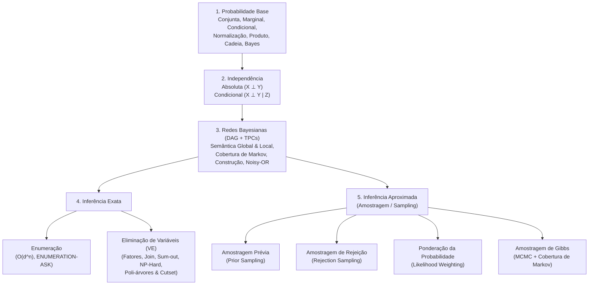

# Módulo 01 — Incerteza, Probabilidade e Redes Bayesianas

> **Fontes consolidadas (100% dos slides, notas do apresentador e 4 slides ocultos cobertos):**
> - [`incerteza.pdf`](file:///home/dcr/repos/trabAI/prova/incerteza.pdf) (30 páginas — Probabilidade, Distribuições, Normalização, Inferência por Enumeração, Regras do Produto, da Cadeia e de Bayes)
> - [`Bayes.pptx`](file:///home/dcr/repos/trabAI/prova/Bayes.pptx) (44 slides — Russell & Norvig Cap. 14: Redes Bayesianas, Semântica Global e Local, Cobertura de Markov, Construção/Ordenação, Distribuições Canônicas/Ou-Ruidoso, `ENUMERATION-ASK`)
> - [`cs188-fa26-lec13.pdf`](file:///home/dcr/repos/trabAI/prova/cs188-fa26-lec13.pdf) (42 páginas — CS188 Lecture 13: Independência Absoluta e Condicional, Representação e Semântica de RBs, Causalidade vs. Independência, Tamanho)
> - [`naivebayes.pdf` — Parte B (págs. 19–52)](file:///home/dcr/repos/trabAI/prova/naivebayes.pdf) (**CS188: Redes Bayesianas — Independência & D-Separação completa:** 3 triplas canônicas com provas e contraexemplos, acessibilidade, triplas/caminhos ativos e inativos incluindo descendentes observados, algoritmo formal de d-separação, 3 exemplos resolvidos e diagrama de Venn de distribuições representáveis!)
> - [`RB4.pptx`](file:///home/dcr/repos/trabAI/prova/RB4.pptx) (40 slides XML, incluindo **2 slides ocultos**: Slide 18 e Slide 34 — Inferência Exata, *Factor Zoo*, Eliminação de Variáveis, Ordenação, Redução 3-SAT / NP-Hard, Poli-árvores, *Cutset Conditioning*)
> - [`RB5.pptx`](file:///home/dcr/repos/trabAI/prova/RB5.pptx) (28 slides XML, incluindo **2 slides ocultos**: Slide 4 e Slide 26 — Inferência Aproximada por Amostragem: Prévia, Rejeição, Ponderação da Probabilidade e Gibbs + prova algébrica da Cobertura de Markov)
> - Referência de prova: [`prova2.pdf`](file:///home/dcr/repos/trabAI/prova/prova2.pdf) (Questão 3) e [`Documento sem título.pdf`](file:///home/dcr/repos/trabAI/prova/Documento%20sem%20ti%A6%FCtulo.pdf) (Questão 1 — Miles)

---

## Mapa do Módulo e Guia de Notação



### Tabela de Equivalência de Notação (CS188 vs. Russell & Norvig vs. Provas UFPR)

Os 5 arquivos alternam entre notação **CS188** (`incerteza.pdf`, `lec13`, `RB4`, `RB5`, provas da Prof. Aurora) e **Russell & Norvig** (`Bayes.pptx`). Domine as equivalências:

| Conceito | Notação CS188 / Provas (`incerteza`, `lec13`, `RB4`, `RB5`) | Notação R&N (`Bayes.pptx`) | Observação Crítica |
| :--- | :--- | :--- | :--- |
| Variável vs. Valor | Maiúscula = variável livre (tabela): $X, Q, W$<br>Minúscula = valor fixo (escalar/dimensão selecionada): $x, q, w$ | $\mathbf{P}(X)$ (negrito = tabela) vs. $P(x)$ (escalar) | Em `RB4` Slide 13: *"Número de maiúsculas = dimensionalidade do fator"*. |
| Valores Booleanos | $\{+x, -x\}$ (ex.: $+b, -b, +t, -t$) — **padrão das provas UFPR!** | `T`/`F` nas tabelas; $x$ e $\neg x$ nas equações | $+b \equiv b \equiv (B=\text{T})$; $-b \equiv \neg b \equiv (B=\text{F})$. (`RB4` Slide oculto 34 mistura $+b$ e $\neg b$.) |
| Conjunção (E) / Disjunção (OU) | Vírgula `,` e `OR` (ex.: $P(+x, +y)$, $P(-y \text{ OR } +x)$) | $\land$ e $\lor$ (ex.: $\mathbf{P}(j \land m \land \neg b)$) | $P(a, b) \equiv P(a \land b)$. |
| Independência | $X \perp\!\!\!\perp Y$ e $X \perp\!\!\!\perp Y \mid Z$ | Descrita textualmente / topologia | Símbolo $\perp\!\!\!\perp$ em `lec13`. |
| Pais de um nó | $\text{parents}(X_i)$ ou $\text{Parents}(X_i)$ ou `Pais(Xi)` | $Pais(X_i)$ ou $Pa(Y)$ (no pseudocódigo) | Mesma noção. |
| Tabela de Prob. Condicional | **CPT** (*Conditional Probability Table*) | **TPC** (*Tabela de Probabilidade Condicional*) | Mesma tabela $P(X_i \mid Pais(X_i))$. |
| Consulta / Evidência / Ocultas | $Q$ / $E_1\dots E_k = e_1\dots e_k$ / $H_1\dots H_r$ | $X$ / $\mathbf{E} = \mathbf{e}$ / $\mathbf{Y}$ ($y$) | $Q \leftrightarrow X$; $E \leftrightarrow \mathbf{E}$; $H \leftrightarrow \mathbf{Y}$. |
| Normalização | $Z = \sum_q P(q, e)$, multiplicar por $\frac{1}{Z}$; ou $\propto_Q$ | $\alpha = \frac{1}{Z} = \frac{1}{P(e)}$; `NORMALIZE` | $\alpha \cdot P(X, e) = \frac{1}{Z} P(X, e) = P(X \mid e)$. |
| Tamanho / Complexidade | $n$ (ou $N$) vars, domínio $d$, máx $k$ pais $\implies O(N \cdot 2^{k+1})$ entradas | $n$ vars booleanas, máx $k$ pais $\implies O(n \cdot 2^k)$ parâmetros | $2^{k+1}$ inclui ambas as linhas (`+x` e `-x`); $2^k$ guarda só $P(+x\mid \cdot)$ (o outro é $1-p$). |

> **Dicionário rápido das traduções literais em `RB4.pptx` e `RB5.pptx`:**
> *Eliminação variável / Remoção de variável* = Variable Elimination (VE) · *Adesão / Junção / Junte-se* = Join (produto pontual) · *Resumir* = Sum out (marginalizar) · *Articulação* = Joint (conjunta) · *Provas* = Evidence (evidência) · *Rede líquida / Inferência líquida* = Bayes Net ("net" traduzido literalmente) · *Número de capitais* = Número de letras maiúsculas · *Fator Jardim Zoológico* = Factor Zoo · *Condicionamento de corte* = Cutset Conditioning · *Amostragem prévia* = Prior Sampling · *Ponderação da probabilidade* = Likelihood Weighting · *Corrigir evidências* = Fix evidence (`E = e`).

---

## 1. Fundamentos de Probabilidade e Inferência na Conjunta (`incerteza.pdf` pp. 1–30; `lec13` pp. 1–9)

### 1.1. Variáveis Aleatórias, Distribuições e Modelos Probabilísticos

#### 1. Intuição do Zero
Agentes reais operam sob incerteza: o chão escorrega, sensores falham, não sabemos onde o fantasma está ou se vai chover. Em vez de dizer apenas "verdadeiro" ou "falso" (como na lógica ou nos CSPs), atribuímos **graus de crença (probabilidades)** a cada cenário possível do mundo.

#### 2. Definições Formais e Equações (`incerteza.pdf` pp. 3–8)
- **Variável Aleatória (*Random Variable*):** representa um aspecto incerto do mundo; denotada por **letra maiúscula**, com um **domínio** de valores possíveis:
  - $R \in \{\text{true}, \text{false}\}$ (frequentemente escrito $\{+r, -r\}$) — *está chovendo?*
  - $T \in \{\text{hot}, \text{cold}\}$ — *temperatura*
  - $D \in [0, \infty)$ — *tempo de trajeto (contínuo)*
  - $L \in \{(0,0), (0,1), \dots\}$ — *posição do fantasma (Ghostbusters)*
- **Distribuição de Probabilidade vs. Probabilidade:**
  - **Distribuição** $P(W)$ (maiúscula) = uma **tabela** atribuindo probabilidade a cada valor do domínio (ex.: `sun: 0.6, rain: 0.1, fog: 0.3, meteor: 0.0`).
  - **Probabilidade** $P(W = \text{rain}) = 0.1$ (valor específico) = um **único número**.
  - **Notação abreviada:** $P(\text{hot}) = P(T = \text{hot})$ — **só é válida se todos os nomes de valores forem únicos entre as variáveis!**
- **Axiomas obrigatórios:**
  $$\forall x:\; P(X = x) \ge 0 \qquad \text{e} \qquad \sum_{x} P(X = x) = 1$$
- **Distribuição Conjunta (*Joint Distribution*):** atribui um número a cada atribuição completa (**desfecho / *outcome***) de $X_1, \dots, X_n$:
  $$P(x_1, x_2, \dots, x_n) \ge 0, \qquad \sum_{(x_1, \dots, x_n)} P(x_1, \dots, x_n) = 1$$
  - **Tamanho:** Para $n$ variáveis com domínios de tamanho $d$, a tabela conjunta tem **$d^n$ linhas** ($O(d^n)$ — exponencial, impraticável de armazenar!).
- **Modelos Probabilísticos vs. CSPs (`incerteza.pdf` p. 7):**
  - Ambos têm variáveis com domínios e buscam interações locais.
  - Em CSPs, tabelas de restrição dizem se uma atribuição é **possível** (`T`/`F`); em Modelos Probabilísticos, a conjunta diz quão **provável** é cada desfecho (*outcome*) e é **normalizada** (soma $1$).
  - Citação clássica (`lec13` p. 9): *"All models are wrong; but some are useful"* (George E. P. Box). Modelos servem para **explicação/diagnóstico** (sintoma $\to$ causa), **previsão/causal** (intervenção $\to$ futuro) e **valor da informação**.
- **Evento (*Event*):** qualquer conjunto $E$ de desfechos (frequentemente atribuições parciais):
  $$P(E) = \sum_{(x_1 \dots x_n) \in E} P(x_1 \dots x_n)$$

### 1.2. Marginais, Condicionais e Truque da Normalização (`incerteza.pdf` pp. 10–19)

1. **Distribuição Marginal (*Summing Out* / Marginalização):** elimina variáveis somando as linhas colapsadas:
   $$P(X_1 = x_1) = \sum_{x_2} P(X_1 = x_1, X_2 = x_2)$$
2. **Probabilidade Condicional (definição):**
   $$P(a \mid b) = \frac{P(a, b)}{P(b)}$$
3. **Distribuição Condicional $P(W \mid T)$:** família de distribuições sobre $W$, uma para cada valor fixo de $T$ (cada condicional separadamente soma $1$).
4. **Truque da Normalização (*Normalization Trick*):** para calcular $P(X_1 \mid X_2 = x_2)$ a partir da conjunta $P(X_1, X_2)$ sem calcular $P(x_2)$ à parte:
   - **Passo 1 (`SELECT`):** filtre apenas as linhas compatíveis com $X_2 = x_2$, obtendo $P(X_1, x_2)$.
   - **Passo 2 (`NORMALIZE`):** calcule $Z = \sum_{x_1} P(x_1, x_2)$ (que é exatamente $P(x_2)$!) e divida cada entrada por $Z$:
     $$P(x_1 \mid x_2) = \frac{P(x_1, x_2)}{P(x_2)} = \frac{P(x_1, x_2)}{\sum_{x_1} P(x_1, x_2)} = \frac{1}{Z} P(x_1, x_2)$$

#### Exemplo Resolvido à Mão (`incerteza.pdf` pp. 9–19)
Dada $P(X, Y)$: `(+x,+y): 0.2`, `(+x,-y): 0.3`, `(-x,+y): 0.4`, `(-x,-y): 0.1`:
- **Evento:** $P(-y \text{ OR } +x) = 0.2 + 0.3 + 0.1 = \mathbf{0.6}$.
- **Marginais:** $P(+x) = 0.2+0.3 = \mathbf{0.5}$, $P(-x) = \mathbf{0.5}$; $P(+y) = 0.2+0.4 = \mathbf{0.6}$, $P(-y) = \mathbf{0.4}$.
- **Condicional direta:** $P(+x \mid +y) = \frac{0.2}{0.6} = \mathbf{\frac{1}{3}}$; $P(-y \mid +x) = \frac{0.3}{0.5} = \mathbf{0.6}$.
- **Truque da normalização para $P(X \mid Y = -y)$:**
  1. `SELECT` ($Y = -y$): `(+x,-y): 0.3`, `(-x,-y): 0.1`.
  2. `NORMALIZE` ($Z = 0.3 + 0.1 = 0.4$): $P(+x \mid -y) = \frac{0.3}{0.4} = \mathbf{0.75}$, $P(-x \mid -y) = \frac{0.1}{0.4} = \mathbf{0.25}$.

### 1.3. Inferência por Enumeração sobre a Conjunta (`incerteza.pdf` pp. 20–23; `lec13` pp. 2–5)
Dada a conjunta sobre todas as variáveis particionadas em **Consulta** $Q$, **Evidência** $E_1\dots E_k = e_1\dots e_k$ e **Ocultas** $H_1\dots H_r$, calculamos $P(Q \mid e_1\dots e_k)$ em 3 passos:
1. **Step 1 (Select):** selecionar entradas consistentes com $e_1\dots e_k$.
2. **Step 2 (Sum out $H$):** marginalizar todas as variáveis ocultas:
   $$P(Q, e_1 \dots e_k) = \sum_{h_1 \dots h_r} P(Q, h_1 \dots h_r, e_1 \dots e_k)$$
3. **Step 3 (Normalize):** calcular $Z = \sum_q P(q, e_1\dots e_k)$ e retornar $P(Q \mid e_1\dots e_k) = \frac{1}{Z} P(Q, e_1\dots e_k)$.
- **Complexidade (o grande gargalo!):** **Tempo $O(d^n)$** e **Espaço $O(d^n)$**.
- **Exemplo trabalhado (`incerteza.pdf` p. 22 / `lec13` p. 4):** sobre a tabela de 8 linhas $P(S, T, W)$ (`(sum,hot,sun):0.30, (sum,hot,rain):0.05, (sum,cold,sun):0.10, (sum,cold,rain):0.05, (win,hot,sun):0.10, (win,hot,rain):0.05, (win,cold,sun):0.15, (win,cold,rain):0.20`):
  - $P(W \mid \text{winter})$: seleciona $S=\text{winter}$ $\to$ soma $T$: `sun`: $0.10+0.15=0.25$, `rain`: $0.05+0.20=0.25$ $\to$ normaliza ($Z=0.50$): $\langle \text{sun}: 0.50,\; \text{rain}: 0.50\rangle$.
  - $P(W \mid \text{winter}, \text{hot})$: seleciona `sun: 0.10, rain: 0.05` $\to$ normaliza ($Z=0.15$): $\langle \text{sun}: \frac{2}{3},\; \text{rain}: \frac{1}{3}\rangle$.

### 1.4. Regra do Produto, Regra da Cadeia e Regra de Bayes (`incerteza.pdf` pp. 24–30; `lec13` pp. 6–8)

1. **Regra do Produto (*Product Rule*):**
   $$P(x, y) = P(y)\, P(x \mid y) = P(x)\, P(y \mid x)$$
2. **Regra da Cadeia (*Chain Rule*):** sempre verdadeira para **qualquer** ordenação $x_1, \dots, x_n$ (por aplicação repetida da Regra do Produto):
   $$P(x_1, x_2, \dots, x_n) = \prod_{i=1}^{n} P(x_i \mid x_1, \dots, x_{i-1})$$
3. **Regra de Bayes (*Bayes' Rule*):** igualando as duas fatorações de $P(x, y)$:
   $$P(x \mid y) = \frac{P(y \mid x)\, P(x)}{P(y)}$$
   - **Por que é uma das equações mais importantes da IA?** Permite inverter condicionais — calcular a probabilidade **diagnóstica** $P(\text{causa} \mid \text{efeito})$ a partir da probabilidade **causal** $P(\text{efeito} \mid \text{causa})$ e da priori $P(\text{causa})$ (usada em ASR, tradução automática, diagnóstico médico e Naive Bayes!).

#### Exemplos Resolvidos à Mão (`incerteza.pdf` pp. 25, 29–30)
- **Meningite ($M$) e Rigidez no Pescoço ($S$) (p. 29):**
  Dados $P(+m) = 0.0001$, $P(+s \mid +m) = 0.8$, $P(+s \mid -m) = 0.01$:
  $$P(+m \mid +s) = \frac{P(+s \mid +m) P(+m)}{P(+s \mid +m) P(+m) + P(+s \mid -m) P(-m)} = \frac{0.8 \times 0.0001}{0.8 \times 0.0001 + 0.01 \times 0.9999} = \frac{0.00008}{0.010079} \approx \mathbf{0.00794 \approx 0.008}$$
  *(Obs.: o slide imprime `0.999` em vez de `0.9999` para $P(-m)$; ambos resultam em $\approx 0.008$. Mesmo sendo $0.8\%$, o sintoma aumentou a chance em $\sim 80\times$ e o risco de não tratar é gravíssimo!)*
- **Quiz `P(W | dry)` (p. 30):**
  Dados $P(\text{sun})=0.8, P(\text{rain})=0.2$ e $P(\text{dry}\mid \text{sun})=0.9, P(\text{dry}\mid \text{rain})=0.3$:
  - $P(\text{sun}, \text{dry}) = 0.8 \times 0.9 = 0.72$; $P(\text{rain}, \text{dry}) = 0.2 \times 0.3 = 0.06$.
  - $Z = P(\text{dry}) = 0.72 + 0.06 = 0.78 \implies P(\text{sun}\mid \text{dry}) = \frac{0.72}{0.78} = \mathbf{\frac{12}{13}},\; P(\text{rain}\mid \text{dry}) = \frac{0.06}{0.78} = \mathbf{\frac{1}{13}}$.

---

## 2. Independência Absoluta e Independência Condicional (`lec13` pp. 10–20)

### 2.1. Intuição do Zero
Como escapamos da explosão exponencial $O(d^n)$ da distribuição conjunta? Explorando o fato de que a maioria das variáveis **não interage diretamente com todas as outras**!

### 2.2. Definições Formais e Equações
1. **Independência Absoluta (Incondicional) — $X \perp\!\!\!\perp Y$ (`lec13` pp. 10–13):**
   $X$ e $Y$ são independentes **se e somente se**:
   $$\forall x, y:\; P(x, y) = P(x)\, P(y) \quad \Longleftrightarrow \quad \forall x, y:\; P(x \mid y) = P(x)$$
   - *Ganho de representação:* $N$ lançamentos de moedas independentes exigem apenas $N$ tabelas de 2 linhas em vez de $2^N$ entradas!
   - *Limitação:* independência absoluta é muito rara no mundo real.
2. **Independência Condicional — $X \perp\!\!\!\perp Y \mid Z$ (`lec13` pp. 14–20):**
   $X$ é condicionalmente independente de $Y$ dado $Z$ **se e somente se**:
   $$\forall x, y, z:\; P(x, y \mid z) = P(x \mid z)\, P(y \mid z) \quad \Longleftrightarrow \quad \forall x, y, z:\; P(x \mid z, y) = P(x \mid z)$$
   *(E simetricamente $P(y \mid z, x) = P(y \mid z)$.)*
   - **Exemplos canônicos dos slides:**
     - **Causa comum:** `Toothache` $\perp\!\!\!\perp$ `Catch` $\mid$ `Cavity`; `Traffic` $\perp\!\!\!\perp$ `Umbrella` $\mid$ `Rain`.
     - **Cadeia causal:** `Fire` $\perp\!\!\!\perp$ `Alarm` $\mid$ `Smoke`.
   - **Combinada com a Regra da Cadeia (`lec13` pp. 19–20):**
     $$P(\text{Traffic}, \text{Rain}, \text{Umbrella}) = P(\text{Rain})\,P(\text{Traffic} \mid \text{Rain})\,P(\text{Umbrella} \mid \text{Rain})$$
     No exemplo **Ghostbusters** ($T \perp\!\!\!\perp B \mid G$): $P(T, B, G) = P(G)\,P(T \mid G)\,P(B \mid G)$ (com $P(+g)=0.5$, $P(+t\mid +g)=0.8, P(+t\mid -g)=0.4$, $P(+b\mid +g)=0.4, P(+b\mid -g)=0.8 \implies P(+t,+b,+g) = 0.5\times 0.8\times 0.4 = 0.16$, etc.).

---

## 3. Redes Bayesianas: Sintaxe, Semântica, Construção e Distribuições Canônicas (`Bayes.pptx` 1–37; `lec13` 21–42)

### 3.1. Intuição do Zero
Uma **Rede Bayesiana (RB)** (*Bayes' Net* / *Graphical Model*) é um "mapa" compacto de uma distribuição conjunta gigante. Em vez de listar todas as $2^n$ combinações de variáveis, desenhamos um grafo com setas indicando quais variáveis influenciam diretamente quais, e armazenamos apenas pequenas tabelas locais (TPCs/CPTs) para cada nó dados os seus pais.

### 3.2. Sintaxe e Complexidade (`Bayes.pptx` 3–10; `lec13` 26–32, 41)
Uma Rede Bayesiana = **Topologia (Grafo) + Probabilidades Condicionais Locais**:
1. Um conjunto de **nós**, um por variável aleatória $X_i$.
2. Um **Grafo Direcionado e Acíclico (DAG)** — não pode haver ciclos direcionados! Setas representam intuitivamente "influência direta", mas **formalmente codificam independência condicional** (não precisam ser causais!).
3. Cada nó $X_i$ possui uma **Tabela de Probabilidade Condicional (TPC / CPT)**: $\mathbf{P}(X_i \mid Pais(X_i))$, contendo uma distribuição sobre $X_i$ para cada combinação de valores dos pais (**caso de condicionamento**).
   - Nó sem pais: possui apenas 1 linha (sua probabilidade a priori).
   - As probabilidades resumem circunstâncias omitidas — motivação de **"Preguiça e ignorância"** (`Bayes.pptx` Slide 7).
- **Complexidade de Espaço (Economia Exponencial):**
  - Conjunta completa de $n$ variáveis booleanas: **$2^n$** entradas ($2^n - 1$ parâmetros).
  - Rede Bayesiana com no máximo $k$ pais por nó:
    - Cada TPC booleana tem $2^k$ probabilidades independentes (já que $P(\neg x \mid \cdot) = 1 - P(x \mid \cdot)$), ou $2^{k+1}$ linhas se listar ambos $+x$ e $-x$.
    - Rede inteira: **$O(n \cdot 2^k)$** parâmetros (`Bayes.pptx` Slide 10) / **$O(N \cdot 2^{k+1})$** entradas (`lec13` p. 41) — crescimento **linear em $n$**!
  - Exemplo do Alarme (5 variáveis booleanas): apenas **10 parâmetros** ($1+1+4+2+2$) contra **$31$** ($2^5-1$) da conjunta!

### 3.3. Semântica Global vs. Semântica Local e Cobertura de Markov (`Bayes.pptx` 11–18; `lec13` 33–34)

Existem **duas visões equivalentes** de uma Rede Bayesiana:

1. **Semântica Global (Numérica) — *indica como construir e calcular probabilidades*:**
   A distribuição conjunta total é o produto de todas as TPCs locais (**Regra da Cadeia para Redes Bayesianas**):
   $$P(x_1, x_2, \dots, x_n) = \prod_{i=1}^{n} P\big(x_i \mid \text{parents}(X_i)\big)$$
   - **Por que isso garante uma distribuição conjunta válida (soma 1 e $\ge 0$)? (`lec13` p. 34):**
     1. Como o grafo é um DAG, existe uma **ordenação topológica** $X_1, \dots, X_n$ onde os pais de $X_i$ sempre precedem $X_i$.
     2. Pela Regra da Cadeia: $P(x_1,\dots,x_n) = \prod_{i=1}^n P(x_i \mid x_1, \dots, x_{i-1})$.
     3. Assumindo a independência local $P(x_i \mid x_1, \dots, x_{i-1}) = P(x_i \mid \text{parents}(X_i))$, obtemos exatamente o produto das TPCs!
   - **Exemplo numérico na Rede do Alarme (`B, E -> A -> J, M`):**
     - `Bayes.pptx` Slide 14: $P(j \land m \land a \land \neg b \land \neg e) = P(j\mid a)P(m\mid a)P(a\mid \neg b,\neg e)P(\neg b)P(\neg e) = 0.9 \times 0.7 \times 0.001 \times 0.999 \times 0.998 \approx \mathbf{0.00063}$.
     - `RB4` Slides 4–5: $P(+b, -e, +a, -j, +m) = 0.001 \times 0.998 \times 0.94 \times 0.1 \times 0.7 = \mathbf{0.0000656684}$.

2. **Semântica Local (Topológica) — *indica independências e como inferir* (`Bayes.pptx` Slides 15–18; `RB5` Slide Oculto 26):**
   - **Propriedade dos Pais:** Cada nó $X$ é **condicionalmente independente de todos os seus não-descendentes**, dados os seus **pais** $\text{Pais}(X)$.
     *(Ex.: no Alarme, $J$ é independente de $B, E$ e $M$ dado seu pai $A$.)*
   - **Cobertura de Markov (*Markov Blanket*):** Cada nó $X$ é **condicionalmente independente de TODOS os outros nós da rede**, dada a sua **Cobertura de Markov**:
     $$\text{Cobertura de Markov}(X) = \{\text{pais de } X\} \;\cup\; \{\text{filhos de } X\} \;\cup\; \{\text{outros pais dos filhos de } X\}$$
     *(Fundamental também para a eficiência da Amostragem de Gibbs na Seção 5.5!)*
   - **Teorema:** As semânticas global (numérica) e local (topológica) são **equivalentes**.

> **Resumo Rápido — D-Separação e Independência Direta do Grafo (`naivebayes.pdf` Parte B, págs. 19–52):**
> *(Atenção: a aula completa de **Independência em Redes Bayesianas / D-Separação** da disciplina está incorporada nas páginas 19–52 do arquivo `naivebayes.pdf`! Veja todos os detalhes formais na Seção 3.4 abaixo.)*

### 3.4. Independência em Redes Bayesianas e D-Separação (`naivebayes.pdf` págs. 19–52)

#### 1. Intuição do Zero
Dado o grafo de uma Rede Bayesiana (sem olhar os números das TPCs), queremos responder rapidamente: **"As variáveis $X$ e $Y$ são garantidamente independentes dado o conjunto de evidências $\{E_1, \dots, E_k\}$?"**
- Se a resposta for **SIM**, provar por álgebra é trabalhoso; a **d-separação** responde isso diretamente olhando os caminhos do grafo!
- Se a resposta for **NÃO**, basta **um único contraexemplo** (uma escolha de TPCs) onde $X$ e $Y$ dependem entre si (`naivebayes.pdf` p. 31). *(Atenção: mesmo quando a d-separação diz "NÃO garantido", para TPCs muito particulares — ex.: que ignoram seus pais — elas poderiam acabar sendo independentes; a d-separação mede **independências garantidas pela topologia**!)*

#### 2. Estratégia em 3 Passos e as 3 Triplas Canônicas (`naivebayes.pdf` págs. 32–39)
1. Entender independência em **triplas** (3 nós consecutivos).
2. Analisar grafos complexos decompondo cada caminho não direcionado em triplas.
3. Aplicar o algoritmo de **D-Separação**.

- **Tripla 1 — Cadeia Causal (*Causal Chain*, $X \to Y \to Z$, pp. 35–37):**
  - Fatoração: $P(x, y, z) = P(x)\,P(y \mid x)\,P(z \mid y)$. Exemplo: $X=\text{Baixa pressão} \to Y=\text{Chuva} \to Z=\text{Tráfego}$.
  - **$X \perp\!\!\!\perp Z$ garantido? NÃO!** Contraexemplo determinístico: $P(+y\mid +x)=1, P(-y\mid -x)=1, P(+z\mid +y)=1, P(-z\mid -y)=1$.
  - **$X \perp\!\!\!\perp Z \mid Y$ garantido? SIM!** **Prova algébrica completa (p. 37):**
    $$P(z \mid x, y) = \frac{P(x, y, z)}{P(x, y)} = \frac{P(x)\,P(y \mid x)\,P(z \mid y)}{P(x)\,P(y \mid x)} = P(z \mid y)$$
  - **Regra:** Evidência no meio da cadeia ($Y$ observado) **BLOQUEIA** a influência!

- **Tripla 2 — Causa Comum (*Common Cause*, $X \leftarrow Y \to Z$, p. 38):**
  - Fatoração: $P(x, y, z) = P(y)\,P(x \mid y)\,P(z \mid y)$. Exemplo: $Y=\text{Vencimento de projeto} \to X=\text{Fóruns ocupados},\; Z=\text{Lab cheio}$.
  - **$X \perp\!\!\!\perp Z$ garantido? NÃO!** Contraexemplo determinístico: $P(+x\mid +y)=1, P(-x\mid -y)=1, P(+z\mid +y)=1, P(-z\mid -y)=1$.
  - **$X \perp\!\!\!\perp Z \mid Y$ garantido? SIM!** Observar a causa comum $Y$ **BLOQUEIA** a influência entre $X$ e $Z$!

- **Tripla 3 — Efeito Comum / V-Estrutura (*Common Effect / V-Structure*, $X \to Z \leftarrow Y$, p. 39):**
  - Exemplo: $X=\text{Chuva}$, $Y=\text{Jogo de bola}$, $Z=\text{Tráfego}$.
  - **$X \perp\!\!\!\perp Y$ garantido? SIM!** Causas independentes sem observar o efeito não se influenciam.
  - **$X \perp\!\!\!\perp Y \mid Z$ garantido? NÃO!** Observar o efeito $Z$ (tráfego) coloca $X$ e $Y$ **em competição como explicações** (*"explaining away"*): se há tráfego e descubro que está chovendo, reduz-se a necessidade de haver jogo!
  - **Regra inversa (CRÍTICA!):** Na V-estrutura, observar $Z$ **ou QUALQUER descendente de $Z$** **ATIVA** o fluxo de influência!

#### 3. Triplas Ativas vs. Inativas e Algoritmo Formal de D-Separação (`naivebayes.pdf` págs. 40–44)

| Tipo de Tripla | Estrutura | **ATIVA** (Fluxo de Influência Passa) | **INATIVA** (Bloqueia o Caminho) |
| :--- | :---: | :--- | :--- |
| **Cadeia Causal** | $A \to B \to C$ (ou $A \leftarrow B \leftarrow C$) | $B$ **não observado** (não sombreado) | $B$ **observado** (sombreado) |
| **Causa Comum** | $A \leftarrow B \to C$ | $B$ **não observado** (não sombreado) | $B$ **observado** (sombreado) |
| **Efeito Comum (V-estrutura)** | $A \to B \leftarrow C$ | $B$ **ou qualquer descendente de $B$** é **observado** (sombreado) | Nem $B$ nem nenhum descendente de $B$ é observado |

- **Regra do Caminho:**
  - Considere **todos os caminhos não direcionados** (*undirected paths*) entre $X_i$ e $X_j$.
  - Um caminho é **ATIVO** se e somente se **TODAS** as triplas ao longo dele forem **ATIVAS**.
  - Basta **UMA ÚNICA tripla inativa** para **BLOQUEAR** o caminho inteiro!
- **Algoritmo Formal de D-Separação (`naivebayes.pdf` p. 44):**
  Para a consulta $X_i \perp\!\!\!\perp X_j \mid \{X_{k_1}, \dots, X_{k_n}\}$:
  1. Sombreie todos os nós de evidência $\{X_{k_1}, \dots, X_{k_n}\}$.
  2. Verifique **todos** os caminhos não direcionados entre $X_i$ e $X_j$:
     - Se **um ou mais caminhos forem ativos** $\implies$ independência **NÃO garantida**:
       $$X_i \not\perp\!\!\!\perp X_j \mid \{X_{k_1}, \dots, X_{k_n}\}$$
     - Se **TODOS os caminhos forem inativos** (nenhum caminho ativo) $\implies$ $X_i$ e $X_j$ são **d-separados** e a independência **É garantida**:
       $$X_i \perp\!\!\!\perp X_j \mid \{X_{k_1}, \dots, X_{k_n}\}$$

#### 4. Todos os 3 Exemplos Resolvidos de D-Separação dos Slides (`naivebayes.pdf` págs. 45–47)
1. **Exemplo 1 (p. 45) — Grafo $R \to T \leftarrow B$, $T \to T'$:**
   - $R \perp\!\!\!\perp B$? **SIM** (único caminho $R \to T \leftarrow B$ tem V-estrutura inativa em $T$).
   - $R \perp\!\!\!\perp B \mid T$? **NÃO** ($T$ observado ativa a V-estrutura $R \to T \leftarrow B$).
   - $R \perp\!\!\!\perp B \mid T'$? **NÃO** ($T'$ é descendente de $T$, logo ativa a V-estrutura $R \to T \leftarrow B$!).
2. **Exemplo 2 (p. 46) — Grafo $L \to R$, $R \to D$, $R \to T \leftarrow B$, $T \to T'$:** *(Obs.: na pág. 41, o nó `L` foi traduzido erroneamente como `eu`; na pág. 46 está corretamente `L`.)*
   - $L \perp\!\!\!\perp T' \mid T$? **SIM** (cadeia $L \to R \to T \to T'$ bloqueada em $R \to T \to T'$ porque $T$ está observado).
   - $L \perp\!\!\!\perp B$? **SIM** (V-estrutura $R \to T \leftarrow B$ inativa).
   - $L \perp\!\!\!\perp B \mid T$? **NÃO** (no caminho $L \to R \to T \leftarrow B$: $L \to R \to T$ ativa com $R$ não observado E $R \to T \leftarrow B$ ativa com $T$ observado).
   - $L \perp\!\!\!\perp B \mid T'$? **NÃO** (mesmo motivo, pois $T'$ é descendente de $T$).
   - $L \perp\!\!\!\perp B \mid T, R$? **SIM!** (mesmo com a V-estrutura em $T$ ativa, observar $R$ **bloqueia** a cadeia causal $L \to R \to T$ — basta uma tripla inativa para bloquear o caminho inteiro!).
3. **Exemplo 3 — Grafo Diamante (p. 47) — $R \to T$, $R \to D$, $T \to S$, $D \to S$** ($R$: chuva, $T$: tráfego, $D$: goteira no telhado, $S$: estou triste):
   - Existem **dois** caminhos entre $T$ e $D$: superior ($T \leftarrow R \to D$) e inferior ($T \to S \leftarrow D$).
   - $T \perp\!\!\!\perp D$? **NÃO** (caminho superior $T \leftarrow R \to D$ está ativo).
   - $T \perp\!\!\!\perp D \mid R$? **SIM** (superior bloqueado por $R$ observado **e** inferior bloqueado por $S$ não observado).
   - $T \perp\!\!\!\perp D \mid R, S$? **NÃO** (superior bloqueado por $R$, **mas** inferior $T \to S \leftarrow D$ foi ativado por $S$ observado!).

#### 5. Implicações da Estrutura e Diagrama de Venn de Distribuições (`naivebayes.pdf` págs. 48–51)
- A lista completa de independências obtidas por d-separação caracteriza o conjunto de distribuições que um grafo $G$ consegue representar:
  - **Adicionar arestas aumenta** o conjunto de distribuições representáveis (ao custo de TPCs maiores e inferência mais lenta).
  - **4 Topologias Canônicas de 3 Nós (pp. 49–50):**
    1. **Grafo vazio** ($X, Y, Z$ isolados — região mais interna do Venn): garante todas as 6 independências ($\{X\perp\!\!\!\perp Y, X\perp\!\!\!\perp Z, Y\perp\!\!\!\perp Z, X\perp\!\!\!\perp Z\mid Y, X\perp\!\!\!\perp Y\mid Z, Y\perp\!\!\!\perp Z\mid X\}$).
    2. **3 Grafos Equivalentes de 2 arestas** ($X \leftarrow Y \to Z$, $X \to Y \to Z$, $X \leftarrow Y \leftarrow Z$ — região intermediária): todos garantem exatamente o mesmo conjunto **$\{X \perp\!\!\!\perp Z \mid Y\}$**!
    3. **V-estrutura** ($X \to Y \leftarrow Z$): garante **$\{X \perp\!\!\!\perp Z\}$** (diferente dos 3 acima!).
    4. **Todos os 6 DAGs completos (triângulos acíclicos)** (região externa): garantem **$\{\}$** (nenhuma restrição $\implies$ representam **qualquer** distribuição conjunta sobre $X, Y, Z$).
- *(Nota de tradução em `naivebayes.pdf` Parte B: o tradutor automático converteu `CPTs` em *"tubos de raios catódicos"* nas págs. 35, 36 e 38, e *"blocks"* em *"blocos"* na pág. 37 — leia sempre **CPTs** e **bloqueia**!)*

### 3.5. Construção de Redes Bayesianas e Impacto da Ordem das Variáveis (`Bayes.pptx` Slides 19–27; `lec13` pp. 38–40)

#### Algoritmo de Construção (`Bayes.pptx` Slide 19)
1. Escolha uma ordem $X_1, X_2, \dots, X_n$ para as variáveis.
2. Para $i = 1$ até $n$: adicione $X_i$ à rede e escolha um conjunto minimal de pais $Pais(X_i) \subseteq \{X_1, \dots, X_{i-1}\}$ tal que:
   $$\mathbf{P}(X_i \mid Pais(X_i)) = \mathbf{P}(X_i \mid X_1, \dots, X_{i-1})$$
- **Regra de ouro (`Bayes.pptx` Slide 20):** Adicione primeiro as **causas de raiz**, depois os efeitos intermediários, até as **folhas** (modelo **causal**).
- **O que acontece com ordens ruins (modelo diagnóstico) na rede do Alarme (`Bayes.pptx` Slides 21–27)?**
  - **Ordem causal `B, E, A, J, M`:** **4 arestas**, **10 parâmetros** (compacta e natural).
  - **Ordem ruim `M, J, A, B, E`:** gera **6 arestas** (**13 parâmetros**): $M \to J$, $M \to A$, $J \to A$, $A \to B$, $A \to E$, e ainda **`B -> E`** (devido ao *explaining away*: dado $A$, saber $B$ altera a probabilidade de $E$, exigindo estimar $\mathbf{P}(E \mid B, A)$ — julgamento antinatural!).
  - **Ordem péssima `M, J, E, B, A`:** gera um **DAG completo com 10 arestas** (**31 parâmetros** — nenhuma independência explorada!).
- **Teorema crucial (`Bayes.pptx` Slide 27; `lec13` pp. 38–39):**
  > **Todas as três redes (assim como Tráfego Causal $R \to T$ com $P(+r)=\frac{1}{4}, P(+t\mid +r)=\frac{3}{4}, P(+t\mid -r)=\frac{1}{2}$ e Tráfego Reverso $T \to R$ com $P(+t)=\frac{9}{16}, P(+r\mid +t)=\frac{1}{3}, P(+r\mid -t)=\frac{1}{7}$, que geram a mesma conjunta $\langle \frac{3}{16}, \frac{1}{16}, \frac{6}{16}, \frac{6}{16}\rangle$) representam exatamente a MESMA distribuição conjunta!** Redes mal ordenadas não são "erradas" probabilisticamente — apenas deixam de capturar independências condicionais e ficam muito mais densas e difíceis de parametrizar.
- **Causalidade vs. Independência (`lec13` p. 40):** Nem sempre existe uma RB causal sobre o subconjunto de variáveis modelado (se causas latentes forem omitidas, ex.: `Traffic` e `Drips` sem `Rain`). A seta de uma RB significa formalmente independência condicional, não necessariamente causalidade física.

### 3.6. Representação Eficiente de TPCs — Distribuições Canônicas (`Bayes.pptx` Slides 30, 33–37)

Quando um nó tem muitos pais $k$, preencher $2^k$ entradas manualmente é difícil. Podemos usar **distribuições canônicas** com poucos parâmetros:

1. **Nós Determinísticos (`Bayes.pptx` Slide 35):**
   O valor do nó é determinado sem incerteza pelos pais: $X = f(Pais(X))$.
   - Exemplos: booleano ($\text{Norte Americano} \Leftrightarrow \text{Canadense} \lor \text{EUA} \lor \text{Mexicano}$); contínuo ($\Delta\text{nível da água} = \text{afluentes} - \text{escoadouros}$); valor mínimo de uma função.

2. **Ou-Ruidoso (*Noisy-OR*, `Bayes.pptx` Slides 36–37):**
   Generalização probabilística do OU lógico: cada pai verdadeiro $X_i = \text{T}$ causa o efeito $Y = \text{T}$, a menos que a relação seja **inibida** com probabilidade de inibição $q_i = P(\neg y \mid x_i = \text{T}, \{x_j = \text{F}\}_{j\neq i})$.
   - **Duas suposições obrigatórias:** (1) **todas as causas possíveis estão listadas** (se todos os pais forem `F`, $P(Y=\text{T})=0.0$ e $P(Y=\text{F})=1.0$); (2) **as inibições são independentes** entre os pais.
   - **Fórmula (reduz $O(2^k)$ para apenas $k$ parâmetros!):**
     $$P(\neg y \mid x_1, \dots, x_k) = \prod_{i \,:\, x_i = \text{T}} q_i \qquad \text{e} \qquad P(y \mid x_1, \dots, x_k) = 1 - \prod_{i \,:\, x_i = \text{T}} q_i$$
   - **Exemplo completo dos slides (`Cold, Flu, Malaria -> Fever`, `Bayes.pptx` Slide 36):**
     Parâmetros de inibição: $q_{\text{Cold}} = 0.6$, $q_{\text{Flu}} = 0.2$, $q_{\text{Malaria}} = 0.1$:
     - `(F, F, F)`: $P(\neg\text{Fever}) = 1.0 \implies P(\text{Fever}) = \mathbf{0.0}$
     - `(F, T, T)`: $P(\neg\text{Fever}) = 0.2 \times 0.1 = 0.02 \implies P(\text{Fever}) = \mathbf{0.98}$
     - `(T, F, T)`: $P(\neg\text{Fever}) = 0.6 \times 0.1 = 0.06 \implies P(\text{Fever}) = \mathbf{0.94}$
     - `(T, T, F)`: $P(\neg\text{Fever}) = 0.6 \times 0.2 = 0.12 \implies P(\text{Fever}) = \mathbf{0.88}$
     - `(T, T, T)`: $P(\neg\text{Fever}) = 0.6 \times 0.2 \times 0.1 = 0.012 \implies P(\text{Fever}) = \mathbf{0.988}$

---

## 4. Inferência Exata em Redes Bayesianas (`Bayes.pptx` 38–44; `RB4.pptx` 1–40)

### 4.1. Tipos de Consultas (`RB4` Slide 7)
1. **Probabilidade Posterior:** $P(Q \mid E_1 = e_1, \dots, E_k = e_k)$
2. **Explicação Mais Provável (MAP):** $\arg\max_q\; P(Q = q \mid E_1 = e_1, \dots, E_k = e_k)$

---

### 4.2. Inferência por Enumeração em uma Rede Bayesiana (`Bayes.pptx` Slides 39–42; `RB4` Slides 8–10)

#### 1. Intuição e Equação
Em vez de materializar toda a tabela conjunta gigante de $2^n$ entradas, avaliamos $P(Q \mid e)$ somando sobre as variáveis ocultas $H$ diretamente a partir do **produto das TPCs**:
$$P(Q \mid \mathbf{e}) = \alpha \sum_{\mathbf{h}} P(Q, \mathbf{e}, \mathbf{h}) = \alpha \sum_{h_1} \cdots \sum_{h_r} \prod_{i=1}^{n} P\big(x_i \mid \text{parents}(X_i)\big)$$
*(Na notação de `Bayes.pptx`: $P(X \mid E) = \alpha \sum_y P(X, e, y)$. Em `RB4` Slide 9: $P(B \mid +j, +m) \propto_B \sum_{e,a} P(B)P(e)P(a\mid B,e)P(+j\mid a)P(+m\mid a)$.)*

#### 2. Pseudocódigo Exato (`ENUMERATION-ASK` / `ENUMERATE-ALL`, `Bayes.pptx` Slide 42)
```text
function ENUMERATION-ASK(X, e, bn) returns uma distribuição sobre X
  Q(X) ← distribuição sobre X, inicialmente vazia
  for each valor x_i de X do
    estender e com X = x_i
    Q(x_i) ← ENUMERATE-ALL(VARS[bn], e)
  return NORMALIZE(Q(X))

function ENUMERATE-ALL(vars, e) returns um número real
  if EMPTY?(vars) then return 1.0
  Y ← FIRST(vars)
  if Y tem valor y em e then
    return P(y | Pa(Y)) × ENUMERATE-ALL(REST(vars), e)
  else
    return Σ_y P(y | Pa(Y)) × ENUMERATE-ALL(REST(vars), e_y)
      (onde e_y é e estendido com Y = y)
```
*(Note: `VARS[bn]` está em ordem topológica, garantindo que $Pa(Y)$ já esteja atribuído em `e`.)*

#### 3. Exemplo e Gargalo (`Bayes.pptx` Slides 40–41)
Para $P(B \mid j, m)$ no Alarme (com $E$ e $A$ ocultas):
$$P(B \mid j, m) = \alpha\, P(B) \sum_{e} P(e) \sum_{a} P(a \mid B, e)\, P(j \mid a)\, P(m \mid a)$$
*(Erratas dos slides `Bayes.pptx`: o Slide 40 omite o fator $P(e)$ na fórmula escrita e o Slide 41 imprime $P(j\mid a)P(m\mid a)$ duas vezes na legenda em vez de $P(j\mid \neg a)P(m\mid \neg a)$; a árvore visual do Slide 41 está correta e dá $P(B \mid j, m) \approx \langle 0.284,\; 0.716 \rangle$.)*
- **Por que é lenta?** Complexidade de espaço é $O(n)$ (busca em profundidade), mas o **tempo continua exponencial $O(2^n)$** porque **recalcula repetidamente as mesmas sub-expressões** (ex.: $P(j\mid a)P(m\mid a)$ e $P(j\mid \neg a)P(m\mid \neg a)$ são calculados para $e$ e de novo para $\neg e$, e para $b$ e de novo para $\neg b$)!

---

### 4.3. Eliminação de Variáveis (VE — *Variable Elimination*) (`Bayes.pptx` 43–44; `RB4` 11–40)

#### 1. Intuição do Zero
Se na Enumeração primeiro multiplicamos tudo (montando fatores gigantes) e só no final somamos as variáveis ocultas, na **Eliminação de Variáveis (VE)** nós **intercalamos multiplicações (*Join*) e somatórios (*Eliminate / Sum out*)**, marginalizando cada variável oculta **o mais cedo possível** (programação dinâmica)!
A essência algébrica (`RB4` Slide 35) é simplesmente a **lei distributiva**:
$$uwy + uwz + uxy + uxz + vwy + vwz + vxy + vxz = (u + v)(w + x)(y + z)$$

#### 2. Zoológico de Fatores (*Factor Zoo*, `RB4` Slides 12–16)
Um **fator** $P(Y_1\dots Y_N \mid X_1\dots X_M)$ é um array/tabela multidimensional indexado pelas variáveis **MAIÚSCULAS** (livres). Letras **minúsculas** são valores selecionados (dimensões removidas).

| Tipo de Fator | Notação | Quanto somam todas as entradas? | Exemplo (`RB4` Slides 13–15) |
| :--- | :---: | :---: | :--- |
| Conjunta (*Joint*) | $P(X, Y)$ | **$1$** | $P(T, W)$: soma $= 1.0$ |
| Conjunta selecionada | $P(x, Y)$ | **$P(x)$** | $P(\text{cold}, W) = \langle 0.2, 0.3\rangle$: soma $= 0.5 = P(\text{cold})$ |
| Condicional única | $P(Y \mid x)$ | **$1$** | $P(W \mid \text{cold}) = \langle 0.4, 0.6\rangle$: soma $= 1.0$ |
| Família de condicionais | $P(X \mid Y)$ | **$\|Y\|$** | $P(W \mid T)$: soma $= 2.0 = \|T\|$ |
| Família especificada | $P(y \mid X)$ | **...quem sabe!** (não normalizada!) | $P(\text{rain} \mid T) = \langle 0.2, 0.6\rangle$: soma $= 0.8$ |

#### 3. As Duas Operações e o Algoritmo Geral de VE (`RB4` Slides 19–23, 31)
- **Operação 1 — Join (Junção / Produto Pontual):** junta todos os fatores que mencionam a variável escolhida $H$, criando um novo fator sobre a **união** de suas variáveis onde cada entrada é o produto das entradas correspondentes (como um *natural join* de banco de dados).
- **Operação 2 — Eliminate (Marginalização / *Sum out*):** soma sobre todos os valores de $H$ no fator recém-unido, reduzindo sua dimensionalidade. **Regra de ouro:** só é permitido somar $H$ **depois** de ter feito *join* de **todos** os fatores que mencionam $H$!

```text
Algoritmo ELIMINAÇÃO-DE-VARIÁVEIS(Q, e_1..e_k, BN):
  1. Fatores iniciais = todas as TPCs locais P(X_i | Parents(X_i)),
     INSTANCIADAS (selecionadas) pelas evidências E_1=e_1, ..., E_k=e_k.
  2. Enquanto existirem variáveis ocultas H (não estão em Q nem em E):
       a) Escolha uma variável oculta H (seguindo uma ordem de eliminação).
       b) JOIN: multiplique todos os fatores que mencionam H em um único fator.
       c) ELIMINATE: some H para fora desse fator (criando um novo fator f_j).
  3. Finalização:
       a) JOIN de todos os fatores restantes (gera P(Q, e_1..e_k)).
       b) NORMALIZE (divida pela soma Z) para obter P(Q | e_1..e_k).
```

#### 4. Exemplos Resolvidos à Mão (Dos Slides — Incluindo Slide Oculto 34!)

**Exemplo A — Cadeia de Tráfego $R \to T \to L$ (`RB4` Slides 17, 26–30):**
CPTs: $P(+r)=0.1, P(-r)=0.9$; $P(T\mid R)$: `(+r,+t):0.8, (+r,-t):0.2, (-r,+t):0.1, (-r,-t):0.9`; $P(L\mid T)$: `(+t,+l):0.3, (+t,-l):0.7, (-t,+l):0.1, (-t,-l):0.9`.
- **Consulta 1: $P(L)$ por VE** ($\sum_t P(L\mid t) \sum_r P(r)P(t\mid r)$):
  1. **Eliminar $R$:**
     - *Join $R$:* $P(R,T) = P(R)\times P(T\mid R) = \langle (+r,+t):0.08,\; (+r,-t):0.02,\; (-r,+t):0.09,\; (-r,-t):0.81\rangle$ (4 entradas).
     - *Sum out $R$:* $P(T) = \langle +t: 0.08+0.09=0.17,\; -t: 0.02+0.81=0.83\rangle$ (2 entradas).
  2. **Eliminar $T$:**
     - *Join $T$:* $P(T,L) = P(T)\times P(L\mid T) = \langle (+t,+l):0.051,\; (+t,-l):0.119,\; (-t,+l):0.083,\; (-t,-l):0.747\rangle$.
     - *Sum out $T$:* $P(L) = \langle +l: 0.051+0.083 = \mathbf{0.134},\; -l: 0.119+0.747 = \mathbf{0.866}\rangle$.
  *(Obs.: maior fator teve 4 entradas em vez das 8 da Enumeração! Errata no `RB4` Slide 24: imprime `-l: 0.886` por erro de digitação; o Slide 28 tem o valor correto `0.866`.)*
- **Consulta 2 com evidência: $P(L \mid +r)$ (`RB4` Slides 29–30):**
  1. Selecionar $+r$: $P(+r)=\langle 0.1\rangle$, $P(T\mid +r)=\langle +t:0.8, -t:0.2\rangle$, $P(L\mid T)$ (4 linhas).
  2. Eliminar $T$: *Join* $P(+r)\times P(T\mid +r)\times P(L\mid T)$ e *sum out* $T$:
     - $P(+r, +l) = 0.1(0.8\cdot 0.3 + 0.2\cdot 0.1) = 0.026$
     - $P(+r, -l) = 0.1(0.8\cdot 0.7 + 0.2\cdot 0.9) = 0.074$
  3. Normalizar ($Z = 0.026 + 0.074 = 0.10$): $P(L \mid +r) = \langle +l: \mathbf{0.26},\; -l: \mathbf{0.74}\rangle$.

**Exemplo B — Slide Oculto 34 de `RB4.pptx`: $P(B \mid a)$ em $B \to A$:**
- CPTs: $P(B) = \langle +b: 0.1,\; \neg b: 0.9\rangle$; $P(A\mid B)$: `(+b,+a):0.8, (+b,¬a):0.2, (¬b,+a):0.1, (¬b,¬a):0.9`.
- Seleciona evidência $+a$: $P(a \mid B) = \langle +b: 0.8,\; \neg b: 0.1\rangle$.
- Sem variáveis ocultas $\to$ *Join* em $B$: $P(a, B) = \langle +b: 0.1\times 0.8 = 0.08,\; \neg b: 0.9\times 0.1 = 0.09\rangle$.
- Normaliza ($Z = 0.17$): $P(B \mid a) = \langle +b: \mathbf{8/17},\; \neg b: \mathbf{9/17}\rangle$.

**Exemplo C — Alarme Simbólico (`RB4` Slides 32–33, 35) para $P(B \mid j, m)$:**
Fatores iniciais: $[P(B), P(E), P(A\mid B,E), P(j\mid A), P(m\mid A)]$.
1. **Elimina $A$:** $f_1(B, E, j, m) = \sum_a P(a\mid B, E)P(j\mid a)P(m\mid a)$. Restam $[P(B), P(E), f_1(B, E, j, m)]$.
2. **Elimina $E$:** $f_2(B, j, m) = \sum_e P(e)f_1(B, e, j, m)$. Restam $[P(B), f_2(B, j, m)]$.
3. **Join final + normaliza:** $P(B \mid j, m) = \frac{1}{Z} P(B)\, f_2(B, j, m)$.

*(Veja também a resolução completa, passo a passo com frações exatas, da **Questão 1 — Miles** de `Documento sem título.pdf` no [Módulo 04](file:///home/dcr/repos/trabAI/prova/guia_prova2/04_PROVAS_E_EXERCICIOS_RESOLVIDOS.md)!)*

#### 5. Ordem de Eliminação, Complexidade, NP-Hardness e Poli-árvores (`RB4` 36–40; `RB5` 3–4; `Bayes` 44)
- **O que determina o custo de VE?** O **tamanho do maior fator intermediário gerado**! Um fator sobre $k$ variáveis livres de domínio $d$ tem **$d^k$ entradas** (tempo e espaço proporcionais a isso).
- **Impacto dramático da ordem (`RB4` Slides 36–38 — Rede Estrela-Cadeia $Z \to X_1, \dots, X_n$ com $X_i \to Y_i$, consulta $P(X_n \mid y_1, \dots, y_n)$):**
  - **Ordem ruim ($Z$ primeiro, depois $X_1\dots X_{n-1}$):** eliminar $Z$ obriga juntar $p(Z)$ e todos os $p(X_i\mid Z)$ num fator gigante sobre $(Z, X_1, \dots, X_n)$ de tamanho **$2^{n+1}$** (que cai para **$2^n$** após somar $Z$) — **exponencial!**
  - **Ordem boa ($X_1, \dots, X_{n-1}$, depois $Z$):** cada $X_i$ junta apenas $p(X_i\mid Z)p(y_i\mid X_i)$ de tamanho **$2^2$** (cai para **$2$** após somar $X_i$), e ao final $Z$ junta apenas sobre $(Z, X_n)$ de tamanho **$2^2$** (cai para **$2$**) — **linear em $n$!**
  - *(Nota: encontrar a ordem de eliminação ótima é um problema **NP-Completo** — `Bayes.pptx` Slide 44.)*
- **Pior Caso — Prova de NP-Hardness por Redução de 3-SAT (`RB4` Slide 39; `RB5` Slide Oculto 4):**
  - Dada qualquer fórmula 3-SAT com variáveis booleanas $X_1, \dots, X_m$ e cláusulas $C_1, \dots, C_c$, constrói-se em tempo polinomial uma RB:
    1. Nós raiz $X_i$ com priori uniforme $P(X_i=0)=P(X_i=1)=0.5$.
    2. Nós de cláusula $Y_j$ com TPC determinística `OR` dos 3 literais da cláusula (3 pais $\implies 2^4=16$ entradas por TPC).
    3. Uma **árvore binária de nós `AND` determinísticos** combinando $Y_1, \dots, Y_c$ aos pares (2 pais cada $\implies 2^3=8$ entradas por TPC) até uma única raiz final $Z$.
  - A fórmula 3-SAT é satisfatível **se e somente se** **$P(Z = 1) > 0$**!
  - **Conclusão:** Inferência exata em Redes Bayesianas gerais é **NP-difícil (*NP-hard*)** — existem grafos densos para os quais **nenhuma** ordem de eliminação gera fatores pequenos!
- **Casos Tratáveis (`RB4` Slide 40):**
  - **Poli-árvore (*Polytree*):** grafo direcionado **sem ciclos não direcionados** (existe no máximo um caminho não direcionado entre quaisquer dois nós). Em poli-árvores, **sempre existe** uma ordem de eliminação eficiente (tempo polinomial).
  - **Condicionamento de Corte (*Cutset Conditioning*):** escolhe-se um conjunto de variáveis (o *cutset*) que, quando removidas/instanciadas, transformam a RB em uma **poli-árvore**; executa-se inferência eficiente de poli-árvore para cada atribuição do *cutset* e combinam-se os resultados!

### 4.4. Como Isso Cai na Prova + Armadilhas Comuns
- **Questões clássicas de prova:**
  1. Escrever a equação de **Inferência por Enumeração** para uma RB desenhada (`prova2.pdf` Q3a).
  2. Executar **Eliminação de Variáveis** completa à mão com frações exatas (`Documento sem título.pdf` Q1 — Miles).
- **Armadilhas fatais em VE:**
  - **Somar uma variável antes de juntar TODOS os fatores que a mencionam!** Sempre liste todos os fatores ativos antes de escolher $H$, destaque **todos** que contêm $H$, multiplique-os primeiro e só então some sobre $H$.
  - **Esquecer de instanciar a evidência logo no início** (ou esquecer de normalizar no final!).
  - **Eliminar a variável de consulta $Q$ por engano:** nunca elimine $Q$ (nem evidências); elimine apenas variáveis ocultas $H$!
  - **Erros de fração:** verifique sempre se as colunas das TPCs que não dependem de evidência ainda somam $1$ (mas lembre que fatores intermediários envolvendo evidência, como $f_2(C, D, -t)$, **não** somam $1$!).

---

## 5. Inferência Aproximada: Amostragem (*Sampling*) (`RB5.pptx` Slides 1–28)

### 5.1. Intuição do Zero e Amostragem Básica (`RB5` Slides 5–8)
Como a inferência exata é **NP-hard**, em redes grandes e densas recorremos à **inferência aproximada por amostragem** (simulação repetida):
1. Gerar $N$ amostras a partir de uma distribuição de amostragem $S$.
2. Estimar a probabilidade desejada $\hat{P}$ pelas frequências (ou pesos) das amostras.
3. Garantir **consistência**: $\lim_{N \to \infty} \hat{P} = P$.

- **Como sortear de uma distribuição discreta $P(C)$ (`RB5` Slide 7)?**
  Sorteie $u \sim \text{Uniform}[0, 1)$ (`random()`), particione $[0, 1)$ em subintervalos proporcionais às probabilidades e devolva o valor correspondente.
  *Exemplo:* $P(C) = \langle \text{red}: 0.6,\; \text{green}: 0.1,\; \text{blue}: 0.3 \rangle$: $[0, 0.6) \to \text{red}$, $[0.6, 0.7) \to \text{green}$, $[0.7, 1) \to \text{blue}$. Se $u = 0.83 \implies C = \mathbf{\text{blue}}$.

- **Rede Canônica dos Slides (`Cloudy -> Sprinkler, Rain -> WetGrass`, `RB5` Slides 10, 19):**
  - $P(+c)=0.5,\; P(-c)=0.5$
  - $P(+s\mid +c)=0.1,\; P(+s\mid -c)=0.5$
  - $P(+r\mid +c)=0.8,\; P(+r\mid -c)=0.2$
  - $P(+w\mid +s,+r)=0.99,\; P(+w\mid +s,-r)=0.90,\; P(+w\mid -s,+r)=0.90,\; P(+w\mid -s,-r)=0.01$

---

### 5.2. Método 1: Amostragem Prévia (*Prior Sampling*, `RB5` Slides 9–13)

- **Algoritmo (em ordem topológica $X_1, \dots, X_n$):**
  ```text
  Para i = 1, 2, ..., n:
      Amostrar x_i de P(X_i | Parents(X_i))
  Retornar (x_1, x_2, ..., x_n)
  ```
- **Prova de Consistência (`RB5` Slide 12):**
  A probabilidade de gerar a amostra $(x_1, \dots, x_n)$ é:
  $$S_{PS}(x_1 \dots x_n) = \prod_{i=1}^{n} P\big(x_i \mid \text{Parents}(X_i)\big) = P(x_1 \dots x_n)$$
  Logo $\lim_{N \to \infty} \hat{P}(x_1, \dots, x_n) = \lim_{N \to \infty} \frac{N_{PS}(x_1, \dots, x_n)}{N} = S_{PS}(x_1, \dots, x_n) = P(x_1, \dots, x_n)$ (**consistente!**).
- **Exemplo (`RB5` Slide 13):** 5 amostras geradas: `(+c,-s,+r,+w)`, `(+c,+s,+r,+w)`, `(-c,+s,+r,-w)`, `(+c,-s,+r,+w)`, `(-c,-s,-r,+w)` $\implies$ 4 têm $+w$, 1 tem $-w \implies \hat{P}(W) = \langle +w: 0.8,\; -w: 0.2\rangle$.
- **Limitação:** Se quisermos $P(C \mid -r, -w)$ nas 5 amostras acima, nenhuma amostra bate $\implies 0/0$ (indefinido para eventos raros!).

---

### 5.3. Método 2: Amostragem de Rejeição (*Rejection Sampling*, `RB5` Slides 14–16, 18)

- **Intuição:** Para estimar $P(Q \mid \mathbf{e})$, gere amostras como na Amostragem Prévia, mas **rejeite imediatamente** (aborte o ciclo) assim que qualquer variável de evidência sorteada discordar de $\mathbf{e}$!
- **Algoritmo (com rejeição antecipada, `RB5` Slide 16):**
  ```text
  Entrada: instanciação da evidência e
  Para i = 1, 2, ..., n:
      Amostrar x_i de P(X_i | Parents(X_i))
      Se x_i não é consistente com a evidência e:
          Rejeitar: retornar (nenhuma amostra gerada neste ciclo)
  Retornar (x_1, x_2, ..., x_n)
  ```
  Após coletar as amostras aceitas, conte as ocorrências de cada valor de $Q$ e normalize!
- **Exemplo (`RB5` Slide 15):** Para $P(C \mid +s)$ nas 5 amostras anteriores, rejeitam-se as 3 com $-s$; restam `(+c,+s,+r,+w)` e `(-c,+s,+r,-w)` $\implies \hat{P}(C \mid +s) = \langle +c: 0.5,\; -c: 0.5\rangle$.
- **Consistência:** **Sim** (exato no limite $N \to \infty$).
- **Grande Problema (`RB5` Slide 18):** Se a evidência for improvável ($P(\mathbf{e})$ muito pequeno, como em `Shape -> Color` pedindo `Color = blue` quando quase tudo é `red`/`green`), **quase todas as amostras são rejeitadas**, desperdiçando esforço computacional imenso porque a evidência **não orienta a geração das amostras**!

---

### 5.4. Método 3: Ponderação da Probabilidade (*Likelihood Weighting*, `RB5` Slides 17–22, 24)

- **Intuição:** Para nunca desperdiçar amostras, **fixamos** as variáveis de evidência nos valores observados e só sorteamos as demais! Mas fixar sem corrigir distorceria a distribuição (seria inconsistente) — portanto, **ponderamos** cada amostra pela probabilidade da evidência dados seus pais!
- **Algoritmo (`RB5` Slide 20, em ordem topológica $X_1, \dots, X_n$):**
  ```text
  Entrada: instanciação da evidência e
  w ← 1.0
  Para i = 1, 2, ..., n:
      Se X_i é variável de evidência:
          Fixar X_i = valor observado e_i
          w ← w * P(e_i | Parents(X_i))
      Senão:
          Amostrar x_i de P(X_i | Parents(X_i))
  Retornar (x_1, x_2, ..., x_n), w
  ```
  Para estimar $P(Q \mid \mathbf{e})$, some os **pesos $w$** de todas as amostras com cada valor de $Q$ e **normalize** pela soma total dos pesos!
- **Exemplo Resolvido à Mão (`RB5` Slide 19):**
  Evidência: $S = +s$ e $W = +w$ na rede $C, S, R, W$:
  1. $C$ (não-evidência): sorteia de $P(C) \to +c$.
  2. $S$ (evidência $+s$): fixa $+s$, atualiza $w = 1.0 \times P(+s \mid +c) = 1.0 \times 0.1 = 0.1$.
  3. $R$ (não-evidência): sorteia de $P(R \mid +c) \to +r$.
  4. $W$ (evidência $+w$): fixa $+w$, atualiza $w = 0.1 \times P(+w \mid +s, +r) = 0.1 \times 0.99 = \mathbf{0.099}$.
  Resultado: amostra `(+c, +s, +r, +w)` com peso **$w = 0.099$**.
- **Prova de Consistência (`RB5` Slide 21):**
  Sejam $\mathbf{z} = (z_1, \dots, z_l)$ as variáveis amostradas e $\mathbf{e} = (e_1, \dots, e_m)$ as evidências fixadas:
  $$S_{WS}(\mathbf{z}, \mathbf{e}) = \prod_{i=1}^{l} P\big(z_i \mid \text{Parents}(Z_i)\big), \qquad w(\mathbf{z}, \mathbf{e}) = \prod_{i=1}^{m} P\big(e_i \mid \text{Parents}(E_i)\big)$$
  Multiplicando ambos (distribuição ponderada):
  $$S_{WS}(\mathbf{z}, \mathbf{e}) \cdot w(\mathbf{z}, \mathbf{e}) = \prod_{i=1}^{l} P\big(z_i \mid \text{Parents}(Z_i)\big) \prod_{i=1}^{m} P\big(e_i \mid \text{Parents}(E_i)\big) = P(\mathbf{z}, \mathbf{e})$$
  Portanto, ao acumular pesos e normalizar, converge exatamente para $P(Q \mid \mathbf{e})$ (**consistente!**).
- **Prós e Contras (`RB5` Slides 22, 24):**
  - **Prós:** Nunca rejeita amostras; variáveis **abaixo (*downstream*)** da evidência são amostradas já condicionadas nela!
  - **Contras:** A evidência **NÃO influencia variáveis acima (*upstream*)**! Se a evidência estiver nas folhas (como $W$) e for improvável sob os valores sorteados no topo ($C$), os pesos $w$ ficam minúsculos — e como a **soma dos pesos indica o número efetivo de amostras** (`RB5` Slide 24), a estimativa terá variância enorme!

---

### 5.5. Método 4: Amostragem de Gibbs (*Gibbs Sampling* — MCMC, `RB5` Slides 23–28)

- **Intuição:** Queremos que a evidência influencie **tanto variáveis *upstream* quanto *downstream***! Em vez de gerar cada amostra do zero de cima para baixo, mantemos uma atribuição completa do mundo (com evidências fixas) e vamos **reamostrando uma variável por vez** dada a configuração atual de todas as outras!
- **Algoritmo (`RB5` Slides 24–25):**
  ```text
  1. Fixar todas as variáveis de evidência E = e (nunca mudam).
  2. Inicializar todas as demais variáveis (não-evidência) com valores aleatórios.
  3. Repetir por muitas iterações:
       a) Escolher uma variável não-evidência X_i.
       b) Reamostrar X_i a partir de P(X_i | todas as outras variáveis).
       c) Registrar o estado atual como amostra (acumular contagem de Q).
  4. Normalizar as contagens de Q para obter P̂(Q | e).
  ```
- **Consistência (`RB5` Slide 24):** No limite de infinitas repetições, os estados visitados provêm exatamente da distribuição posterior real $P(Q, H \mid \mathbf{e})$.
- **Por que a reamostragem local é super rápida? — Cobertura de Markov (`RB5` Slide Oculto 26 + Prova do Slide 27)!**
  Para amostrar $X_i$ dado todo o resto da rede, **NÃO precisamos da rede inteira**: basta fazer **um único *join*** das TPCs que mencionam $X_i$, que dependem apenas da **Cobertura de Markov de $X_i$** (seus **pais**, seus **filhos** e os **outros pais de seus filhos**)!
  - **Prova algébrica exata de 5 linhas (`RB5` Slide 27 — reamostrando $S$ em $P(S \mid +c, +r, -w)$):**
    $$\begin{aligned}
    P(S \mid +c, +r, -w) &= \frac{P(S, +c, +r, -w)}{P(+c, +r, -w)} \\
    &= \frac{P(S, +c, +r, -w)}{\sum_s P(s, +c, +r, -w)} \\
    &= \frac{P(+c)\,P(S \mid +c)\,P(+r \mid +c)\,P(-w \mid S, +r)}{\sum_s P(+c)\,P(s \mid +c)\,P(+r \mid +c)\,P(-w \mid s, +r)} \\
    &= \frac{\cancel{P(+c)\,P(+r \mid +c)}\,P(S \mid +c)\,P(-w \mid S, +r)}{\cancel{P(+c)\,P(+r \mid +c)}\sum_s P(s \mid +c)\,P(-w \mid s, +r)} \\
    &= \frac{P(S \mid +c)\,P(-w \mid S, +r)}{\sum_s P(s \mid +c)\,P(-w \mid s, +r)}
    \end{aligned}$$
    *(Todos os fatores sem $S$ cancelam! Sobram apenas $P(S \mid \text{Pais}(S)) = P(S \mid +c)$ e a TPC do filho $W$: $P(-w \mid S, +r)$, envolvendo exatamente $\{C, W, R\} = \text{Cobertura de Markov}(S)$!)*
  - **Cálculo numérico desse passo de Gibbs:**
    - Para $+s$: $P(+s\mid +c)P(-w\mid +s,+r) = 0.1 \times 0.01 = 0.001$
    - Para $-s$: $P(-s\mid +c)P(-w\mid -s,+r) = 0.9 \times 0.10 = 0.090$
    - Normalizando ($Z = 0.091$): $P(+s \mid +c, +r, -w) = \frac{1}{91} \approx 0.011$ e $P(-s \mid +c, +r, -w) = \frac{90}{91} \approx 0.989$.

### 5.6. Quadro Comparativo dos 4 Métodos de Amostragem (`RB5` Slide 28)

| Método | Nome nos Slides PT | Consistente? | Trata Evidência? | Mecanismo-Chave | Principal Vantagem | Principal Limitação |
| :--- | :--- | :---: | :--- | :--- | :--- | :--- |
| **Prior Sampling** | Amostragem prévia | Sim | Apenas filtrando depois | Sorteia topologicamente $P(X_i\mid \text{Parents})$ | Simples; estima qualquer consulta | Falha ($0/0$) para evidências raras |
| **Rejection Sampling** | Amostragem de rejeição | Sim | Rejeita amostras incompatíveis (aborta cedo) | Igual à prévia, mas descarta se $x_i \neq e_i$ | Não guarda amostras inválidas | Desperdiça quase todo o tempo se $P(\mathbf{e})$ é pequeno |
| **Likelihood Weighting** | Ponderação da probabilidade | Sim ($S_{WS}\cdot w = P$) | Fixa evidência e pondera amostra | $w \leftarrow w \cdot P(e_i \mid \text{Parents}(E_i))$ | Nunca rejeita; evidencia afeta nós *downstream* | **Não** afeta nós *upstream* $\implies$ pesos minúsculos (poucas amostras efetivas) |
| **Gibbs Sampling** | Amostragem Gibbs | Sim (no limite) | Fixa evidência e reamostra por MCMC | Reamostra $X_i \sim P(X_i \mid \text{Markov Blanket})$ | Evidência afeta nós **upstream e downstream**; cálculo local | Amostras correlacionadas; exige muitas iterações para convergir |

---

## 6. Mini-Autoavaliação do Módulo 01

1. **(Semântica & Tamanho):** Uma Rede Bayesiana possui $n = 20$ variáveis booleanas e cada nó tem no máximo $k = 3$ pais. Quantos parâmetros independentes (no máximo) a rede exige, comparado aos $2^{20}-1$ da distribuição conjunta completa?
2. **(Cobertura de Markov):** Na rede `A -> S`, `C -> S`, `C -> D`, `S -> T`, `D -> T` (Questão 1 de Miles), qual é a **Cobertura de Markov** do nó $S$? E do nó $C$?
3. **(Eliminação de Variáveis):** Por que na rede estrela-cadeia $Z \to X_1, \dots, X_n$ ($X_i \to Y_i$) eliminar $Z$ primeiro gera custo exponencial, enquanto eliminar $X_1, \dots, X_{n-1}$ primeiro gera custo linear?
4. **(Noisy-OR):** Em um nó Ou-Ruidoso com dois pais $X_1, X_2$ cujas probabilidades de inibição são $q_1 = 0.4$ e $q_2 = 0.25$, qual é $P(Y = \text{T} \mid X_1 = \text{T}, X_2 = \text{T})$?
5. **(D-Separação):** Na rede `prova2.pdf` Q3 ($B \to A$, $D \to A$, $A \to C$, $B \to E$, $C \to E$), responda usando d-separação: (a) $B \perp\!\!\!\perp D$? (b) $B \perp\!\!\!\perp D \mid C$? (c) $D \perp\!\!\!\perp E \mid A, B$?
6. **(Amostragem):** Na Ponderação da Probabilidade (*Likelihood Weighting*), qual é a principal desvantagem quando as variáveis de evidência são folhas da rede (ex.: $W$ na rede $C \to S, R \to W$), e como a Amostragem de Gibbs resolve isso?

<details>
<summary><strong>Clique para ver o Gabarito Comentado da Mini-Autoavaliação</strong></summary>

1. **Resposta:** Cada nó com até $k=3$ pais precisa de no máximo $2^3 = 8$ probabilidades independentes (armazenando $P(+x\mid \cdot)$; a outra é $1-p$), logo a rede completa precisa de no máximo $n \cdot 2^k = 20 \times 8 = \mathbf{160}$ parâmetros (ou $20 \times 2^4 = 320$ entradas se listar `+x` e `-x`), contra $2^{20}-1 = \mathbf{1.048.575}$ da conjunta!
2. **Resposta:**
   - **Cobertura de Markov($S$):** pais $\{A, C\}$ $\cup$ filhos $\{T\}$ $\cup$ outros pais dos filhos $\{D\} = \mathbf{\{A, C, D, T\}}$ (neste caso pequeno, todos os demais nós!).
   - **Cobertura de Markov($C$):** pais $\emptyset$ $\cup$ filhos $\{S, D\}$ $\cup$ outros pais dos filhos $\{A\}$ (pois $A$ também é pai de $S$) $= \mathbf{\{A, S, D\}}$ (note que $T$ **não** entra!).
3. **Resposta:** Eliminar $Z$ primeiro exige fazer o *join* de todos os fatores que mencionam $Z$ — isto é, $p(Z), p(X_1\mid Z), \dots, p(X_n\mid Z)$ — criando um único fator gigante sobre $n+1$ variáveis com **$2^{n+1}$ entradas** (e $2^n$ após somar $Z$). Eliminando cada $X_i$ antes de $Z$, cada *join* envolve apenas $p(X_i\mid Z)$ e $p(y_i\mid X_i)$ (tamanho $2^2$, caindo para $2$ após somar $X_i$), mantendo todos os fatores de tamanho constante!
4. **Resposta:** Como as inibições são independentes, $P(Y=\text{F} \mid X_1=\text{T}, X_2=\text{T}) = q_1 \cdot q_2 = 0.4 \times 0.25 = 0.10$. Logo $P(Y=\text{T} \mid X_1=\text{T}, X_2=\text{T}) = 1 - 0.10 = \mathbf{0.90}$.
5. **Resposta:**
   - **(a) $B \perp\!\!\!\perp D$? SIM!** Os dois caminhos não direcionados são $B \to A \leftarrow D$ (V-estrutura em $A$ inativa) e $B \to E \leftarrow C \leftarrow A \leftarrow D$ (V-estrutura em $E$ inativa). Todos bloqueados!
   - **(b) $B \perp\!\!\!\perp D \mid C$? NÃO!** Como $C$ é **descendente** de $A$, observar $C$ **ativa** a V-estrutura $B \to A \leftarrow D$, tornando o caminho $B \to A \leftarrow D$ ativo!
   - **(c) $D \perp\!\!\!\perp E \mid A, B$? SIM!** Os dois caminhos entre $D$ e $E$ são: $D \to A \to C \to E$ (bloqueado na cadeia causal $D \to A \to C$ por $A$ observado) e $D \to A \leftarrow B \to E$ (mesmo com $A$ ativando a V-estrutura, a causa comum $A \leftarrow B \to E$ está bloqueada por $B$ observado!).
6. **Resposta:** Na Ponderação da Probabilidade, os nós acima (*upstream*, como $C, S, R$) são sorteados sem levar em conta a evidência nas folhas ($W$). Se a evidência for improvável sob os valores sorteados no topo, os pesos $w$ ficam muito pequenos, reduzindo drasticamente o número efetivo de amostras. A Amostragem de Gibbs resolve isso reamostrando cada variável condicionada em **toda a sua Cobertura de Markov** (incluindo seus filhos e co-pais), fazendo a evidência influenciar tanto variáveis *upstream* quanto *downstream*.

</details>
