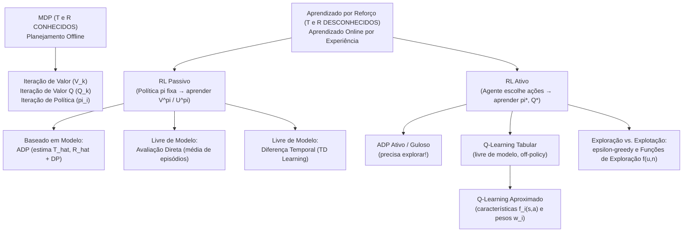

# Módulo 02 — MDPs e Aprendizado por Reforço (*Reinforcement Learning*)

> **Fontes consolidadas (100% dos slides, imagens e exercícios cobertos):**
> - [`RL.pptx`](file:///home/dcr/repos/trabAI/prova/RL.pptx) (22 slides XML: 21 visíveis + 1 slide oculto — Slide 16 *"Aprendizado Q Aproximado"* — incluindo questões de prova embutidas como imagem: Labirinto 2×3, Táxi 5×5 e Pacman 2×3)
> - [`aprendizado-reforco-2 2.pdf`](file:///home/dcr/repos/trabAI/prova/aprendizado-reforco-2%202.pdf) (32 páginas — híbrido de Russell & Norvig Cap. 21 §§21.1–21.3 e UC Berkeley CS188)
> - [`CS_188_Su26_Discussion_5_SOLUTION.pdf`](file:///home/dcr/repos/trabAI/prova/CS_188_Su26_Discussion_5_SOLUTION.pdf) (5 páginas — revisão formal de TD Learning e Q-Learning + questões Q1 e Q2)
> - [`Documento sem título.pdf`](file:///home/dcr/repos/trabAI/prova/Documento%20sem%20ti%A6%FCtulo.pdf) (Questão 2 — MDPs: Jim e Pam — Iteração de Valor e Iteração de Política)

---

## Mapa do Módulo e Guia de Notação

Antes de mergulhar nos algoritmos, entenda o panorama geral:



### Tabela de Equivalência de Notação (CS188 vs. Russell & Norvig vs. Provas)

Os materiais da disciplina misturam duas tradições clássicas (**UC Berkeley CS188** e **Russell & Norvig — R&N**). Na prova, você deve reconhecer ambas instantaneamente:

| Conceito | Notação CS188 / `RL.pptx` / `Discussion 5` | Notação R&N (partes de `aprendizado-reforco-2`) | Cuidados e Observações |
| :--- | :--- | :--- | :--- |
| Estados e Ações | $s \in S,\; a \in A$ | $s \in S,\; a \in A$ | Em `aprendizado-reforco-2` p. 5, fonte Symbol converte $\in$ em `e` (`s e S`). |
| Modelo de Transição | $T(s, a, s')$ (empírico: $\hat{T}(s, a, s')$) | $T(s, a, s')$ | Probabilidade $P(s' \mid s, a)$. Desconhecido em RL. |
| Função de Recompensa | $R(s, a, s')$ (empírico: $\hat{R}(s, a, s')$), amostra $r$ | $R(s)$ (recompensa dependente apenas do estado) | Nas equações de Bellman/Q-learning, preste atenção se o enunciado dá $R(s)$ ou $R(s,a,s')$. |
| Fator de Desconto | $\gamma \in (0, 1]$ | $\gamma$ (renderizado como `g` em `ar2` pp. 7, 14) | $\gamma=1$ sem desconto; $\gamma<1$ desconta recompensas futuras. |
| Política / Ótima | $\pi(s),\; \pi^*(s)$ | $\pi(s),\; \pi^*(s)$ (renderizado como `p(s)` em `ar2`) | Fixa no RL Passivo; buscada no RL Ativo. |
| Valor / Utilidade de Estado | $V^\pi(s),\; V^*(s),\; V_k(s),\; V_k^\pi(s)$ | $U^\pi(s),\; U(s)$ | $U^\pi(s) \equiv V^\pi(s)$. |
| Valor Q (Estado-Ação) | **$Q(s, a),\; Q^*(s, a),\; Q_k(s, a)$** | **$Q(a, s)$** (`ar2` p. 23) | **Atenção:** R&N inverte a ordem dos argumentos para $Q(a,s)$! Em toda prova CS188/UFPR usa-se $Q(s,a)$. |
| Taxa de Aprendizado | $\alpha \in [0, 1]$ (`learning rate`) | $\alpha$ | Atalho `ar2` p. 27: $x \leftarrow_\alpha y$ significa $x \leftarrow (1-\alpha)x + \alpha y$. |
| Amostra / Alvo de 1 Passo | $\text{sample}$ ou $\text{amostra}$ ou $Q_{\mathbf{new}}(s,a)$ (`RL` Slides 21–22) | $R(s) + \gamma \max_{a'} Q(a', s')$ | Os 3 nomes (`sample`, `amostra`, $Q_{\mathbf{new}}$) significam exatamente a mesma coisa! |
| Erro TD / Diferença | $\text{difference} = [r + \gamma \max_{a'} Q(s', a')] - Q(s, a)$ | $R(s) + \gamma \max_{a'} Q(a', s') - Q(a, s)$ | Equivale a $\text{sample} - Q(s,a)$ ou $Q_{\mathbf{new}}(s,a) - Q(s,a)$. |
| Exploração vs. Explotação | `Exploração vs. Intensificação` (`RL.pptx`), `Explotação` (`ar2` p. 25) | `Exploração vs. Aproveitamento` (`ar2` p. 21) | Três traduções em português para *Exploitation* nos mesmos slides. |
| Características e Pesos | $f_i(s, a)$ (ou $F_g, F_p, f_{\text{DOT}}, f_{\text{GST}}$), pesos $w_i$ | — | $Q(s,a) = \sum_{i=1}^n w_i f_i(s,a)$. |

---

## 1. Base Obrigatória: Processos de Decisão de Markov (MDPs) — Planejamento *Offline*

> **Por que começar por aqui?** Além de o Aprendizado por Reforço ser construído diretamente sobre MDPs (`RL.pptx` Slide 1; `ar2` pp. 3–5), a prova anterior [`Documento sem título.pdf`](file:///home/dcr/repos/trabAI/prova/Documento%20sem%20ti%A6%FCtulo.pdf) (Questão 2 — Jim e Pam) cobra explicitamente **avaliação de políticas com série geométrica**, **Iteração de Valor** e **Iteração de Política**.

### 1.1. Intuição do Zero
Imagine um robô navegando em um labirinto onde o chão é escorregadio: quando ele tenta ir para a direita, pode acertar com probabilidade $p$ ou escorregar e ficar parado (ou ir para o lado) com probabilidade $1 - p$. Além disso, cada movimento ou estado dá uma recompensa (positiva ao chegar no objetivo, negativa ao cair em um buraco ou gastar energia).
Um **MDP** modela esse problema de decisão sequencial sob incerteza **quando o agente conhece perfeitamente as regras do mundo** (isto é, conhece $T$ e $R$). Por isso chamamos a resolução de um MDP de **planejamento *offline***: o robô pode calcular mentalmente a melhor estratégia antes de dar um único passo no mundo real.

### 1.2. Definição Formal e Equações

Um **MDP** é definido pela tupla $(S, A, T, R, \gamma)$:
- $S$: conjunto de **estados** $s \in S$.
- $A$: conjunto de **ações** $a \in A$.
- $T(s, a, s') = P(s' \mid s, a)$: **função/modelo de transição**, probabilidade de alcançar o estado $s'$ ao executar a ação $a$ no estado $s$ (satisfaz a **Propriedade de Markov**: o futuro depende apenas do estado atual $s$ e ação $a$, não do histórico anterior).
- $R(s, a, s')$ (notação CS188) ou $R(s)$ (notação R&N): **função de recompensa** imediata.
- $\gamma \in (0, 1]$: **fator de desconto** (*discount factor*). Uma recompensa recebida $t$ passos no futuro vale $\gamma^t$ vezes seu valor imediato. Para horizonte infinito sem estado terminal, exige-se $0 \le \gamma < 1$ para que a soma de recompensas convirja.
  - **Fórmula essencial de prova (série geométrica infinita):** Se uma política recebe recompensa constante $a$ a cada passo com desconto $r = \gamma \in [0, 1)$:
    $$S = a + a\gamma + a\gamma^2 + \dots = \frac{a}{1 - \gamma}$$
- **Política $\pi : S \to A$:** prescreve qual ação $\pi(s)$ tomar em cada estado $s$.
- **Política ótima $\pi^*(s)$:** política que maximiza a soma esperada de recompensas descontadas a partir de qualquer estado.

#### Equações de Bellman Fundamentais
1. **Valor ótimo de um estado $V^*(s)$** (utilidade esperada começando em $s$ e agindo de forma ótima):
   $$V^*(s) = \max_{a \in A} Q^*(s, a) = \max_{a \in A} \sum_{s'} T(s, a, s') \big[ R(s, a, s') + \gamma V^*(s') \big]$$
2. **Valor Q ótimo de um par estado-ação (q-estado) $Q^*(s, a)$** (utilidade esperada após escolher $a$ em $s$ e agir otimamente a partir do estado resultante $s'$):
   $$Q^*(s, a) = \sum_{s'} T(s, a, s') \big[ R(s, a, s') + \gamma V^*(s') \big]$$
3. **Extração da política ótima:**
   $$\pi^*(s) = \arg\max_{a \in A} Q^*(s, a) = \arg\max_{a \in A} \sum_{s'} T(s, a, s') \big[ R(s, a, s') + \gamma V^*(s') \big]$$
4. **Avaliação de uma política fixa $\pi$ (Equação de Bellman para $\pi$):**
   $$V^\pi(s) = \sum_{s'} T(s, \pi(s), s') \big[ R(s, \pi(s), s') + \gamma V^\pi(s') \big]$$
   *(Obs.: sem o operador $\max$, isto forma um **sistema linear** de $|S|$ equações e $|S|$ incógnitas!)*

### 1.3. Algoritmos Passo a Passo (Planejamento *Offline*)

#### A. Iteração de Valor (*Value Iteration*)
```text
Inicializar V_0(s) = 0 para todo s em S
Para k = 0, 1, 2, ... até convergir:
  Para cada estado s em S:
    V_{k+1}(s) ← max_a  Σ_{s'} T(s, a, s') [ R(s, a, s') + γ V_k(s') ]
```
- **Complexidade por iteração:** $O(|S|^2 |A|)$ (para cada um dos $|S|$ estados, testa $|A|$ ações, somando sobre até $|S|$ sucessores $s'$).
- **Propriedades e Convergência:**
  - Para $0 \le \gamma < 1$ (ou horizonte finito), o operador de Bellman é uma contração $\implies$ **convergência garantida** para a única solução $V^*(s)$, independentemente da inicialização.
  - $V_k(s)$ representa o valor ótimo com horizonte limitado a exatamente $k$ passos.
  - **Atenção:** O operador $\max$ é **não linear**, por isso precisamos de iterações (não dá para resolver por sistema linear direto).
  - **Atualização síncrona:** na prova, ao calcular $V_{k+1}(s)$ para todos os estados, use **sempre** os valores da linha anterior $V_k(s')$, nunca os novos valores de $V_{k+1}$ já calculados no mesmo passo!

#### B. Iteração de Valor Q (*Q-Value Iteration* — `RL.pptx` Slide 9; `ar2` p. 22; `disc5` p. 2)
```text
Inicializar Q_0(s, a) = 0 para todo (s, a)
Para k = 0, 1, 2, ... até convergir:
  Para cada par (s, a):
    Q_{k+1}(s, a) ← Σ_{s'} T(s, a, s') [ R(s, a, s') + γ max_{a'} Q_k(s', a') ]
```
- **Diferença exata em relação à Iteração de Valor (`disc5` p. 2):** Apenas a **posição do operador $\max$** muda! Na Iteração de Valor, estamos em um estado $s$, então escolhemos a ação antes de transitar ($\max_a$ fora do somatório). Na Iteração de Valor Q, já estamos no q-estado $(s,a)$, então primeiro transitamos (somatório sobre $s'$) e só depois escolhemos a melhor ação futura ($\max_{a'}$ dentro do somatório).

#### C. Iteração de Política (*Policy Iteration*)
Alterna dois passos até a política parar de mudar ($\pi_{i+1} = \pi_i$):
```text
Escolher política inicial π_0
Repetir para i = 0, 1, 2, ...:
  1. Avaliação de Política (Policy Evaluation):
     Resolver exatamente o sistema linear (ou iterar V_{k+1}^{π_i} até convergir):
       V^{π_i}(s) = Σ_{s'} T(s, π_i(s), s') [ R(s, π_i(s), s') + γ V^{π_i}(s') ]
  2. Melhoria de Política (Policy Improvement / Extraction):
     Para cada estado s em S:
       π_{i+1}(s) = argmax_a  Σ_{s'} T(s, a, s') [ R(s, a, s') + γ V^{π_i}(s') ]
Até que π_{i+1}(s) == π_i(s) para todo s em S.
```
- **Complexidade:** Cada avaliação de política iterativa custa $O(|S|^2)$ por passo (sem o fator $|A|$ porque a ação está fixa!), ou $O(|S|^3)$ resolvendo o sistema linear exato. Costuma convergir em **muito poucas iterações externas** (embora cada iteração externa exija avaliar $V^{\pi_i}$ completamente!).
- **Garantia:** O teorema da melhoria de política garante que $V^{\pi_{i+1}}(s) \ge V^{\pi_i}(s)$ para todo $s$, e quando $\pi_{i+1} = \pi_i$, tem-se necessariamente $\pi_i = \pi^*$ (ótima!).

### 1.4. Exemplo Resolvido à Mão — Labirinto 2×3 Determinístico (`RL.pptx` Slide 1)
**Enunciado (Tom Mitchell / `RL.pptx` Slide 1):** Grade 2×3 com objetivo absorvente `G` em `(0,2)` (auto-laço com recompensa $0$). Movimentos determinísticos (Norte, Sul, Leste, Oeste), $\gamma = 0.9$. Recompensa $R = 100$ ao entrar em `G` vindo de `(0,1)` (direita) ou `(1,2)` (cima); todas as demais transições têm $R = 0$.

**Resolução formal:**
Como as transições são determinísticas ($T(s,a,s')=1$ para o vizinho escolhido) e `G` é absorvente com $R=0 \implies V^*(G)=0$:
1. **Estados a 1 passo de `G`:**
   - $V^*(0,1) = \max\{ 100 + 0.9 \cdot 0,\; \dots \} = 100$ (ação $\rightarrow$)
   - $V^*(1,2) = \max\{ 100 + 0.9 \cdot 0,\; \dots \} = 100$ (ação $\uparrow$)
2. **Estados a 2 passos de `G`:**
   - $V^*(0,0) = 0 + 0.9 \cdot V^*(0,1) = 0.9 \times 100 = 90$
   - $V^*(1,1) = 0 + 0.9 \cdot \max\{V^*(0,1), V^*(1,2)\} = 0.9 \times 100 = 90$
3. **Estado a 3 passos de `G`:**
   - $V^*(1,0) = 0 + 0.9 \cdot \max\{V^*(0,0), V^*(1,1)\} = 0.9 \times 90 = 81$
4. **Valores $Q^*(s, a) = R(s, a, s') + 0.9\, V^*(s')$:**
   - De `(0,0)`: $Q^*((0,0), \rightarrow) = 0 + 0.9(100) = 90$; $Q^*((0,0), \downarrow) = 0 + 0.9(81) = 72.9$ *(Nota: a figura do Slide 1 trunca `72.9` para `72`)*
   - De `(0,1)`: $\leftarrow: 81$, $\rightarrow: 100$, $\downarrow: 81$
   - De `(1,0)`: $\uparrow: 81$, $\rightarrow: 81$
   - De `(1,1)`: $\uparrow: 90$, $\rightarrow: 90$, $\leftarrow: 72.9$ *(truncado para `72` no slide)*
   - De `(1,2)`: $\uparrow: 100$, $\leftarrow: 81$
5. **Uma política ótima $\pi^*(s)$:** note que não é única! Tanto em `(1,0)` quanto em `(1,1)` há empate entre $\uparrow$ e $\rightarrow$. Uma solução ótima é: `(0,0)→, (0,1)→, (1,0)→, (1,1)→, (1,2)↑`.

*(Veja a resolução completa da Questão 2 de MDPs — Jim e Pam — no [Módulo 04](file:///home/dcr/repos/trabAI/prova/guia_prova2/04_PROVAS_E_EXERCICIOS_RESOLVIDOS.md).)*

### 1.5. Como Isso Cai na Prova + Armadilhas Comuns
- **Questões típicas:**
  1. Comparar duas políticas fixas em função de $p$ ou $\gamma$ usando a soma da série geométrica $S = \frac{a}{1-\gamma}$.
  2. Preencher tabela de 2 ou 3 iterações de **Iteração de Valor** ($V_0, V_1, V_2$).
  3. Preencher tabela de 2 iterações de **Iteração de Política** ($\pi_i \to V^{\pi_i} \to \pi_{i+1} \to V^{\pi_{i+1}} \to \pi_{i+2}$).
- **Armadilhas fatais:**
  - **Confundir Iteração de Valor com Iteração de Política:** Na Iteração de Valor você calcula $V_{k+1}$ dando apenas **1 passo** de lookahead usando $V_k$. Na **Avaliação de Política** dentro da Iteração de Política, você deve calcular o valor **exato de horizonte infinito** $V^{\pi_i}(s)$ resolvendo as equações da política $\pi_i$ (não apenas 1 iteração)!
  - **Esquecer o caso de borda da parede / estado terminal:** se o agente tenta mover-se contra a borda da grade (ex.: `right` no quadrado 5 de Jim e Pam), ele permanece no mesmo estado e recebe recompensa $0$, logo $Q(5, \text{right}) = 0 + \gamma V(5)$.
  - **Usar $V_{k+1}$ antes da hora:** na Iteração de Valor síncrona, $V_2(s)$ usa exclusivamente valores da linha $V_1(\cdot)$, nunca valores da própria linha $V_2(\cdot)$.

---

## 2. Transição de MDPs para Aprendizado por Reforço (*Offline* vs. *Online*)

### 2.1. Intuição do Zero
No mundo real, raramente alguém entrega ao robô as tabelas $T(s,a,s')$ e $R(s,a,s')$ prontas. Um robô real precisa **agir no ambiente**, observar em qual estado caiu e qual recompensa recebeu (inclusive caindo no poço de fogo algumas vezes!) e aprender a partir dessa experiência.

### 2.2. Definição Formal (`ar2` pp. 3–5, 12)
- **Continua sendo um MDP:** $s \in S$, $a \in A$, $T(s,a,s')$, $R(s,a,s')$ (ou $R(s)$), $\gamma$.
- **Objetivo:** Continuar encontrando uma política ótima $\pi^*(s)$.
- **A grande novidade do RL:** **$T$ e $R$ são desconhecidos!**
- **Ciclo Agente–Ambiente (`ar2` p. 4):**
  1. O **Agente** envia uma **Ação $a$** ao **Ambiente**.
  2. O **Ambiente** transita e devolve o novo **Estado $s$** e uma **Recompensa $r$** (*feedback*).
  3. A utilidade do agente é definida pela função de recompensa; ele deve aprender ações que maximizam recompensas esperadas com base exclusivamente em observações.
- **Offline (MDPs) vs. Online (RL):**
  - *Offline:* planeja no simulador interno com $T$ e $R$ conhecidos.
  - *Online:* executa ações reais no mundo; **não é possível "voltar no tempo"** para testar várias ações a partir do mesmo estado instantaneamente.

---

## 3. Aprendizado por Reforço Passivo (*Passive RL*)

### 3.1. Definição da Tarefa (`ar2` pp. 6, 11–12; `RL.pptx` Slide 5)
- **Entrada:** uma **política fixa $\pi(s)$** já fornecida.
- **Desconhecidos:** $T(s, a, s')$ e $R(s, a, s')$ (ou $R(s)$).
- **Restrição:** o agente **não escolhe ações** — apenas executa $\pi(s)$ online ("ao longo do jogo").
- **Objetivo:** **Avaliação de Política (*Policy Evaluation*)** — aprender os valores $V^\pi(s)$ (ou $U^\pi(s)$) para saber quão boa é a política fixa $\pi$.

Os slides apresentam **3 métodos** de RL Passivo:
1. **Baseado em Modelo:** Programação Dinâmica Adaptativa (ADP / *Model-Based RL*).
2. **Livre de Modelo:** Avaliação Direta (*Direct Evaluation* / *Direct Utility Estimation*).
3. **Livre de Modelo:** Aprendizado por Diferença Temporal (*Temporal Difference Learning* — TD Learning).

---

### 3.2. RL Baseado em Modelo / Programação Dinâmica Adaptativa (ADP)

#### 1. Intuição do Zero
Se o único obstáculo para resolver o MDP é não conhecer $T$ e $R$, por que não **estimar $T$ e $R$ contando o que acontece** durante os episódios e depois resolver o MDP estimado como se fosse o verdadeiro?

#### 2. Definição Formal e Equações (`ar2` pp. 7, 9–10; `disc5` Q1a)
A partir de um conjunto de transições observadas $(s, a, s', r)$:
1. **Modelo empírico de transição:**
   $$\hat{T}(s, a, s') = \frac{\text{count}(s, a, s')}{\text{count}(s, a)}$$
   onde $\text{count}(s, a)$ é quantas vezes a ação $a$ foi executada em $s$, e $\text{count}(s, a, s')$ é quantas dessas vezes resultaram em $s'$.
2. **Modelo empírico de recompensa:**
   - Na notação CS188: $\hat{R}(s, a, s') =$ média das recompensas observadas na transição $(s, a, s')$ (ou o valor observado quando determinística).
   - Na notação R&N (`ar2` p. 9): atualiza-se $\hat{R}(s)$ na primeira vez que o estado $s$ é visitado.
3. **Resolução do MDP aprendido:** aplica-se **Programação Dinâmica** (Iteração de Valor simplificada **sem o $\max$**, i.e., Avaliação de Política) sobre $\hat{T}$ e $\hat{R}$ para obter $V^\pi(s)$ (ou $U^\pi(s)$):
   $$V^\pi(s) = \sum_{s'} \hat{T}(s, \pi(s), s') \big[ \hat{R}(s, \pi(s), s') + \gamma V^\pi(s') \big]$$

#### 3. Algoritmo Passo a Passo e Propriedades
```text
Inicializar contadores N(s, a) = 0, N(s, a, s') = 0
Para cada transição observada (s, a, s', r) seguindo π:
  N(s, a) ← N(s, a) + 1
  N(s, a, s') ← N(s, a, s') + 1
  T̂(s, a, s') ← N(s, a, s') / N(s, a)
  R̂(s, a, s') ← média observada das recompensas de (s, a, s')
Resolver o MDP (S, A, T̂, R̂, γ) para a política π via Programação Dinâmica (sem max)
```
- **Propriedades:**
  - **Alta eficiência amostral (estatística):** aproveita ao máximo toda a informação das conexões entre estados (equações de Bellman) e pela Lei dos Grandes Números $\hat{T} \to T$ e $\hat{R} \to R$ quando as contagens crescem.
  - **Custo computacional:** exige armazenar tabelas $\hat{T}$ de tamanho até $O(|S|^2 |A|)$ e resolver o MDP (caro quando $|S|$ é enorme).
  - **Caso de borda:** se um par $(s, a)$ nunca foi visitado ($\text{count}(s,a)=0$), $\hat{T}(s,a,\cdot)$ é indefinido.

#### 4. Exemplos Resolvidos à Mão (Dos Slides)
**Exemplo A — Gridworld 5 estados A–E (`ar2` p. 7, $\gamma = 1$):**
Política fixa $\pi$: $\pi(B)=\text{east}$, $\pi(C)=\text{east}$, $\pi(E)=\text{north}$; $A$ e $D$ são estados terminais de saída (`exit` para estado terminal `x`).
Episódios observados:
- Ep. 1: `(B, east, C, -1)`, `(C, east, D, -1)`, `(D, exit, x, +10)`
- Ep. 2: `(B, east, C, -1)`, `(C, east, D, -1)`, `(D, exit, x, +10)`
- Ep. 3: `(E, north, C, -1)`, `(C, east, D, -1)`, `(D, exit, x, +10)`
- Ep. 4: `(E, north, C, -1)`, `(C, east, A, -1)`, `(A, exit, x, -10)`

Contagens e modelo aprendido:
- Em `(B, east)`: 2 ocorrências, ambas foram para `C` $\implies \hat{T}(B, \text{east}, C) = \frac{2}{2} = 1.00$, $\hat{R}(B, \text{east}, C) = -1$.
- Em `(C, east)`: 4 ocorrências — 3 foram para `D` (Eps. 1, 2, 3) e 1 para `A` (Ep. 4) $\implies \hat{T}(C, \text{east}, D) = \frac{3}{4} = 0.75$ e $\hat{T}(C, \text{east}, A) = \frac{1}{4} = 0.25$; $\hat{R}(C, \text{east}, D) = \hat{R}(C, \text{east}, A) = -1$.
- Em `(E, north)`: 2 ocorrências, ambas para `C` $\implies \hat{T}(E, \text{north}, C) = 1.00$, $\hat{R}(E, \text{north}, C) = -1$.
- Em `(D, exit)`: $\hat{T}(D, \text{exit}, x) = 1.00$, $\hat{R}(D, \text{exit}, x) = +10$. Em `(A, exit)`: $\hat{T}(A, \text{exit}, x) = 1.00$, $\hat{R}(A, \text{exit}, x) = -10$.
- *(Nota: resolvendo o MDP aprendido, $V(D)=10$, $V(A)=-10$, $V(C) = 0.75(-1+10) + 0.25(-1-10) = 6.75 - 2.75 = +4$, e **$V(B) = V(E) = -1 + 4 = +3$** — coerente com a estrutura do grafo!)*

**Exemplo B — Gridworld 4×3 R&N (`ar2` p. 10):**
3 episódios observados (subscrito = $R(s)$):
1. $(1,1)_{-.04} \to (1,2)_{-.04} \to (1,3)_{-.04} \to (1,2)_{-.04} \to (1,3)_{-.04} \to (2,3)_{-.04} \to (3,3)_{-.04} \to (4,3)_{+1}$
2. $(1,1)_{-.04} \to (1,2)_{-.04} \to (1,3)_{-.04} \to (2,3)_{-.04} \to (3,3)_{-.04} \to (3,2)_{-.04} \to (3,3)_{-.04} \to (4,3)_{+1}$
3. $(1,1)_{-.04} \to (2,1)_{-.04} \to (3,1)_{-.04} \to (3,2)_{-.04} \to (4,2)_{-1}$
- No estado $(1,3)$, a política executa `Direita` 3 vezes no total: 1 vez caiu em $(1,2)$ (Ep. 1) e 2 vezes chegou a $(2,3)$ (Eps. 1 e 2) $\implies \hat{T}((1,3), \text{Direita}, (2,3)) = \frac{2}{3}$.
- No estado $(2,3)$, executa `Direita` 2 vezes (Eps. 1 e 2), ambas indo a $(3,3)$ $\implies \hat{T}((2,3), \text{Direita}, (3,3)) = \frac{2}{2} = 1$.
- Recompensas: $\hat{R}((1,1)) = -0.04$, $\hat{R}((4,3)) = +1$, etc.

#### 5. Como Cai na Prova + Armadilhas
- **Questão clássica (`disc5` Q1a):** Dá uma tabela de transições de um episódio e pede $\hat{T}(s, a, s')$ e $\hat{R}(s, a, s')$.
- **Armadilha:** Dividir pelo total de visitas ao **estado $s$** em vez do total de vezes que o **par $(s, a)$** foi executado! O denominador de $\hat{T}(s, a, s')$ é sempre $\text{count}(s, a)$ (somente transições que saíram de $s$ usando a ação $a$).

---

### 3.3. Avaliação Direta (*Direct Evaluation* / Estimativa Direta da Utilidade)

#### 1. Intuição do Zero
É o método **livre de modelo** (*model-free*) mais simples possível (estilo Monte Carlo): em vez de tentar adivinhar as regras $T$ e $R$, simplesmente execute vários episódios seguindo $\pi$, anote quanto de recompensa total (daquele ponto até o fim do episódio) você ganhou cada vez que passou por um estado $s$, e tire a **média aritmética**.

#### 2. Definição Formal e Equações (`ar2` pp. 8, 13–15; `RL.pptx` Slide 2)
Para cada visita ao estado $s$ no instante $t$ de um episódio que termina no instante $T_{\text{fim}}$, calcula-se o retorno observado (*reward-to-go*):
$$G_t = r_t + \gamma r_{t+1} + \gamma^2 r_{t+2} + \dots + \gamma^{T_{\text{fim}} - t} r_{T_{\text{fim}}}$$
A estimativa de valor de $s$ é a média dos retornos de todas as $N(s)$ visitas ao estado $s$:
$$V^\pi(s) = \frac{1}{N(s)} \sum_{j=1}^{N(s)} G^{(j)}(s)$$

#### 3. Algoritmo Passo a Passo e Propriedades
```text
Para cada estado s: SomaRetornos(s) = 0, Contagem(s) = 0
Para cada episódio completo gerado seguindo π:
  Para cada visita a um estado s no episódio:
    Calcular G = soma descontada das recompensas desde s até o fim do episódio
    SomaRetornos(s) ← SomaRetornos(s) + G
    Contagem(s) ← Contagem(s) + 1
Para cada s:
  V^π(s) ← SomaRetornos(s) / Contagem(s)
```
- **Vantagens (`ar2` p. 15):**
  1. Fácil de entender e implementar.
  2. **Não requer conhecimento de $T$ nem de $R$** (livre de modelo).
  3. **Eventualmente converge** para os valores médios verdadeiros $V^\pi(s)$ (estimador não enviesado).
- **Desvantagens (`ar2` pp. 8, 15; `disc5` Q1c-iii):**
  1. **Desperdiça informação sobre as conexões entre estados** (não usa as equações de Bellman!).
  2. **Cada estado precisa ser aprendido de forma independente.**
  3. **Convergência lenta** (exige muitos episódios).
  4. **Só atualiza ao final de episódios completos** (não aprende passo a passo a cada transição — pegadinha direta da `disc5` Q1c-iii!).
  5. **On-policy:** só avalia a política fixa $\pi$ sendo executada.

#### 4. Exemplos Resolvidos à Mão (Dos Slides)
**Exemplo A — Gridworld 5 estados A–E (`ar2` pp. 14–15, $\gamma = 1$):**
Usando os mesmos 4 episódios da Seção 3.2:
- **Estado $D$:** visitado nos Eps. 1, 2, 3, sempre recebendo $+10 \implies V(D) = \frac{10+10+10}{3} = \mathbf{+10}$.
- **Estado $A$:** visitado no Ep. 4, recebendo $-10 \implies V(A) = \mathbf{-10}$.
- **Estado $C$:**
  - Ep. 1: $-1 + 10 = +9$
  - Ep. 2: $-1 + 10 = +9$
  - Ep. 3: $-1 + 10 = +9$
  - Ep. 4: $-1 + (-10) = -11$
  - Média: $V(C) = \frac{9 + 9 + 9 + (-11)}{4} = \frac{16}{4} = \mathbf{+4}$.
- **Estado $B$:**
  - Ep. 1: $-1 + (-1) + 10 = +8$
  - Ep. 2: $-1 + (-1) + 10 = +8$
  - Média: $V(B) = \frac{8 + 8}{2} = \mathbf{+8}$.
- **Estado $E$:**
  - Ep. 3: $-1 + (-1) + 10 = +8$
  - Ep. 4: $-1 + (-1) + (-10) = -12$
  - Média: $V(E) = \frac{8 + (-12)}{2} = \frac{-4}{2} = \mathbf{-2}$.

> **O Paradoxo de $B$ e $E$ (`ar2` p. 15):** *"Se $B$ e $E$ vão ambos deterministicamente para $C$ (com recompensa $-1$), por que ganharam valores tão diferentes ($V(B)=+8$ e $V(E)=-2$)?"*
> Porque a Avaliação Direta **ignora a conexão de Markov** ($B \to C$ e $E \to C$)! Por pura sorte amostral, depois de $B$ o estado $C$ sempre foi para $+10$, enquanto depois de $E$ ele foi uma vez para $+10$ e outra para $-10$. Se usássemos Bellman com $V(C)=+4$, saberíamos imediatamente que $V(B) = V(E) = -1 + 4 = +3$!

**Exemplo B — Gridworld 4×3 R&N (`ar2` p. 8, $\gamma = 1$):**
Com os 3 episódios de R&N da Seção 3.2:
- Ep. 1 a partir de $(1,1)$: $7 \times (-0.04) + 1 = +0.72$
- Ep. 2 a partir de $(1,1)$: $7 \times (-0.04) + 1 = +0.72$
- Ep. 3 a partir de $(1,1)$: $4 \times (-0.04) + (-1) = -1.16$
$$U^\pi((1,1)) = \frac{0.72 + 0.72 + (-1.16)}{3} = \frac{0.28}{3} \approx 0.0933$$
*(Nota de errata dos slides: a pág. 8 de `aprendizado-reforco-2 2.pdf` esquece de imprimir `/3` na expressão intermediária `(0.72 + 0.72 + (-1.16)) = 0.28/3`, mas o resultado `0.28/3` está correto.)*

#### 5. Como Cai na Prova + Armadilhas
- **Armadilha 1:** Na `disc5` Q1c-iii: *"Na Avaliação Direta, você recalcula os valores dos estados após cada transição que experimenta."* $\longrightarrow$ **FALSO!** Calcula-se a partir de **episódios completos**, não de transições individuais.
- **Armadilha 2:** Somar recompensas recebidas **antes** de visitar o estado $s$. Só entram as recompensas **a partir** da visita a $s$ em diante!

---

### 3.4. Por Que Não Avaliação de Política por Amostras? $\longrightarrow$ Aprendizado por Diferença Temporal (TD Learning)

#### 1. Intuição do Zero (`ar2` pp. 16–18; `RL.pptx` Slides 4, 6; `disc5` pp. 1–2)
Queremos unir o melhor dos dois mundos: ser **livre de modelo** (não precisar de $T$ e $R$) **e** usar as conexões de Bellman (como na Avaliação de Política $V_{k+1}^\pi(s) \leftarrow \sum_{s'} T(s,\pi(s),s')[R(s,\pi(s),s')+\gamma V_k^\pi(s')]$).

- **Primeira tentativa (Avaliação Baseada em Amostras, `RL.pptx` Slide 4 / `ar2` p. 17):**
  Em vez de somar ponderado por $T(s,\pi(s),s')$, poderíamos executar $\pi(s)$ repetidamente a partir de $s$, observar $s'_1, s'_2, \dots, s'_n$, calcular:
  $$\text{sample}_i = R(s, \pi(s), s'_i) + \gamma V_k^\pi(s'_i)$$
  e tirar a média $V_{k+1}^\pi(s) \leftarrow \frac{1}{n}\sum_{i=1}^n \text{sample}_i$.
  **Por que falha no RL online?** *(Legenda oculta sob a imagem do robô mago no Slide 4 de `RL.pptx` e p. 17 de `ar2`)*: **"Quase! Mas nós não podemos voltar no tempo para obter amostra após amostra a partir do mesmo estado $s$."** No mundo real, ao executar $\pi(s)$ você já saiu de $s$ e foi parar em $s'$.

- **A solução genial — Diferença Temporal (TD Learning):**
  **Aprenda a cada única experiência $(s, \pi(s), s', r)$!** Em vez de esperar coletar $n$ amostras do mesmo estado ou esperar o episódio acabar, mantenha uma **média móvel exponencial** que puxa o valor atual $V^\pi(s)$ um pouco (peso $\alpha$) na direção da nova amostra $\text{sample} = R(s,\pi(s),s') + \gamma V^\pi(s')$.

#### 2. Definição Formal e Equações (`RL.pptx` Slide 6; `ar2` p. 18; `disc5` pp. 1–2)
Inicializa-se $\forall s,\; V^\pi(s) = 0$.
A cada transição observada $(s, \pi(s), s', r)$:
1. **Amostra (*sample*):**
   $$\text{sample} = R(s, \pi(s), s') + \gamma V^\pi(s')$$
2. **Atualização por Média Móvel Exponencial (EMA):**
   $$V^\pi(s) \leftarrow (1 - \alpha) V^\pi(s) + \alpha \cdot \text{sample}$$
3. **Forma equivalente por Erro TD (`RL.pptx` Slide 6):**
   $$V^\pi(s) \leftarrow V^\pi(s) + \alpha \big(\text{sample} - V^\pi(s)\big)$$
   onde $0 \le \alpha \le 1$ é a **taxa de aprendizado (*learning rate*)**.

#### Expansão Algébrica da Média Móvel Exponencial (`ar2` p. 18; `disc5` pp. 1–2)
Denotando por $V_k^\pi(s)$ a estimativa após a $k$-ésima atualização de $s$ usando $\text{sample}_k$ (com $V_0^\pi(s)=0$):
$$\begin{aligned}
V_k^\pi(s) &= (1 - \alpha) V_{k-1}^\pi(s) + \alpha \cdot \text{sample}_k \\
           &= (1 - \alpha)\big[(1-\alpha) V_{k-2}^\pi(s) + \alpha \cdot \text{sample}_{k-1}\big] + \alpha \cdot \text{sample}_k \\
           &= (1 - \alpha)^2 V_{k-2}^\pi(s) + (1-\alpha)\alpha \cdot \text{sample}_{k-1} + \alpha \cdot \text{sample}_k \\
           &\;\;\vdots \\
           &= (1-\alpha)^k V_0^\pi(s) + \alpha \cdot \Big[(1-\alpha)^{k-1}\cdot \text{sample}_1 + \dots + (1-\alpha)\cdot \text{sample}_{k-1} + \text{sample}_k\Big] \\
           &= \alpha \cdot \Big[\underbrace{(1-\alpha)^{k-1}}_{\text{peso cai exponencialmente!}} \cdot \text{sample}_1 + \dots + (1-\alpha)\cdot \text{sample}_{k-1} + \text{sample}_k\Big]
\end{aligned}$$

**Por que dar peso exponencialmente menor às amostras antigas é excelente (`disc5` pp. 1–2)?**
1. Porque $0 \le (1-\alpha) \le 1$, logo $(1-\alpha)^{k-j}$ encolhe exponencialmente para amostras mais antigas — e amostras antigas foram calculadas usando **estimativas iniciais ruins** de $V^\pi(s')$! Assim, o TD "esquece" automaticamente os erros antigos.
2. Aprende a **cada passo de tempo** (online, sem esperar fim de episódio), usando versões continuamente atualizadas de $V^\pi(s')$ (*bootstrapping*).
3. Converge para os valores verdadeiros $V^\pi(s)$ **muito mais rápido** (em menos episódios) do que a Avaliação Direta.
4. Na prática (`disc5` p. 1): costuma-se iniciar com $\alpha = 1$ (atribuindo a primeira amostra diretamente) e ir **diminuindo $\alpha$ lentamente em direção a $0$** (para que a variância das amostras desapareça e a estimativa estabilize).

#### 3. Algoritmo Passo a Passo e Limitação Fundamental (`RL.pptx` Slide 7; `disc5` p. 2)
```text
Inicializar V^π(s) = 0 para todo s em S
Para cada transição observada (s, a = π(s), s', r):
  sample ← r + γ * V^π(s')
  V^π(s) ← (1 - α) * V^π(s) + α * sample
```
- **Limitação fatal do TD Learning (e da Avaliação Direta) — *Como transformar $V^\pi(s)$ em uma nova política?* (`RL.pptx` Slide 7; `disc5` p. 2):**
  Para melhorar a política, precisamos extrair:
  $$\pi(s) = \arg\max_a Q(s, a) \qquad \text{onde} \qquad Q(s, a) = \sum_{s'} T(s, a, s') \big[ R(s, a, s') + \gamma V(s') \big]$$
  **Mas não temos $T$ nem $R$!** Portanto, aprender apenas $V^\pi(s)$ **não permite melhorar a política de forma livre de modelo**! Além disso, TD Learning é **on-policy**: avalia apenas a política fixa $\pi$ que está sendo seguida, **não** encontra a política ótima $\pi^*$.
- **A sacada revolucionária (`RL.pptx` Slide 7):** Em vez de aprender $V(s)$, **aprenda diretamente os valores $Q(s, a)$** — e deixe o agente escolher ações!

#### 4. Exemplo Resolvido à Mão — TD Learning no Gridworld 5 Estados
Usando os mesmos 4 episódios da Seção 3.2 com $\gamma = 1$, $\alpha = 0.5$ e $V_0(s) = 0$ para todo $s$, trace as atualizações do Episódio 1 (`(B, east, C, -1)`, `(C, east, D, -1)`, `(D, exit, x, +10)` com $V(x)=0$):
1. `(B, east, C, -1)`: $\text{sample} = -1 + 1\cdot V(C) = -1 + 0 = -1 \implies V(B) \leftarrow 0.5(0) + 0.5(-1) = -0.5$.
2. `(C, east, D, -1)`: $\text{sample} = -1 + 1\cdot V(D) = -1 + 0 = -1 \implies V(C) \leftarrow 0.5(0) + 0.5(-1) = -0.5$.
3. `(D, exit, x, +10)`: $\text{sample} = 10 + 1\cdot 0 = 10 \implies V(D) \leftarrow 0.5(0) + 0.5(10) = +5.0$.
No Episódio 2 (mesmas transições):
4. `(B, east, C, -1)`: $\text{sample} = -1 + (-0.5) = -1.5 \implies V(B) \leftarrow 0.5(-0.5) + 0.5(-1.5) = -1.0$.
5. `(C, east, D, -1)`: $\text{sample} = -1 + 5.0 = +4.0 \implies V(C) \leftarrow 0.5(-0.5) + 0.5(4.0) = +1.75$ *(a recompensa de $D$ já começou a se propagar para trás para $C$!)*.
6. `(D, exit, x, +10)`: $\text{sample} = 10 \implies V(D) \leftarrow 0.5(5.0) + 0.5(10) = +7.5$.

#### 5. Como Cai na Prova + Armadilhas
- **Pegadinha clássica (`disc5` Q1c-ii):** *"No TD Learning, se eu multiplicar todas as recompensas por um escalar não nulo $p$, o algoritmo ainda tem garantia de encontrar a política ótima."* $\longrightarrow$ **FALSO!** Primeiro porque TD Learning **não encontra política ótima** (só avalia uma política fixa $\pi$); segundo porque se $p < 0$, inverteria a ordenação das políticas.
- **Não confundir:** TD Learning **usa** o valor atual $V^\pi(s')$ no instante da transição; se $V^\pi(s')$ ainda é $0$, a informação de recompensas distantes só chega a $s$ em passagens futuras (propaga um passo para trás a cada repetição do caminho).

---

## 4. Aprendizado por Reforço Ativo (*Active RL*) e Q-Learning

### 4.1. Definição da Tarefa (`RL.pptx` Slide 8; `ar2` p. 19)
- **Desconhecidos:** $T(s, a, s')$ e $R(s, a, s')$.
- **Novidade:** Agora **o agente escolhe as ações**!
- **Objetivo:** Aprender a **política ótima $\pi^*$** e os **valores ótimos** ($V^*$ ou $Q^*$).

---

### 4.2. ADP Ativo e a Falha do ADP Guloso (*Greedy ADP*, `ar2` pp. 19–21)

#### 1. Intuição e Problema
Em **ADP Ativo**, o agente usa ADP para estimar $\hat{T}$ e $\hat{R}$, resolve o MDP estimado via Iteração de Valor para obter a política ótima **do modelo atual**, executa essa política, refina o modelo e repete.
**O que dá errado se o agente for puramente guloso (*Greedy ADP*)? (`ar2` pp. 20–21)**
- Considere o grid 4×3 de R&N (parede em `(2,2)`, terminal $+1$ em `(4,3)`, terminal $-1$ em `(4,2)`).
- Se, nas primeiras tentativas, o agente descobre um caminho subótimo até `+1` passando por baixo (`(1,2)↓ (1,1)→ (2,1)→ (3,1)↑ (3,2)↑ (3,3)→ (4,3)`), seu modelo atual acredita que essa é a melhor rota, enquanto as casas superiores `(1,3)` e `(2,3)` ficam marcadas como `?` (nunca visitadas).
- Um agente **guloso** repete esse caminho subótimo **para sempre** e **nunca visita** `(1,3)` e `(2,3)`, deixando de descobrir a rota ótima mais curta por cima!
- **Conclusão (`ar2` p. 19, 21):** Para aprender o ótimo, o agente precisa aprender o modelo (ou valores Q) para **todos** os estados e ações — o que exige equilibrar **Exploração vs. Explotação**.

---

### 4.3. Q-Learning (RL Ativo Livre de Modelo)

#### 1. Intuição do Zero
Como vimos na Seção 3.4, aprender $V(s)$ não basta para escolher ações sem conhecer $T$ e $R$. Se aprendermos diretamente a tabela **$Q(s, a)$**, escolher a melhor ação vira trivial: $\pi(s) = \arg\max_a Q(s, a)$, **sem precisar de $T$ nem de $R$**!
O **Q-Learning** aplica exatamente a ideia da média móvel exponencial do TD Learning sobre a equação de **Iteração de Valor Q**.

#### 2. Definição Formal e Equações (Todas as 3 Formas dos Slides!)

1. **Forma CS188 — Média Móvel Exponencial (`RL.pptx` Slide 10; `ar2` p. 22; `disc5` p. 2):**
   Recebida a transição online $(s, a, s', r)$:
   $$\text{sample} = R(s, a, s') + \gamma \max_{a'} Q(s', a')$$
   $$Q(s, a) \leftarrow (1 - \alpha) Q(s, a) + \alpha \cdot \text{sample}$$
   *(Nos slides da UFPR: `sample` também aparece escrito como `amostra` ou $Q_{\mathbf{new}}(s,a)$.)*

2. **Forma equivalente TD-Error (`RL.pptx` Slide 18; `ar2` p. 31):**
   $$\text{difference} = \left[ r + \gamma \max_{a'} Q(s', a') \right] - Q(s, a)$$
   $$Q(s, a) \leftarrow Q(s, a) + \alpha \cdot [\text{difference}]$$

3. **Forma Russell & Norvig com argumentos invertidos $Q(a, s)$ (`ar2` p. 23):**
   Define $Q(a, s)$ como a utilidade de executar a ação $a$ no estado $s$, de modo que $U(s) = \max_a Q(a, s)$ e $\pi(s) = \arg\max_a Q(a, s)$:
   $$Q(a, s) \leftarrow Q(a, s) + \alpha \Big( R(s) + \gamma \max_{a'} Q(a', s') - Q(a, s) \Big)$$

4. **Forma Determinística de Tom Mitchell ($\alpha = 1$, `RL.pptx` Slide 3):**
   Para ambientes **determinísticos** (sem ruído nas transições), $\alpha = 1$ reduz a regra a:
   $$Q(s_t, a_t) \leftarrow r + \gamma \max_{a'} Q(s_{t+1}, a')$$

#### 3. Algoritmo Passo a Passo, Propriedades e Convergência (`ar2` p. 24; `disc5` pp. 2–3)
```text
Inicializar Q(s, a) = 0 para todo (s, a)
Repetir para cada passo/episódio:
  No estado s, escolher ação a (ex.: usando ε-greedy ou função de exploração)
  Executar a no ambiente; observar recompensa r e próximo estado s'
  sample ← r + γ * max_{a'} Q(s', a')       (se s' for terminal, max_{a'} Q(s', a') = 0)
  Q(s, a) ← (1 - α) * Q(s, a) + α * sample
  s ← s'
```
- **Complexidade:**
  - **Tempo por atualização:** $O(|A|)$ (basta calcular $\max_{a'} Q(s', a')$ sobre as ações possíveis em $s'$!).
  - **Espaço (Tabular):** $O(|S| \cdot |A|)$ para armazenar a Q-Table.
- **Propriedade Surpreendente — *Off-Policy Learning* (`ar2` p. 24; `disc5` pp. 2–3):**
  - **Q-Learning converge para a política ótima $\pi^*$ e para $Q^*(s, a)$ mesmo quando o agente executa ações subótimas ou aleatórias!**
  - Por quê? Porque na fórmula da `sample`, usamos $\max_{a'} Q(s', a')$ (a **melhor** ação futura estimada), e **não** a ação que o agente realmente tomará em $s'$! Por isso é chamado de **aprendizado *off-policy*** (contraste com Avaliação Direta e TD Learning, que são ***on-policy***).
  - **Livre de modelo (`disc5` Q1c-i):** Q-Learning **não** aprende o modelo ($T, R$) explicitamente — aprende a política/valores Q explicitamente e o modelo apenas implicitamente.
- **Condições / Ressalvas para Convergência (`ar2` p. 24; `disc5` p. 2):**
  1. **Explorar o suficiente:** todos os pares estado-ação $(s, a)$ devem ser visitados infinitas vezes no limite (ou com frequência suficiente).
  2. **Tornar $\alpha$ pequeno o suficiente eventualmente** ($\sum \alpha_t^2 < \infty$ — para amortecer o ruído estocástico).
  3. **...mas não diminuir $\alpha$ rápido demais** ($\sum \alpha_t = \infty$ — para não travar antes de convergir).
  4. **Resumo:** no limite, desde que haja exploração suficiente e decaimento adequado de $\alpha$, **não importa qual política comportamental seleciona as ações**!

#### 4. Exemplos Resolvidos à Mão (Dos Slides — Incluindo Questão de Prova!)

**Exemplo A — Labirinto 2×3 Determinístico ($\alpha = 1, \gamma = 0.9$, `RL.pptx` Slide 3):**
O robô está em $s_1 = (0,0)$, executa $a_{\text{right}}$ e vai para $s_2 = (0,1)$ com $r = 0$. Os valores Q já armazenados saindo de $s_2$ são: $\text{Esquerda} = 63$, $\text{Baixo} = 81$, $\text{Direita} = 100$.
$$Q(s_1, a_{\text{right}}) \leftarrow r + \gamma \max_{a'} Q(s_2, a') = 0 + 0.9 \cdot \max\{63, 81, 100\} = 0.9 \times 100 = \mathbf{90}$$

**Exemplo B — Questão de Prova: Táxi 5×5 (`RL.pptx` Slides 11–13):**
- **Cenário:** Grade 5×5 com paredes; 6 ações (`Cima`, `Baixo`, `Esquerda`, `Direita`, `Pegar Passageiro`, `Entregar Passageiro`). Recompensas: mover $= -2$; pegar/entregar inválido $= -10$; entregar no destino $= +20$. Parâmetros: $\gamma = 0.5$, $\alpha = 0.5$.
- **Estados:** $S_0 = \text{pos } (0,1)$, passageiro no táxi, destino `R` em `(0,0)`.
  - `Baixo` leva de $S_0$ para **$S_1$** (`(1,1)`), $R(S_0, \text{Baixo}, S_1) = -2$.
  - `Esquerda` leva de $S_0$ para **$S_2$** (`(0,0)`, sobre `R`), $R(S_0, \text{Esquerda}, S_2) = -2$.
  - `Entregar Passageiro` em $S_2$ dá $R(S_2, \text{Entregar}, S_2) = +20$.
- **Q-Table atual:**

| Estado | Cima | Baixo | Esquerda | Direita | Pegar | Entregar |
| :--- | :---: | :---: | :---: | :---: | :---: | :---: |
| **$S_0$** | $-1$ | **$1$** | $0.5$ | $0$ | $0$ | $0$ |
| **$S_1$** | $0$ | $0$ | **$2$** | $0$ | $0$ | $0$ |
| **$S_2$** | $0$ | $0$ | $0$ | $0$ | $0$ | **$20$** |

- **(a) Qual ação o agente executa em $S_0$ (guloso, sem $\epsilon$-greedy)?**
  Olhando a linha $S_0$, $\max_a Q(S_0, a) = \max\{-1, 1, 0.5, 0, 0, 0\} = 1$, alcançado por **`Baixo`**.
  *Observação pedagógica do slide:* embora `Esquerda` $\to$ `Entregar` dê $+20$, a Q-Table ainda não convergiu, então a política gulosa atual escolhe a ação subótima `Baixo`.
- **(b) Atualizar a Q-Table após executar `Baixo` a partir de $S_0$:**
  - Transição real: $s = S_0$, $a = \text{Baixo}$, **$s' = S_1$**, $R(S_0, \text{Baixo}, S_1) = -2$.
  - Valor atual: $Q(S_0, \text{Baixo}) = 1.0$.
  - Melhor Q no estado seguinte $S_1$: $\max_{a'} Q(S_1, a') = Q(S_1, \text{Esquerda}) = 2.0$.
  - Amostra:
    $$\text{amostra} = R(S_0, \text{Baixo}, S_1) + \gamma \max_{a'} Q(S_1, a') = -2 + 0.5 \times 2.0 = -2 + 1.0 = \mathbf{-1}$$
  - Atualização:
    $$Q(S_0, \text{Baixo}) \leftarrow (1 - 0.5) \times 1.0 + 0.5 \times (-1) = 0.5 - 0.5 = \mathbf{0.0}$$
  - **Resultado:** Na nova Q-Table, apenas $Q(S_0, \text{Baixo})$ muda de $1$ para **$0$** (note que agora `Esquerda`, com $0.5$, passa a ser a maior ação em $S_0$!).
  > **Alerta de errata no slide oficial (`RL.pptx` Slide 13):** o gabarito em vermelho no Slide 13 digita `$s' = S_2$` por engano, mas usa corretamente os valores numéricos de **$S_1$** ($\max_{a'} Q(S_1, a') = 2.0$; se fosse $S_2$, o máximo seria $20$). O cálculo numérico e o resultado final $0.0$ estão corretos para $s' = S_1$.

#### 5. Como Cai na Prova + Armadilhas
- **Questões típicas (`RL.pptx` Slides 11–13, `disc5` Q1b, Q2a):**
  1. Executar uma ou várias atualizações manuais de Q-Learning passo a passo em uma sequência de amostras $(s, a, s', r)$.
  2. Perguntar em qual iteração $Q(s, a)$ se torna diferente de zero pela primeira vez (propagação para trás de 1 passo por ciclo — ver `disc5` Q1b no [Módulo 04](file:///home/dcr/repos/trabAI/prova/guia_prova2/04_PROVAS_E_EXERCICIOS_RESOLVIDOS.md)!).
  3. Verdadeiro/Falso sobre off-policy, model-free e convergência.
- **Armadilhas fatais:**
  - **Ordem temporal das amostras (`disc5` Q2a):** cada amostra usa os valores de $Q$ **do momento exato em que ela é processada** (atualização online sequencial!), não valores futuros de amostras que ainda vão aparecer!
  - **Usar $Q(s', a_{\text{tomada}})$ em vez de $\max_{a'} Q(s', a')$:** Q-Learning **sempre** usa o $\max$ sobre todas as ações possíveis em $s'$, mesmo que todos os valores de $s'$ sejam negativos (cuidado: se todas as ações em $s'$ têm $Q < 0$, o máximo é o **menos negativo**, não $0$! Só é $0$ se $s'$ for estado terminal ou se ainda houver ações não atualizadas com $Q=0$).
  - **Esquecer que estado terminal tem $\max_{a'} Q(s_{\text{term}}, a') = 0$.**

---

## 5. Exploração vs. Explotação (*Exploration vs. Exploitation*)

### 5.1. Intuição do Zero (`RL.pptx` Slides 14–15; `ar2` pp. 21, 25–27)
Pense na tirinha do robô nos slides: você está em frente ao seu restaurante favorito (*"The Usual Place"* — **Explotação/Aproveitamento/Intensificação**, certeza de algo bom) e ao lado abriu um restaurante novo (*"GRAND OPENING!"* — **Exploração**, desconhecido, pode ser horrível ou o melhor da cidade).
- **Exploração:** escolher ações que parecem subótimas segundo o conhecimento atual, para descobrir áreas desconhecidas do ambiente.
- **Explotação (Aproveitamento / Intensificação):** escolher a ação que atualmente tem a maior estimativa de valor.
- **Princípio de ouro (`ar2` p. 21):** **Explorar mais no início e explotar mais no final.**

### 5.2. Estratégia 1: $\epsilon$-Greedy (`RL.pptx` Slide 15; `ar2` p. 26)

#### Definição Formal
A cada passo de tempo, lança-se uma moeda viciada com parâmetro $\epsilon \in [0, 1]$:
- Com probabilidade **$\epsilon$**: escolhe uma ação **aleatoriamente** (exploração).
- Com probabilidade **$1 - \epsilon$**: segue a **política gulosa atual** $\arg\max_a Q(s, a)$ (explotação).

#### Limitação e Solução
- **Problema do $\epsilon$ fixo:** mesmo depois de o agente já ter aprendido perfeitamente a política ótima, ele continua executando ações aleatórias ruins com frequência $\epsilon$ para sempre (*thrashing* / desperdiçando recompensas).
- **Soluções:**
  1. **Decrescer $\epsilon$ ao longo do tempo** (ex.: $\epsilon \to 0$ conforme o número de episódios aumenta).
  2. Usar **Funções de Exploração** (exploração direcionada, não aleatória cega!).

### 5.3. Estratégia 2: Funções de Exploração (*Exploration Functions*, `ar2` p. 27)

> **Atenção:** Este tópico aparece **apenas** em `aprendizado-reforco-2 2.pdf` (pág. 27) e **não** aparece em `RL.pptx` — excelente candidato a detalhe diferencial de prova!

#### 1. Intuição do Zero
Em vez de explorar aleatoriamente lugares que já sabemos que são ruins, é muito mais inteligente ser **otimista diante da incerteza**: dê um bônus temporário a pares $(s, a)$ pouco visitados. Conforme o número de visitas $n$ cresce, o bônus $\frac{k}{n}$ desaparece e o agente passa a explotar naturalmente!

#### 2. Definição Formal e Equações (`ar2` p. 27)
Uma **função de exploração** $f(u, n)$ recebe uma estimativa de valor $u$ e uma contagem de visitas $n$, retornando uma **utilidade otimista**:
$$f(u, n) = u + \frac{k}{n}$$
Em notação de Q-Learning:
$$f(s, a) = Q(s, a) + \frac{k}{N(s, a)}$$
onde:
- $u = Q(s, a)$: estimativa atual de valor Q.
- $n = N(s, a)$: número de vezes que $(s, a)$ já foi visitado.
- $k > 0$: constante de bônus de otimismo (quanto maior $k$, mais agressiva a exploração).

#### Comparação: Q-Update Regular vs. Q-Update Modificado (`ar2` p. 27)
Usando a notação abreviada de média móvel $x \leftarrow_\alpha y \iff x \leftarrow (1-\alpha)x + \alpha y$:
- **Atualização Regular do Q-Learning:**
  $$Q(s, a) \leftarrow_\alpha R(s, a, s') + \gamma \max_{a'} Q(s', a')$$
- **Atualização Modificada com Função de Exploração:**
  $$Q(s, a) \leftarrow_\alpha R(s, a, s') + \gamma \max_{a'} f\big(Q(s', a'),\, N(s', a')\big)$$

#### 3. Propriedade Chave (`ar2` p. 27)
- **Propagação para trás dos bônus de exploração:** Ao colocar $f(\cdot, \cdot)$ **dentro** do $\max_{a'}$ da equação de atualização do Q-Learning, o bônus $\frac{k}{N(s', a')}$ de regiões inexploradas é **propagado para trás** para os estados anteriores que levam até lá! Assim, o agente navega intencionalmente em direção a estados desconhecidos distantes, e para de explorar automaticamente assim que $N(s, a)$ cresce ($\frac{k}{N(s,a)} \to 0$).
- **Caso de borda:** se $N(s, a) = 0$, $\frac{k}{0} = +\infty$ (ou um valor otimista máximo $R^+$), garantindo que toda ação nunca tentada tenha prioridade máxima!

### 5.4. Exemplo Resolvido à Mão — Função de Exploração
Suponha $k = 10$, $\gamma = 0.5$, $\alpha = 0.5$. No estado $s'$, há duas ações:
- $a_1$: $Q(s', a_1) = 4.0$, já visitada $N(s', a_1) = 10$ vezes $\implies f(4.0, 10) = 4.0 + \frac{10}{10} = 5.0$.
- $a_2$: $Q(s', a_2) = 1.0$, visitada apenas $N(s', a_2) = 1$ vez $\implies f(1.0, 1) = 1.0 + \frac{10}{1} = \mathbf{11.0}$.
Logo, no Q-update modificado de uma transição $(s, a, s', r=0)$ com $Q(s,a)=0$:
$$\text{sample}_{\text{mod}} = 0 + 0.5 \cdot \max\{5.0, 11.0\} = 5.5 \implies Q(s, a) \leftarrow 0.5(0) + 0.5(5.5) = 2.75$$
Mesmo $a_2$ tendo $Q=1.0 < 4.0$, seu bônus por poucas visitas eleva o valor de $s'$ (e, por propagação, de $s$), atraindo o agente para investigar $a_2$!

### 5.5. Como Cai na Prova + Armadilhas
- **Armadilha:** Achar que $f(u, n)$ só serve para escolher a ação imediata em $s$ — na verdade, o grande diferencial mostrado na pág. 27 de `ar2` é inseri-la **dentro da regra de atualização** ($\max_{a'} f(Q(s',a'), N(s',a'))$) para propagar o incentivo de exploração para trás no grafo de estados!

---

## 6. Generalização e Q-Learning Aproximado (*Approximate Q-Learning*)

### 6.1. Intuição do Zero (`RL.pptx` Slides 16–18; `ar2` pp. 28–32)
O Q-Learning tabular armazena um número separado para **cada par $(s, a)$**. Em jogos como Pacman (ou problemas reais), existem milhões ou bilhões de configurações de tabuleiro:
1. É impossível armazenar uma tabela desse tamanho em memória.
2. É impossível visitar cada estado durante o treino.
3. Pior ainda: se o Pacman morre para um fantasma no canto superior esquerdo, o Q-Learning tabular **não aprende nada** sobre um fantasma no canto inferior direito!

**Solução (a ideia central de Aprendizado de Máquina aplicada a RL):** descreva os estados (ou pares $(s, a)$) por um pequeno vetor de **características (*features*)** relevantes e aprenda **pesos $w_i$** que se generalizam automaticamente para estados nunca vistos!

### 6.2. Definição Formal e Equações (`RL.pptx` Slide 18; `ar2` pp. 29–31; `disc5` pp. 4–5)

1. **Vetor de características (*feature vector*):**
   Funções reais $f_1(s, a), f_2(s, a), \dots, f_n(s, a)$ que capturam propriedades importantes de um estado ou q-estado (exemplos do Pacman em `ar2` p. 29: distância ao fantasma mais próximo, distância à comida mais próxima, número de fantasmas, $1 / (\text{distância à comida})^2$, se o Pacman está em um túnel `0/1`, etc.).
2. **Funções Lineares de Valor e de Q (`ar2` p. 30):**
   $$V(s) = w_1 f_1(s) + w_2 f_2(s) + \dots + w_n f_n(s)$$
   $$Q(s, a) = w_1 f_1(s, a) + w_2 f_2(s, a) + \dots + w_n f_n(s, a) = \sum_{i=1}^n w_i f_i(s, a)$$
   - **Vantagem (`ar2` p. 30):** toda a experiência do agente fica resumida em apenas $n$ números (os pesos $w_1, \dots, w_n$).
   - **Desvantagem (`ar2` p. 30):** **aliasing de estados** — estados muito diferentes na prática podem acabar produzindo os mesmos valores de características e, consequentemente, o mesmo valor estimado $Q(s, a)$.
3. **Regra de Atualização do Q-Learning Aproximado (`RL.pptx` Slide 18; `ar2` p. 31):**
   Dada uma transição observada $\text{transition} = (s, a, r, s')$:
   $$\text{difference} = \left[ r + \gamma \max_{a'} Q(s', a') \right] - Q(s, a)$$
   - **Compare lado a lado:**
     - **Q-Learning Exato (Tabular):**
       $$Q(s, a) \leftarrow Q(s, a) + \alpha \cdot [\text{difference}]$$
     - **Q-Learning Aproximado:**
       $$w_i \leftarrow w_i + \alpha \cdot [\text{difference}] \cdot f_i(s, a) \qquad \forall i \in \{1, \dots, n\}$$
   - *(Na notação de `RL.pptx` Slides 21–22, escreve-se $Q_{\mathbf{new}}(s, a) = R(s, a, s') + \gamma \max_{a'} Q(s', a')$, logo $\text{difference} = Q_{\mathbf{new}}(s, a) - Q(s, a)$ e $w_i \leftarrow w_i + \alpha \cdot (Q_{\mathbf{new}}(s,a) - Q(s,a)) \cdot f_i(s, a)$.)*

### 6.3. Algoritmo Passo a Passo, Interpretação e Propriedades
```text
Inicializar pesos w_1, ..., w_n (tipicamente 0 ou valores iniciais dados)
Para cada transição observada (s, a, r, s'):
  1. Calcular estimativa atual:  Q(s, a) = Σ_i w_i * f_i(s, a)
  2. Calcular melhor valor em s':
       Se s' é terminal: max_Q_next = 0
       Senão:            max_Q_next = max_{a'} ( Σ_i w_i * f_i(s', a') )
  3. Calcular erro TD:           difference = [ r + γ * max_Q_next ] - Q(s, a)
  4. Atualizar TODOS os pesos simultaneamente (usando os w antigos no passo 1–3):
       Para cada i = 1, ..., n:
         w_i ← w_i + α * difference * f_i(s, a)
```
- **Interpretação intuitiva (`RL.pptx` Slide 18; `ar2` p. 31):**
  - Ajusta os pesos das **características ativas** em $(s, a)$.
  - Se algo inesperadamente ruim acontece ($\text{difference} < 0$), **"culpamos" as características ativas** reduzindo seus pesos $w_i$: a partir daí, **todos** os estados futuros com essas características passarão a ser evitados!
- **Justificativa formal (`RL.pptx` Slide 18):** **Mínimo erro** (*least squares* / descida de gradiente sobre $\frac{1}{2}(\text{alvo} - Q_w(s,a))^2$, cuja derivada em relação a $w_i$ é $-(\text{alvo} - Q_w(s,a)) f_i(s,a)$).
- **Complexidade:** Espaço reduzido de $O(|S||A|)$ para **$O(n)$** (apenas $n$ pesos!). Tempo por passo: $O(n \cdot |A|)$.
- **Limitação:** Depende fortemente de boas características (*feature engineering*) e pode sofrer com aliasing de estados ou não convergir perfeitamente se a verdadeira função $Q^*$ não for linearmente representável pelas características escolhidas.

### 6.4. Exemplos Resolvidos à Mão (Ambos os Exemplos dos Slides!)

#### Exemplo A — Q-Pacman CS188 (`aprendizado-reforco-2 2.pdf` p. 32)
- **Função Q atual:** $Q(s, a) = 4.0\, f_{\text{DOT}}(s, a) - 1.0\, f_{\text{GST}}(s, a)$ (pesos $w_{\text{DOT}} = 4.0$, $w_{\text{GST}} = -1.0$).
- **No estado $s$ com ação $a = \text{NORTH}$:**
  - $f_{\text{DOT}}(s, \text{NORTH}) = 0.5$, $f_{\text{GST}}(s, \text{NORTH}) = 1.0$.
  - $Q(s, \text{NORTH}) = 4.0(0.5) - 1.0(1.0) = 2.0 - 1.0 = \mathbf{+1}$.
- **Transição observada:** Pacman vai para `NORTH`, bate no fantasma, recebe $r = -500$ e entra em estado terminal $s'$ (onde $\max_{a'} Q(s', a') = 0$).
- **Diferença:**
  $$\text{difference} = [-500 + 0] - (+1) = \mathbf{-501}$$
- **Atualização dos pesos:**
  $$w_{\text{DOT}} \leftarrow 4.0 + \alpha \cdot (-501) \cdot (0.5)$$
  $$w_{\text{GST}} \leftarrow -1.0 + \alpha \cdot (-501) \cdot (1.0)$$
- Para $\alpha = \frac{2}{501} \approx 0.004$ (de modo que $\alpha \cdot (-501) = -2.0$), resulta na função exibida no slide:
  $$Q(s, a) = \mathbf{3.0}\, f_{\text{DOT}}(s, a) - \mathbf{3.0}\, f_{\text{GST}}(s, a)$$
  *(Note que $w_{\text{GST}}$ caiu o dobro de $w_{\text{DOT}}$ porque $f_{\text{GST}} = 1.0$ estava duas vezes mais ativa que $f_{\text{DOT}} = 0.5$!)*

#### Exemplo B — Questão de Prova UFPR: Pacman 2×3 (`RL.pptx` Slides 19–22)
- **Cenário (`Figura 1`):** Tabuleiro 2×3. Pacman está na célula inferior central; há 1 fantasma à esquerda (distância 1), 1 fantasma à direita (distância 1) e 1 comida diretamente acima (distância 1). Por simplificação, as características dependem apenas do estado.
- **Características:** $F_g =$ quantidade de fantasmas à distância 1; $F_p =$ quantidade de comidas à distância 1.
- **(a) Extrair características em $s$:**
  $$F_g = \mathbf{2}, \qquad F_p = \mathbf{1}$$
- **(b) Calcular $Q(s, a)$ dados $w_g = 100$ e $w_p = -10$:**
  $$Q(s, a) = w_g \cdot f_g + w_p \cdot f_p = 100 \times 2 + (-10) \times 1 = 200 - 10 = \mathbf{190}$$
- **(c) Calcular $Q_{\mathbf{new}}(s, a)$ (amostra) para transição $(s, a, s', r)$ com $R(s, a, s') = 50$, $\gamma = 0.5$, e estado posterior $s'$ com $F_g = 0$ e $F_p = 2$:**
  Como as ações não alteram as características em $s'$:
  $$\max_{a'} Q(s', a') = w_g \cdot 0 + w_p \cdot 2 = 100(0) + (-10)(2) = -20$$
  $$Q_{\mathbf{new}}(s, a) = R(s, a, s') + \gamma \max_{a'} Q(s', a') = 50 + 0.5 \cdot (-20) = 50 - 10 = \mathbf{40}$$
- **(d) Calcular os novos pesos com $\alpha = 0.5$:**
  $$\text{difference} = Q_{\mathbf{new}}(s, a) - Q(s, a) = 40 - 190 = -150$$
  Usando as características do **estado de origem $s$** ($f_g(s,a)=2,\; f_p(s,a)=1$):
  $$w_g \leftarrow 100 + 0.5 \cdot (-150) \cdot 2 = 100 - 150 = \mathbf{-50}$$
  $$w_p \leftarrow -10 + 0.5 \cdot (-150) \cdot 1 = -10 - 75 = \mathbf{-85}$$

### 6.5. Como Cai na Prova + Armadilhas Comuns
- **Armadilha #1 (a mais comum em prova!):** Multiplicar $\alpha \cdot \text{difference}$ por **$f_i(s', a')$** (estado seguinte) em vez de **$f_i(s, a)$** (estado e ação de origem)! A atualização sempre usa **$f_i(s, a)$**!
- **Armadilha #2:** Atualizar $w_1$ primeiro e já usar o **novo** $w_1$ para calcular $Q(s, a)$ ou $\max_{a'} Q(s', a')$ ao atualizar $w_2$ na **mesma** transição. Calcule $Q(s,a)$, $\max_{a'} Q(s',a')$ e $\text{difference}$ **uma única vez** com os pesos antigos, e só depois atualize todos os $w_i$ simultaneamente!
- **Armadilha #3:** No passo seguinte (segunda amostra, como em `disc5` Q2b), esquecer de **recalcular** $\max_{a'} Q(s', a')$ usando os **novos pesos** atualizados na primeira amostra! No Q-Learning aproximado, mudar os pesos altera imediatamente os valores $Q$ de **todos** os outros estados!

---

## 7. Quadro Comparativo Geral — Todos os Algoritmos do Módulo

| Algoritmo | Tipo | Precisa de $T, R$? | On-Policy / Off-Policy | O que aprende? | Quando atualiza? | Vantagem principal | Limitação principal |
| :--- | :--- | :---: | :---: | :--- | :--- | :--- | :--- |
| **Iteração de Valor** | MDP (Offline) | Sim | — | $V^*(s)$ | A cada varredura ($k$) | Garante $V^*$ ótimo | Precisa de $T, R$; $O(|S|^2|A|)$/iter |
| **Iteração de Política** | MDP (Offline) | Sim | — | $\pi^*(s), V^*(s)$ | A cada melhoria de $\pi$ | Poucas iterações externas | Precisa de $T, R$; avalia $V^\pi$ inteiro |
| **ADP Passivo** | RL Passivo (Model-Based) | Não (estima $\hat{T}, \hat{R}$) | On-policy | $\hat{T}, \hat{R}, V^\pi$ | Contínuo + DP | Aproveita conexões de Bellman | Armazena $\hat{T}$; caro se $|S|$ grande |
| **Avaliação Direta** | RL Passivo (Model-Free) | Não | On-policy | $V^\pi(s)$ | Fim de cada episódio | Muito simples; não enviesado | Lento; ignora conexões ($B$ vs. $E$) |
| **TD Learning** | RL Passivo (Model-Free) | Não | On-policy | $V^\pi(s)$ | A cada transição | Rápido; online; esquece erros antigos | Não extrai nova política sem $T, R$ |
| **Q-Learning Tabular** | RL Ativo (Model-Free) | Não | **Off-policy** | $Q^*(s,a) \to \pi^*$ | A cada transição | Aprende $\pi^*$ mesmo agindo subótimo | Não escala para $|S|$ grande (sem generalização) |
| **Q-Learning Aproximado** | RL Ativo (Model-Free) | Não | **Off-policy** | Pesos $w_1 \dots w_n$ | A cada transição | Generaliza para estados nunca vistos | Aliasing de estados; depende das features |

---

## 8. Mini-Autoavaliação do Módulo 02

Resolva sem olhar o gabarito abaixo; depois confira passo a passo!

1. **(Conceitual — RL Passivo):** Por que o TD Learning converge mais rápido que a Avaliação Direta no gridworld de 5 estados (A–E), e por que **nenhum dos dois** consegue melhorar a política sozinho sem conhecer $T$ e $R$?
2. **(Cálculo — Q-Learning Tabular):** Suponha $\gamma = 0.5$, $\alpha = 0.5$, todos os valores $Q$ inicialmente $0$, exceto $Q(B, \text{esq}) = 4$ e $Q(B, \text{dir}) = 8$. O agente observa a transição $(A, \text{dir}, B, r = 2)$. Qual é o novo valor de $Q(A, \text{dir})$?
3. **(Conceitual — Off-policy e Convergência):** Se um agente Q-Learning usa uma política completamente aleatória (escolhe qualquer ação com probabilidade uniforme em todos os estados), ele ainda pode convergir para $Q^*(s, a)$? Quais condições sobre $\alpha$ são necessárias?
4. **(Conceitual — Exploração):** Qual é a diferença prática entre usar $\epsilon$-greedy fixo e usar uma função de exploração $f(Q(s',a'), N(s',a')) = Q(s',a') + \frac{k}{N(s',a')}$ dentro da regra de atualização do Q-Learning?
5. **(Cálculo — Q-Learning Aproximado):** Com $Q(s,a) = w_1 f_1(s,a) + w_2 f_2(s,a)$, pesos iniciais $w_1 = 1, w_2 = -1$, $\gamma = 1$, $\alpha = 0.5$, o agente observa $(s, a, s', r = 10)$ onde $f(s, a) = (2, 1)$ e $s'$ é terminal. Quais os novos pesos $w_1$ e $w_2$?

<details>
<summary><strong>Clique para ver o Gabarito Comentado da Mini-Autoavaliação</strong></summary>

1. **Resposta:** O TD Learning usa a estrutura de Markov/Bellman (*bootstrapping* em $V^\pi(s')$) e atualiza a cada transição dando peso exponencialmente menor a amostras antigas, enquanto a Avaliação Direta aprende cada estado isoladamente apenas no fim dos episódios (gerando o paradoxo de $B$ e $E$ terem valores diferentes mesmo ambos indo deterministicamente para $C$). Nenhum dos dois melhora a política sem $T$ e $R$ porque extrair uma nova política a partir de $V$ exige calcular $\pi(s) = \arg\max_a \sum_{s'} T(s,a,s')[R(s,a,s') + \gamma V(s')]$, o que depende explicitamente de $T$ e $R$.
2. **Resposta:**
   - $\max_{a'} Q(B, a') = \max\{4, 8\} = 8$.
   - $\text{sample} = r + \gamma \max_{a'} Q(B, a') = 2 + 0.5 \times 8 = 6$.
   - $Q(A, \text{dir}) \leftarrow (1 - 0.5)\cdot 0 + 0.5 \cdot 6 = \mathbf{3.0}$.
3. **Resposta:** **Sim!** O Q-Learning é *off-policy* (usa $\max_{a'} Q(s',a')$ no alvo, não a ação realmente tomada) e uma política aleatória uniforme garante que todos os pares $(s,a)$ sejam visitados infinitas vezes (exploração suficiente). Para convergir em ambientes estocásticos, $\alpha$ precisa diminuir ao longo do tempo até ficar pequeno o suficiente, porém não rápido demais.
4. **Resposta:** O $\epsilon$-greedy fixo explora cegamente (inclusive ações que já se sabe serem ruins) e continua desperdiçando passos mesmo após convergir. Já inserir $f(Q(s',a'), N(s',a'))$ no $\max_{a'}$ da atualização **direciona** a exploração para pares pouco visitados, **propaga o bônus para trás** até estados que conduzem às regiões desconhecidas, e faz o bônus $\frac{k}{N}$ desaparecer naturalmente conforme $N$ cresce.
5. **Resposta:**
   - $Q(s, a) = 1(2) + (-1)(1) = 1$.
   - Como $s'$ é terminal, $\max_{a'} Q(s', a') = 0$.
   - $\text{difference} = [10 + 1 \cdot 0] - 1 = 9$.
   - $w_1 \leftarrow 1 + 0.5 \cdot (9) \cdot 2 = 1 + 9 = \mathbf{10}$.
   - $w_2 \leftarrow -1 + 0.5 \cdot (9) \cdot 1 = -1 + 4.5 = \mathbf{3.5}$.

</details>
