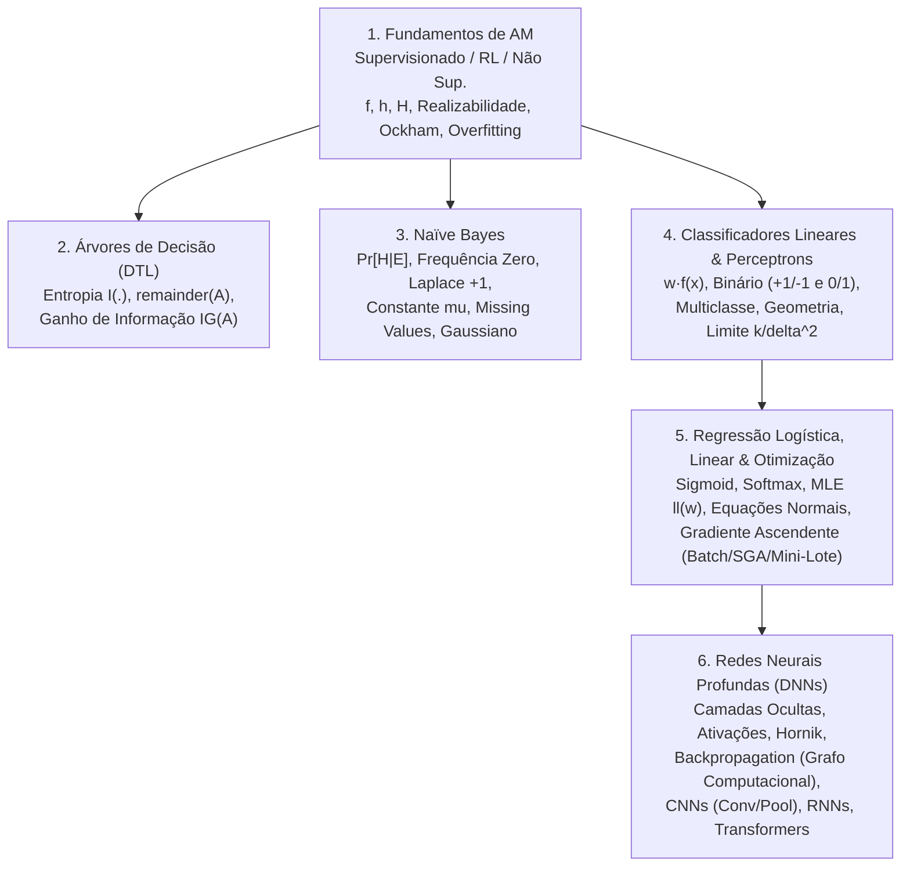

# Módulo 03 — Aprendizado de Máquina: Árvores de Decisão, Naïve Bayes, Perceptrons, Regressão e Redes Neurais

> **Fontes consolidadas (100% das 195 páginas cobertas, incluindo fórmulas visuais e erratas verificadas):**
> - [`CS 188 - Aprendizado de Máquina I.pdf`](file:///home/dcr/repos/trabAI/prova/CS%20188%20-%20Aprendizado%20de%20M%C3%A1quina%20I.pdf) (64 páginas — Conceitos de AM, Paradigmas, Aprendizagem Indutiva, Ajuste de Curva, Overfitting, Navalha de Ockham, **Árvores de Decisão / DTL / Entropia / Ganho de Informação**, Validação e Curva de Aprendizado)
> - [`naivebayes.pdf` — Parte A (págs. 1–18)](file:///home/dcr/repos/trabAI/prova/naivebayes.pdf) (Naïve Bayes Nominal, dataset Tempo/WEKA, Problema da Frequência Zero, Estimador de Laplace +1, Suavização com constante $\mu$, Valores Faltantes e **Naïve Bayes Gaussiano** para atributos numéricos; *nota: as págs. 19–52 tratam de Independência e D-Separação em Redes Bayesianas e estão consolidadas integralmente no [Módulo 01](file:///home/dcr/repos/trabAI/prova/guia_prova2/01_INCERTEZA_E_REDES_BAYESIANAS.md)*)
> - [`perceptrons.pdf`](file:///home/dcr/repos/trabAI/prova/perceptrons.pdf) (54 páginas — Classificadores Lineares, Perceptron Binário e Multiclasse, Interpretação Geométrica, McCulloch–Pitts, Regressão Logística Binária/Softmax, **Regressão Linear / Equações Normais**, Gradiente Ascendente + Prova Taylor/Cauchy–Schwarz, Batch/Estocástico/Mini-Lote, Learning Rate Finder)
> - [`redesneurais.pdf`](file:///home/dcr/repos/trabAI/prova/redesneurais.pdf) (25 páginas — Redes Neurais Profundas, Funções de Ativação e Derivadas, Early Stopping, **Teorema da Aproximação Universal — Hornik 1 & 2**, Tabela de 22 Derivadas, Regra da Cadeia, Backpropagation/Autodiff + PyTorch, **CNNs (Convolução 2D & Max Pooling), RNNs e Transformers**)
> - Referência de prova: [`prova2.pdf`](file:///home/dcr/repos/trabAI/prova/prova2.pdf) (Q1 Naïve Bayes, Q2 Perceptron, Q4 Árvore de Decisão) e [`Documento sem título.pdf`](file:///home/dcr/repos/trabAI/prova/Documento%20sem%20ti%A6%FCtulo.pdf) (Q3 Rede Neural com Ativação Quadrática)

---

## Mapa do Módulo e Guia de Notação



### Alertas Críticos de Colisão de Notação Entre os 4 Decks

Como os 4 arquivos vêm de fontes diferentes (Russell & Norvig, UFRN/WEKA, CS188, MIT 6.S191), **vários símbolos se repetem com significados diferentes** — fique atento ao contexto:

| Símbolo | Significados Possíveis (por deck) | Como Não Confundir |
| :--- | :--- | :--- |
| **$H$** | 1) **Espaço de hipóteses** (`CS 188 ML I` pp. 28, 40)<br>2) **Evento de classe / hipótese** em $\Pr[H \mid E]$ (`naivebayes.pdf` pp. 3, 5) | Em AM geral: $f \in H$ (espaço). Em Naïve Bayes: $H$ é a classe (ex.: `Play=yes`). |
| **$E$** | 1) **Conjunto de treinamento** particionado em $E_1\dots E_v$ (`CS 188 ML I` p. 56)<br>2) **Instância / evidência** $E = (E_1, \dots, E_n)$ (`naivebayes.pdf` pp. 3–7) | Em Árvores: $E$ são os exemplos. Em Naïve Bayes: $E$ são os atributos observados. |
| **$\mu$** | 1) **Constante de suavização** em $\frac{c + \mu/v}{N + \mu}$ (`naivebayes.pdf` p. 13)<br>2) **Média amostral** $\frac{1}{n}\sum x_i$ (`naivebayes.pdf` p. 15) | Olhe se o atributo é nominal (suavização) ou numérico (Gaussiana). |
| **$g(\cdot)$** | 1) **Função de ativação** (`perceptrons.pdf` pp. 22–24; `redesneurais.pdf` pp. 6–8)<br>2) **Função objetivo** a maximizar $g(w)$ (`perceptrons.pdf` pp. 44–51)<br>3) **Saída do grafo computacional** $g(w_1,w_2,w_3)$ (`redesneurais.pdf` p. 17) | Sempre identificar pelo papel na equação! |
| **$w_{i,j}$ vs. $W_{i,j}^{(k-1,k)}$** | McCulloch–Pitts (`perceptrons` p. 22): $w_{i,j}$ vai de **$i \to j$**<br>DNN (`redesneurais` pp. 6–7): $W_{i,j}^{(k-1,k)}$ vai de **$j$ (camada $k-1$) $\to i$ (camada $k$)** | Na multiplicação matricial $z^{(k)} = g(W z^{(k-1)})$, linha $i$ = destino, coluna $j$ = origem! |
| **$y \in \{+1,-1\}$ vs. $\{0,1\}$** | CS188 (`perceptrons` pp. 7–20, 36; `prova2.pdf` Q2): **$y^* \in \{+1, -1\}$**<br>R&N (`perceptrons` p. 21): **$y \in \{0, 1\}$** | Ambos têm a mesma lógica de atualização ($+f$ para falso negativo, $-f$ para falso positivo)! |

---

## 1. Fundamentos de Aprendizado de Máquina (`CS 188 ML I` pp. 1–40, 63–64; `perceptrons` pp. 3–5)

### 1.1. O Que é Aprendizado, Por Que Aprender e Marco Histórico (`CS 188 ML I` pp. 3–12)
- **Definição formal (p. 3):** *"Um agente está aprendendo se melhora seu desempenho em tarefas futuras após observar o mundo."* Três pilares: (1) **Desempenho**, (2) **Experiência/Dados**, (3) **Generalização para tarefas futuras**.
- **Por que aprender?**
  - **Ambientes desconhecidos (p. 5):** o projetista não possui *onisciência*; o ambiente muda.
  - **Construção de sistemas e conhecimento tácito (pp. 7–8):** humanos realizam tarefas **sem saber explicar como** (reconhecimento facial, caminhar, linguagem natural) $\implies$ é melhor expor o sistema a exemplos reais do que escrever regras manualmente.
  - **Marcos históricos citados nos slides:** William James (1890, confusão sensorial do bebê), Alan Turing (1950, *"simular a mente de uma criança: mecanismo reduzido e muitas folhas em branco"*), B.F. Skinner (*condicionamento operante* / Caixa de Skinner com reforço imediato), **Frank Rosenblatt (1957)** — primeiro hardware de rede neural (**Perceptron** com potenciômetros motorizados).
- **5 perguntas para projetar um agente aprendiz (p. 12):** (1) Design do agente, (2) Qual componente melhorar e sua representação, (3) Quais dados são relevantes, (4) Conhecemos as respostas corretas?, (5) Qual conhecimento prévio existe?

### 1.2. Paradigmas, Aprendizagem Indutiva, Overfitting e Navalha de Ockham (`CS 188 ML I` pp. 13–29, 38–40, 63–64; `perceptrons` pp. 3–4)
- **Três tipos de aprendizado (p. 13):**
  1. **Aprendizado Supervisionado:** respostas corretas (rótulos) fornecidas para cada exemplo $(x_j, y_j)$ onde $y_j = f(x_j)$.
     - **Classificação:** saída **discreta** (ex.: Spam/Ham — 200 bilhões/dia; dígitos MNIST — 60 mil imagens com `Label, yhat`; diagnóstico médico; correção de ensaios; detecção de fraude; roteamento de e-mail; classificação de proteínas).
     - **Regressão:** saída **real / contínua** (ajuste de curva).
  2. **Aprendizado por Reforço (RL):** sequência de recompensas, sem rótulos diretos (Módulo 02).
  3. **Aprendizado Não Supervisionado:** sem rótulos de saída; descobre estrutura inerente nos dados (ex.: agrupamento / *clustering*).
- **Aprendizagem Indutiva Clássica (pp. 14–22, 38, 40):**
  - Dada uma coleção de pares $(x_j, y_j) = (x_j, f(x_j))$ da **função-alvo desconhecida** $f$, encontrar uma **hipótese** $h \in H$ (**espaço de hipóteses**) tal que $h \approx f$ em **exemplos não vistos** (generalização).
  - **Hipótese consistente:** concorda com **todos** os exemplos de treino ($\forall j,\; h(x_j) = f(x_j)$).
  - **Problema realizável (*realizable*):** quando $f \in H$ (na prática não sabemos com certeza porque $f$ é desconhecida).
- **Ajuste de Curva, Sobreajuste (*Overfitting*) e Navalha de Ockham (pp. 17–29):**
  - *Ajuste Linear* ($y = ax + b$): simples, difícil errar drasticamente, mas pode ser limitado demais (*underfitting*).
  - *Ajuste Quadrático* (parábola): bom equilíbrio no exemplo dos 6 pontos (ignora o *outlier*).
  - *Polinômio de alto grau / curva dente-de-serra errática:* consistente com 100% do treino (passa até pelo *outlier*), porém **péssimo desempenho em novos dados = Sobreajuste (*Overfitting*)**.
  - **Navalha de Ockham (*Ockham's Razor*):** *"Prefira a hipótese mais simples que seja consistente com os dados"* — pois *"hipóteses mais complexas que os dados estão deixando de extrair algum padrão dos dados!"*
- **Validação e Curva de Aprendizado (`CS 188 ML I` pp. 63–64; `perceptrons` p. 4):**
  - Divisão em **Treinamento** (ajustar parâmetros), **Validação / *Held-out*** (ajustar hiperparâmetros e *early stopping* — *"simulado"*) e **Teste** (avaliação final imparcial — *"prova final"*).
  - **Curva de aprendizagem (*Learning Curve*, p. 64):** gráfico da `% de acertos no conjunto de teste` em função do `tamanho do conjunto de treinamento` (cresce rapidamente no início e tende a um platô alto conforme há mais dados).

---

## 2. Árvores de Decisão (*Decision Tree Learning — DTL*) (`CS 188 ML I` pp. 36–37, 41–62)

### 2.1. Intuição do Zero
Uma **Árvore de Decisão** classifica uma instância fazendo uma **sequência de perguntas (testes)** sobre seus atributos, como no jogo "Adivinha Quem". Cada **nó interno** testa um atributo, cada **ramo** corresponde a um valor possível desse atributo, e cada **nó folha** devolve a classe prevista (`T`/`Sim` ou `F`/`Não`).
O segredo está em escolher **qual pergunta fazer primeiro (na raiz)** para chegar às folhas puras com a **árvore mais compacta possível** (Navalha de Ockham!).

### 2.2. Definição Formal, Expressividade e Equações de Teoria da Informação

- **Expressividade (`CS 188 ML I` p. 46):** **Qualquer função booleana pode ser representada por uma árvore de decisão** (exemplo dos slides: `A xor B` testa `A` na raiz e `B` em ambos os ramos). Embora exista sempre uma árvore consistente trivial (um caminho por exemplo), ela cresce **exponencialmente**; queremos a árvore mais compacta.
- **Conteúdo de Informação / Entropia (`CS 188 ML I` pp. 53–55):**
  Mede a impureza / incerteza em **bits**. Para probabilidades $P(v_1), \dots, P(v_n)$:
  $$I\big(P(v_1), \dots, P(v_n)\big) = \sum_{i=1}^{n} -P(v_i)\log_2 P(v_i)$$
  *(Convenção: $0 \log_2 0 = 0$. Moeda justa: $I(\frac{1}{2}, \frac{1}{2}) = -\frac{1}{2}(-1) - \frac{1}{2}(-1) = \mathbf{1\text{ bit}}$. Conjunto puro: $I(1, 0) = I(0, 1) = \mathbf{0\text{ bits}}$!)*
- **Entropia de um conjunto binário com $p$ positivos e $n$ negativos (p. 55):**
  $$I\!\left(\frac{p}{p+n},\, \frac{n}{p+n}\right) = -\frac{p}{p+n}\log_2\frac{p}{p+n} - \frac{n}{p+n}\log_2\frac{n}{p+n}$$
- **Informação Restante Esperada — $\text{remainder}(A)$ (pp. 56–58):**
  Se o atributo $A$ possui $v$ valores distintos, particionando o conjunto $E$ em subconjuntos $E_1, \dots, E_v$ com $p_i$ positivos e $n_i$ negativos em cada $E_i$:
  $$\text{remainder}(A) = \sum_{i=1}^{v} \frac{p_i + n_i}{p + n}\, I\!\left(\frac{p_i}{p_i + n_i},\, \frac{n_i}{p_i + n_i}\right)$$
  onde $\frac{p_i + n_i}{p + n}$ é o **peso do ramo $i$** (proporção de exemplos que vão para $E_i$).
- **Ganho de Informação — $IG(A)$ (*Information Gain*, p. 59):**
  $$IG(A) = I\!\left(\frac{p}{p+n},\, \frac{n}{p+n}\right) - \text{remainder}(A)$$
  - **Heurística DTL:** escolher em cada nó o atributo $A$ que **maximiza $IG(A)$** (equivalentemente, que **minimiza $\text{remainder}(A)$**!).

### 2.3. Algoritmo DTL Passo a Passo (4 Casos Recursivos — pp. 47–48)
```text
Função DTL(exemplos, atributos, valor_padrao_pai):
  Caso 1 (Sem exemplos restantes):
      Retornar valor_padrao_pai (classificação majoritária no nó pai)
  Caso 2 (Nó puro — todos positivos OU todos negativos):
      Retornar essa classificação (folha Sim/T ou Não/F)
  Caso 3 (Sem atributos restantes, mas restam positivos E negativos):
      (Causa: ruído nos dados, atributos insuficientes ou domínio não-determinístico)
      Retornar votação pela maioria dos exemplos restantes
  Caso 4 (Exemplos mistos e há atributos disponíveis):
      A ← argmax_{a ∈ atributos} IG(a)
      Criar nó raiz com teste em A
      Para cada valor v_i do domínio de A:
          exemplos_i ← {e ∈ exemplos : e.A == v_i}
          subarvore ← DTL(exemplos_i, atributos \ {A}, maioria(exemplos))
          Adicionar ramo A = v_i levando a subarvore
      Retornar árvore
```
- **Propriedades e limitações:** Busca gulosa (*greedy*, não garante a menor árvore globalmente ótima); pode errar em combinações nunca vistas no treino (ex.: `Full` + `WaitEstimate=0-10` no Restaurante).

### 2.4. Exemplo Resolvido à Mão — Restaurante *"Devo Esperar?"* (`CS 188 ML I` pp. 42–62)
- **Base de 12 exemplos ($X_1 \dots X_{12}$):** $p = 6$ positivos (`T`) e $n = 6$ negativos (`F`) $\implies$ entropia inicial:
  $$I\!\left(\frac{6}{12}, \frac{6}{12}\right) = I(0.5, 0.5) = \mathbf{1\text{ bit}}$$
- **Testando `Patrons` (`None`, `Some`, `Full`):**
  - `None`: 2 exemplos ($0\text{T}, 2\text{F}$) $\implies I(0, 1) = 0$
  - `Some`: 4 exemplos ($4\text{T}, 0\text{F}$) $\implies I(1, 0) = 0$
  - `Full`: 6 exemplos ($2\text{T}, 4\text{F}$) $\implies I(\frac{2}{6}, \frac{4}{6}) = -\frac{1}{3}\log_2\frac{1}{3} - \frac{2}{3}\log_2\frac{2}{3} \approx 0.9183$
  $$\text{remainder}(\text{Patrons}) = \frac{2}{12}(0) + \frac{4}{12}(0) + \frac{6}{12}(0.9183) = 0.4591\text{ bits}$$
  $$IG(\text{Patrons}) = 1 - 0.4591 = \mathbf{0.541\text{ bits}}$$
  *(⚠️ **Errata do Slide 60:** o slide imprime `.0541 bits` por erro de digitação de um zero; o valor exato é **$0.541\text{ bits}$**!)*
- **Testando `Type` (`French`, `Italian`, `Thai`, `Burger`):**
  - `French`: $(1\text{T}, 1\text{F}) \to I=1$; `Italian`: $(1\text{T}, 1\text{F}) \to I=1$; `Thai`: $(2\text{T}, 2\text{F}) \to I=1$; `Burger`: $(2\text{T}, 2\text{F}) \to I=1$.
  $$\text{remainder}(\text{Type}) = \frac{2}{12}(1) + \frac{2}{12}(1) + \frac{4}{12}(1) + \frac{4}{12}(1) = 1 \implies IG(\text{Type}) = 1 - 1 = \mathbf{0\text{ bits}}$$
- **Escolha:** `Patrons` vence e vira a raiz! Continuando a recursão no ramo `Full` (`{X2, X4, X5, X9, X10, X12}`), o algoritmo escolhe `Hungry?` (`No` $\to$ `F`, `Yes` $\to$ `Type?`: `French` $\to$ `T` por regra da maioria do pai, `Italian` $\to$ `F`, `Burger` $\to$ `T`, `Thai` $\to$ `Fri/Sat?`: `No` $\to$ `F`, `Yes` $\to$ `T`).

### 2.5. Como Cai na Prova + Armadilhas
- **Questão real de prova (`prova2.pdf` Questão 4):** dá uma tabela de atributos e pede (a) o **melhor** atributo para a raiz (máximo $IG$, mínimo `remainder`) e (b) o **pior** atributo binário (mínimo $IG$, máximo `remainder`)! Veja a resolução detalhada no [Módulo 04](file:///home/dcr/repos/trabAI/prova/guia_prova2/04_PROVAS_E_EXERCICIOS_RESOLVIDOS.md).
- **Armadilha:** Esquecer de multiplicar a entropia de cada ramo pelo **peso $\frac{p_i+n_i}{p+n}$**, ou usar $\ln$ (base $e$) em vez de $\log_2$ (bits)! (Dica: se um ramo é **100% puro**, sua entropia é imediatamente **$0$** — nem precisa fazer conta de logaritmo; se é **50%/50%**, sua entropia é imediatamente **$1$**!)

---

## 3. Classificador Naïve Bayes (`naivebayes.pdf` Parte A, págs. 1–18)

### 3.1. Intuição do Zero
Como classificar um novo exemplo $E = (E_1, E_2, \dots, E_n)$ (por exemplo, o clima de hoje ou características $X_1, X_2$) na classe mais provável $H$ (ex.: `Play=yes` vs. `Play=no`)?
Pela **Regra de Bayes**, precisaríamos da probabilidade conjunta $\Pr[E_1, \dots, E_n \mid H]$ — que tem combinações demais para estimar diretamente! O **Naïve Bayes** faz uma suposição **"ingênua" (*naïve*)**: assume que **todos os atributos $E_1, \dots, E_n$ são condicionalmente independentes dada a classe $H$** (equivalente a uma Rede Bayesiana em estrela $H \to E_1, H \to E_2, \dots, H \to E_n$). Mesmo quando essa suposição é violada na realidade, o classificador costuma funcionar muito bem na prática!

### 3.2. Definição Formal e Equações (`naivebayes.pdf` pp. 3–17)

1. **Teorema de Bayes (p. 3):**
   $$\Pr[H \mid E] = \frac{\Pr[E \mid H]\,\Pr[H]}{\Pr[E]}$$
   - $\Pr[H]$: probabilidade *a priori*; $\Pr[H \mid E]$: probabilidade *a posteriori*.
   - *(Exemplo médico p. 4 — Meningite: $\Pr(S\mid M)=0.5$, $\Pr(M)=1/50000$, $\Pr(S)=1/20 \implies \Pr(M\mid S) = \frac{0.5 \times (1/50000)}{1/20} = \mathbf{0.0002} = 0.02\% = 1\text{ em }5000$. ⚠️ Errata do slide p. 4: imprime `0,002` por descuido antes de escrever corretamente `0,02% ou 1 em 5000`.)*

2. **Fórmula de Classificação Naïve Bayes (p. 5):**
   $$\Pr[H \mid E] = \frac{\Pr[E_1 \mid H]\,\Pr[E_2 \mid H]\cdots \Pr[E_n \mid H]\,\Pr[H]}{\Pr[E]}$$
   - Na prática, calculamos a **verossimilhança não normalizada (*likelihood*)** (o numerador) para cada classe $H = h$, e **normalizamos** dividindo pela soma sobre todas as classes (que equivale a dividir por $\Pr[E]$). A classe prevista é a de maior probabilidade a posteriori!

3. **Problema da Frequência Zero e Suavização (*Smoothing*, pp. 12–13):**
   - **Problema (p. 12):** Se um valor de atributo nunca apareceu junto com a classe $h$ no treino (ex.: `Outlook=Overcast` na classe `Play=no` tem contagem $0/5$), então $\Pr[E_j \mid h] = 0$, o que **zera todo o produto** $\Pr[h \mid E] = 0$ independentemente de todos os outros atributos!
   - **Solução 1 — Estimador de Laplace (+1) (p. 12):** soma **$+1$** a cada contagem de valor do atributo e soma **$+v$** (número de valores possíveis daquele atributo) ao denominador:
     $$\Pr[E_j = a \mid H = h] = \frac{\text{count}(E_j = a,\, H = h) + 1}{\text{count}(H = h) + v}$$
     *(Generalização com parâmetro de Laplace $k$: $\frac{\text{count}(E_j=a, H=h) + k}{\text{count}(H=h) + k \cdot v}$; para $k=1$, recupera o estimador de Laplace clássico.)*
   - **Solução 2 — Estimativa Modificada com constante $\mu$ (p. 13):** distribui um peso total $\mu > 0$ uniformemente entre os $v$ valores do atributo:
     $$\Pr[E_j = a \mid H = h] = \frac{\text{count}(E_j = a,\, H = h) + \mu/v}{\text{count}(H = h) + \mu}$$
     *(Exemplo da p. 13 para `Outlook` com $v=3$ valores dado `yes` (total 9): $\frac{2+\mu/3}{9+\mu},\; \frac{4+\mu/3}{9+\mu},\; \frac{3+\mu/3}{9+\mu}$. Note que $\mu = v = 3$ recupera exatamente o Laplace $+1$, e a soma sempre dá $\frac{9+\mu}{9+\mu}=1$!)*

4. **Valores Faltantes (*Missing Values*, p. 14):**
   - **No treinamento:** a instância com atributo faltante é simplesmente **ignorada** na contagem (e no denominador) daquele atributo.
   - **Na classificação:** o atributo faltante é simplesmente **omitido** do produto de probabilidades!

5. **Atributos Numéricos — Naïve Bayes Gaussiano (pp. 15–17):**
   Assume-se que cada atributo numérico segue uma **distribuição Normal (Gaussiana)** dentro de cada classe $h$, estimando dois parâmetros por atributo e por classe:
   - **Média amostral:** $\mu = \frac{1}{n}\sum_{i=1}^n x_i$
   - **Desvio padrão amostral:**
     $$\sigma = \sqrt{\frac{1}{n - 1}\sum_{i=1}^{n} (x_i - \mu)^2}$$
     *(⚠️ **Errata do Slide 15:** a fórmula impressa omite o sinal $\sqrt{\cdot}$, mostrando a variância $\sigma^2$; os cálculos nas págs. 16–17 usam corretamente o desvio padrão $\sigma$ com raiz quadrada!)*
   - **Função de Densidade de Probabilidade (PDF):**
     $$f(x) = \frac{1}{\sqrt{2\pi}\,\sigma}\, e^{-\frac{(x - \mu)^2}{2\sigma^2}}$$
   - Na classificação, substitui-se $\Pr[E_j = x \mid H = h]$ pelo valor da densidade $f(x \mid h)$ no produto! Valores faltantes numéricos no treino são excluídos do cálculo de $\mu$ e $\sigma$.

### 3.3. Exemplos Resolvidos à Mão (Dos Slides — `naivebayes.pdf` pp. 6–17)
Base de 14 dias (`D1`–`D14`): `Play=yes` ($9/14$) e `Play=no` ($5/14$).
- **Exemplo A — Consulta Nominal (pp. 7–8):** `E = (Outlook=Sunny, Temp=Cool, Humidity=High, Windy=True)`:
  - Numerador `yes`: $\frac{2}{9} \times \frac{3}{9} \times \frac{3}{9} \times \frac{3}{9} \times \frac{9}{14} = \frac{1}{189} \approx 0.0053$
  - Numerador `no`: $\frac{3}{5} \times \frac{1}{5} \times \frac{4}{5} \times \frac{3}{5} \times \frac{5}{14} = \frac{36}{1750} \approx 0.0206$
  - Normalizando ($Z = 0.0053 + 0.0206 = 0.0259$):
    $$P(\text{yes}\mid E) = \frac{0.0053}{0.0259} = \mathbf{0.205}, \qquad P(\text{no}\mid E) = \frac{0.0206}{0.0259} = \mathbf{0.795} \implies \textbf{Classe: no}$$
- **Exemplo B — Violação empírica da suposição Naïve (pp. 9–11):** Nos 9 dias `yes`, $\Pr(\text{Sunny}\mid \text{Windy=true}, \text{yes}) = \frac{1}{3} \neq \frac{2}{9} = \Pr(\text{Sunny}\mid \text{yes})$, provando que os atributos **não** são realmente condicionalmente independentes!
- **Exemplo C — Valor Faltante (p. 14):** `E = (Outlook=?, Temp=Cool, Humidity=High, Windy=True)` — basta omitir `Outlook`:
  - `yes`: $\frac{3}{9}\cdot\frac{3}{9}\cdot\frac{3}{9}\cdot\frac{9}{14} = 0.0238$; `no`: $\frac{1}{5}\cdot\frac{4}{5}\cdot\frac{3}{5}\cdot\frac{5}{14} = 0.0343 \implies P(\text{yes})=\mathbf{41\%},\; P(\text{no})=\mathbf{59\%}$.
- **Exemplo D — Naïve Bayes Gaussiano (pp. 16–17):** `E = (Outlook=Sunny, Temp=66, Humidity=90, Windy=true)`:
  - Estatísticas `yes`: Temp ($\mu=73, \sigma=6.2 \implies f(66)=0.0340$), Hum ($\mu=79.1, \sigma=10.2 \implies f(90)=0.0221$).
  - Estatísticas `no`: Temp ($\mu=74.6, \sigma=7.9 \implies f(66)=0.0279$ — *slide imprime `0.0291` por errata histórica de Witten & Frank, mas usa `0.0279` no produto!*), Hum ($\mu=86.2, \sigma=9.7 \implies f(90)=0.0380$).
  - Numerador `yes`: $\frac{2}{9} \times 0.0340 \times 0.0221 \times \frac{3}{9} \times \frac{9}{14} = 0.000036$.
  - Numerador `no`: $\frac{3}{5} \times 0.0279 \times 0.0380 \times \frac{3}{5} \times \frac{5}{14} = 0.000136$.
  - Normalizando: $P(\text{yes}) = \mathbf{20.9\%}$, $P(\text{no}) = \mathbf{79.1\%} \implies \textbf{Classe: no}$.

### 3.4. Observações Práticas, Como Cai na Prova + Armadilhas (`naivebayes.pdf` p. 18)
- **Quando usar:** conjuntos de treinamento médios ou grandes, atributos aproximadamente condicionalmente independentes dada a classe (muito usado em **diagnóstico** e **classificação de texto/documentos**). Cuidado: nem todo atributo numérico é Gaussiano!
- **Como cai na prova (`prova2.pdf` Questão 1):** tabela pequena de treinamento (`X1, X2, Y`) pedindo para classificar um novo ponto (`X1=1, X2=0`).
- **Armadilhas fatais:**
  1. **Esquecer a probabilidade a priori $\Pr[H]$** (só multiplicar os $\Pr[E_j \mid H]$)!
  2. **Usar o denominador errado na condicional:** $\Pr[E_j = a \mid Y = y]$ divide pelo número de exemplos da **classe $y$**, NÃO pelo total $N$ do dataset!
  3. **Não normalizar** quando a questão pede explicitamente as probabilidades a posteriori (e verificar se há alguma contagem zero exigindo Laplace!).

---

## 4. Classificadores Lineares e Perceptrons (`perceptrons.pdf` págs. 1–31)

### 4.1. Intuição do Zero
Um **Classificador Linear** transforma um objeto $x$ em um vetor numérico de características $f(x)$ (ex.: nº de palavras `"grátis"`, nº de erros de ortografia) e calcula uma **soma ponderada** $\text{activation}_w(x) = w \cdot f(x) = \sum_i w_i f_i(x)$.
Geometricamente, o vetor de pesos $w$ define um **hiperplano** ($w \cdot f = 0$) que corta o espaço em duas metades: pontos do lado para onde $w$ aponta (ângulo agudo $\theta < 90^\circ$) são classificados como $+1$; pontos do outro lado (ângulo obtuso $\theta > 90^\circ$) como $-1$.
O algoritmo **Perceptron** aprende $w$ de forma **orientada a erros**: sempre que erra um exemplo, gira o vetor $w$ na direção certa!

### 4.2. Definições Formais, Geometria e Equações (`perceptrons.pdf` pp. 7–29)

1. **Classificador Linear e Papel do Viés (*Bias*, pp. 7–10, 18):**
   - **Sem viés:** $a(x) = w^T f(x) \implies$ o hiperplano $w^T f(x) = 0$ é **obrigado a passar pela origem**.
   - **Com viés $b$:** $a(x) = w^T f(x) + b \implies$ desloca o hiperplano fora da origem.
   - **Truque padrão de implementação:** incluir uma característica constante $f_0 = 1$ (ou última coordenada $=1$, como na `prova2.pdf` Q2!) com peso correspondente $w_0 = b$, voltando à forma homogênea $w \cdot f(x) = 0$.
   - *Exemplo de hiperplano (p. 10):* `VIÉS: -3, livre: 4, dinheiro: 2` $\implies 4\cdot\text{livre} + 2\cdot\text{dinheiro} - 3 = 0$ (interceptos em $(0.75, 0)$ e $(0, 1.5)$).

2. **Interpretação Geométrica (pp. 13–17):**
   $$h_{\mathbf{w}}(\mathbf{x}) = \mathbf{w} \cdot \mathbf{f}(\mathbf{x}) = \|\mathbf{w}\|\,\|\mathbf{f}(\mathbf{x})\|\,\cos(\theta)$$
   - $\mathbf{w}$ é **perpendicular (ortogonal)** à fronteira de decisão $\mathbf{w}^T \mathbf{f}(\mathbf{x}) = 0$ e aponta para a classe `+`.
   - $\cos(\theta) > 0 \iff \theta < \frac{\pi}{2}$ (ângulo agudo) $\implies$ classe `+`.
   - $\cos(\theta) < 0 \iff \theta > \frac{\pi}{2}$ (ângulo obtuso) $\implies$ classe `-`.
   - Ao errar um exemplo $+$, somar $\mathbf{w} + \mathbf{f}(x)$ **gira $\mathbf{w}$ em direção a $\mathbf{f}(x)$** (reduzindo o ângulo $\theta$); ao errar um exemplo $-$, subtrair $\mathbf{w} - \mathbf{f}(x)$ **afasta $\mathbf{w}$ de $\mathbf{f}(x)$**!

3. **Algoritmo Perceptron Binário — Convenção CS188 $\{+1, -1\}$ (pp. 12, 16):**
   ```text
   Inicializar w = 0 (ou pesos iniciais dados na prova)
   Para cada exemplo de treino (x, y*) com y* ∈ {+1, -1}:
       y = +1  se w · f(x) >= 0    (empate w·f(x) == 0 classifica como +1!)
       y = -1  se w · f(x) <  0
       Se y == y*: não faz nada!
       Se y != y*: w ← w + y* · f(x)
                   (isto é: w ← w + f(x) se y* = +1;  w ← w - f(x) se y* = -1)
   ```

4. **Formulação Alternativa $\{0, 1\}$, Neurônio McCulloch–Pitts e Perda $L_2$ (pp. 21–24):**
   - **Regra do Perceptron para $y, h_{\mathbf{w}}(\mathbf{x}) \in \{0, 1\}$ (p. 21):**
     $$\mathbf{w} \leftarrow \mathbf{w} + \alpha \big(y - h_{\mathbf{w}}(\mathbf{x})\big)\,\mathbf{x}$$
     - *Falso Negativo* ($\mathbf{w}\cdot\mathbf{x} < 0$, $y=1$): $y - h = +1 \implies$ soma $\alpha \mathbf{x}$.
     - *Falso Positivo* ($\mathbf{w}\cdot\mathbf{x} > 0$, $y=0$): $y - h = -1 \implies$ subtrai $\alpha \mathbf{x}$.
   - **Neurônio de McCulloch & Pitts (1943) (p. 22):** entrada fixa de viés $a_0 = 1$ com peso $w_{0,j}$, soma ponderada $\text{in}_j = \sum_i w_{i,j} a_i$ e função de ativação $a_j = g(\text{in}_j) = g(\mathbf{w} \cdot \mathbf{a})$.
   - **Treinamento de um Neurônio Único com perda quadrática $L_2$ (p. 24):**
     $$\text{Loss}(\mathbf{w}) = \big(y - g(\mathbf{w} \cdot \mathbf{x})\big)^2, \qquad w_i \leftarrow w_i - \alpha \frac{\partial}{\partial w_i}\text{Loss}(\mathbf{w})$$

5. **Algoritmo Perceptron Multiclasse (pp. 26–29):**
   - Um vetor de pesos **$w_y$ para cada classe $y$** (note: o caso binário é um caso particular onde $w_{-1} = \mathbf{0}$!).
   - **Regra de decisão:** $y = \arg\max_y\; w_y \cdot f(x)$.
   - **Regra de atualização:** para cada exemplo $(x, y^*)$:
     - Se $y = y^*$: não muda nada.
     - Se $y \ne y^*$: **diminui** o vetor da classe errada prevista e **aumenta** o da classe verdadeira (demais classes ficam intactas!):
       $$w_y \leftarrow w_y - f(x), \qquad w_{y^*} \leftarrow w_{y^*} + f(x)$$

### 4.3. Propriedades Teóricas e 3 Problemas Clássicos do Perceptron (`perceptrons.pdf` pp. 30–31)

- **Propriedades (p. 30):**
  1. **Separabilidade:** existe um vetor $w$ que classifica 100% do conjunto de treinamento sem erros.
  2. **Convergência:** se os dados são linearmente separáveis, o algoritmo **converge em número finito de passos** (provado para o caso binário).
  3. **Limite de erros (*Mistake Bound*):** se existe separação com margem $\delta$:
     $$\text{mistakes} < \frac{k}{\delta^2}$$
     (quanto menor a margem $\delta$, maior o limite de erros até convergir).
- **Três Problemas Clássicos (p. 31):**
  1. **Ruído (*Noise / Thrashing*):** se os dados **não** forem linearmente separáveis, os pesos nunca convergem e ficam oscilando violentamente (*thrashing*). **Solução parcial:** tirar a média dos vetores de peso ao longo das iterações (**Perceptron Médio / *Averaged Perceptron***).
  2. **Generalização medíocre:** mesmo em dados separáveis, o perceptron para assim que acerta tudo, frequentemente gerando uma fronteira "quase encostada" nos pontos (margem pequena).
  3. **Overtraining:** a acurácia no conjunto de validação/teste sobe inicialmente e depois **cai** enquanto a acurácia de treino continua subindo (**overtraining é um tipo de overfitting**).

### 4.4. Exemplos Resolvidos à Mão (Dos Slides — `perceptrons.pdf` pp. 19–20, 28–29)
- **Exemplo A — Perceptron Binário (pp. 19–20):** $w = [w_0\text{ (bias)}, w_1, w_2]$ inicializado em `[-1, 0, 0]`, 5 pontos `[1, f1, f2]`:
  1. `[1, 1, 1]`, $y^*=-1$: $w\cdot f = -1 < 0$ (pred `-`, correto) $\to$ `[-1, 0, 0]`
  2. `[1, 3, 2]`, $y^*=+1$: $w\cdot f = -1 < 0$ (pred `-`, **erro**) $\to [-1,0,0] + [1,3,2] = [0, 3, 2]$
  3. `[1, 2, 4]`, $y^*=+1$: $w\cdot f = 14 \ge 0$ (correto) $\to [0, 3, 2]$
  4. `[1, 3, 4]`, $y^*=+1$: $w\cdot f = 17 \ge 0$ (correto) $\to [0, 3, 2]$
  5. `[1, 2, 3]`, $y^*=-1$: $w\cdot f = 12 \ge 0$ (pred `+`, **erro**) $\to [0,3,2] - [1,2,3] = \mathbf{[-1, 1, -1]}$.
- **Exemplo B — Perceptron Multiclasse (pp. 28–29):** $\mathbf{f}(\mathbf{x}) = [-2, 3, 1]$, $\mathbf{w}_0=[-2,2,1]$, $\mathbf{w}_1=[0,3,4]$, $\mathbf{w}_2=[1,4,-2]$:
  - Scores: $s_0 = 11$, $s_1 = 13$, $s_2 = 8 \implies \arg\max = \mathbf{1}$ (Classe 1).
  - Se a classe verdadeira é $y^* = 2 \neq 1$:
    - $\mathbf{w}_1 \leftarrow [0, 3, 4] - [-2, 3, 1] = \mathbf{[2, 0, 3]}$
    - $\mathbf{w}_2 \leftarrow [1, 4, -2] + [-2, 3, 1] = \mathbf{[-1, 7, -1]}$
    - $\mathbf{w}_0 = [-2, 2, 1]$ não muda!

### 4.5. Como Cai na Prova + Armadilhas
- **Questão real de prova (`prova2.pdf` Questão 2):** (a) rodar 1 iteração do Perceptron nos 3 primeiros pontos com $w$ inicial dado (atenção à posição do bias: na `prova2.pdf`, o bias é a **3ª coordenada** `[x1, x2, 1]`, enquanto no slide 19 é a **1ª coordenada** `[1, f1, f2]`!); (b) discutir **separabilidade linear** (dica: desenhe os pontos no plano 2D e veja se um ponto `+` está dentro do envoltório convexo dos pontos `-`!).

---

## 5. Regressão Logística, Regressão Linear e Otimização Contínua (`perceptrons.pdf` págs. 32–54)

### 5.1. Intuição do Zero
Como corrigir a "generalização medíocre" e a rigidez do Perceptron? Em vez de decisões secas $+1/-1$, queremos **decisões probabilísticas suaves**! Mesmo quando há infinitas retas que separam os dados sem erro (p. 37), a formulação probabilística **prefere automaticamente a reta bem centralizada com maior margem** (p. 38), pois ela atribui probabilidades muito maiores aos pontos corretos!

### 5.2. Regressão Logística Binária e Multiclasse (Softmax) (`perceptrons.pdf` pp. 32–40)

1. **Função Sigmoide ($\phi$, p. 35):** mapeia qualquer escore $z = w \cdot f(x) \in (-\infty, +\infty)$ para uma probabilidade em $(0, 1)$:
   $$\phi(z) = \frac{1}{1 + e^{-z}}$$
   *(Se $z \gg 0 \implies \phi(z) \to 1$; se $z = 0 \implies \phi(0) = 0.5$; se $z \ll 0 \implies \phi(z) \to 0$.)*

2. **Regressão Logística Binária via MLE (p. 36):**
   $$P\!\left(y^{(i)} = +1 \mid x^{(i)}; w\right) = \frac{1}{1 + e^{-w \cdot f(x^{(i)})}}, \qquad P\!\left(y^{(i)} = -1 \mid x^{(i)}; w\right) = 1 - \frac{1}{1 + e^{-w \cdot f(x^{(i)})}}$$
   **Objetivo — Máxima Log-Verossimilhança (*Maximum Likelihood Estimation — MLE*):**
   $$\max_{w}\; ll(w) = \max_{w} \sum_{i} \log P\!\left(y^{(i)} \mid x^{(i)}; w\right)$$

3. **Regressão Logística Multiclasse — Softmax (pp. 39–40):**
   Transforma as ativações brutas $z_y = w_y \cdot f(x)$ de todas as classes em uma distribuição de probabilidade válida (todos positivos e somando $1$):
   $$P\!\left(y^{(i)} \mid x^{(i)}; w\right) = \frac{e^{w_{y^{(i)}} \cdot f(x^{(i)})}}{\sum_{y} e^{w_y \cdot f(x^{(i)})}}$$
   Mesmo objetivo MLE: $\max_w ll(w) = \max_w \sum_i \log P(y^{(i)} \mid x^{(i)}; w)$.

### 5.3. Regressão Linear e Equações Normais Fechadas (`perceptrons.pdf` p. 41)
Para saída contínua $h_{\mathbf{w}}(\mathbf{x}) = w_0 + w_1 x^1 + \dots + w_n x^n$ sobre $N$ exemplos $(\mathbf{x}^j, y^j)$ (matriz de desenho $\mathbf{X}$, vetor alvo $\mathbf{y}$), minimiza-se a **perda quadrática $L_2$**:
$$\text{Loss}(h_{\mathbf{w}}) = \frac{1}{2}\sum_{j=1}^{N}\left(y^j - h_{\mathbf{w}}(\mathbf{x}^j)\right)^2 = \frac{1}{2}\|\mathbf{y} - \mathbf{X}\mathbf{w}\|_2^2$$
**Derivação matricial exata do slide 41:**
$$\nabla_{\mathbf{w}} \frac{1}{2}(\mathbf{y} - \mathbf{X}\mathbf{w})^T(\mathbf{y} - \mathbf{X}\mathbf{w}) = \nabla_{\mathbf{w}} \frac{1}{2}\left(\mathbf{y}^T\mathbf{y} - 2\mathbf{w}^T\mathbf{X}^T\mathbf{y} + \mathbf{w}^T\mathbf{X}^T\mathbf{X}\mathbf{w}\right) = -\mathbf{X}^T\mathbf{y} + \mathbf{X}^T\mathbf{X}\mathbf{w}$$
Igualando o gradiente a zero, obtém-se a **solução exata em forma fechada (Equações Normais)**:
$$-\mathbf{X}^T\mathbf{y} + \mathbf{X}^T\mathbf{X}\mathbf{w} = 0 \implies \hat{\mathbf{w}} = (\mathbf{X}^T\mathbf{X})^{-1}\mathbf{X}^T\mathbf{y}$$
*(Por que isso importa? Na Regressão Linear existe fórmula fechada; já na **Regressão Logística e nas Redes Neurais**, não existe solução fechada — precisamos de **otimização iterativa por gradiente**!)*

### 5.4. Otimização Contínua: Gradiente Ascendente, Prova e Variantes (`perceptrons.pdf` pp. 42–54)

- **Escalada de Montanha (*Hill Climbing*) em espaço contínuo (pp. 43–45):** há infinitos vizinhos! Em 1-D, a derivada (diferença central $\frac{\partial g(w_0)}{\partial w} = \lim_{h\to 0}\frac{g(w_0+h)-g(w_0-h)}{2h}$) indica a direção de subida.
- **Gradiente em $n$ dimensões e Atualização (pp. 46–50):**
  $$\nabla_w g(w) = \begin{bmatrix} \frac{\partial g}{\partial w_1}(w) \\ \vdots \\ \frac{\partial g}{\partial w_n}(w) \end{bmatrix}, \qquad w \leftarrow w + \alpha \cdot \nabla_w g(w)$$
  *(Obs.: para **maximizar** $ll(w)$, **soma-se** $+\alpha \nabla g$ — **Gradiente Ascendente**; para **minimizar** uma perda $\mathcal{L}(w)$, **subtrai-se** $-\alpha \nabla \mathcal{L}$ — **Gradiente Descendente**!)*
- **Prova: Por que o Gradiente é a Direção Mais Íngreme? (p. 48):**
  Queremos $\max_{\|\Delta\| \le \varepsilon} g(w + \Delta)$. Pela **expansão de Taylor de 1ª ordem**:
  $$g(w + \Delta) \approx g(w) + \frac{\partial g}{\partial w_1}\Delta_1 + \frac{\partial g}{\partial w_2}\Delta_2 = g(w) + \Delta^\top \nabla g$$
  Pelo **Lema de Cauchy–Schwarz** ($\max_{\|\Delta\| \le \varepsilon} \Delta^\top a \implies \Delta = \varepsilon \frac{a}{\|a\|}$), temos com $a = \nabla g$:
  $$\Delta = \varepsilon \frac{\nabla g}{\|\nabla g\|} \implies \textbf{A direção do gradiente é a direção de subida mais íngreme!}$$
- **Três Variantes sobre $ll(w) = \sum_i \log P(y^{(i)} \mid x^{(i)}; w)$ (pp. 51–53):**

| Variante | Regra de Atualização | Característica / Trade-off |
| :--- | :--- | :--- |
| **Em Lote (*Batch*)** | $w \leftarrow w + \alpha \sum_{i} \nabla \log P(y^{(i)} \mid x^{(i)}; w)$ | Gradiente exato sobre todo o dataset, mas lento por passo. |
| **Estocástico (*SGA*)** | Escolhe 1 exemplo aleatório $j$: $w \leftarrow w + \alpha \nabla \log P(y^{(j)} \mid x^{(j)}; w)$ | Incorpora cada exemplo imediatamente; atualizações ruidosas mas muito rápidas. |
| **Mini-Lote (*Mini-Batch*)** | Escolhe subconjunto aleatório $J$: $w \leftarrow w + \alpha \sum_{j \in J} \nabla \log P(y^{(j)} \mid x^{(j)}; w)$ | Melhor equilíbrio: o gradiente sobre $J$ pode ser computado **em paralelo** (GPU)! |

- **Escolha da Taxa de Aprendizado $\alpha$ (pp. 50, 54):**
  - *Regra prática (p. 50):* cada atualização deve alterar $w$ em cerca de **0.1% a 1%**.
  - ***Learning Rate Finder* (p. 54):** varia $\alpha$ em escala logarítmica ($10^{-7}$ a $10^{-3}$), plota a `Train Loss` e escolhe $\alpha$ na região onde a perda **cai mais rapidamente antes do mínimo** (e antes de explodir/divergir; exemplo do slide: `5×10^-5 – 3×10^-4`).

---

## 6. Redes Neurais Profundas, Backpropagation e Outras Topologias (`redesneurais.pdf` págs. 1–25)

### 6.1. Intuição do Zero (`redesneurais.pdf` pp. 2–7)
A Regressão Logística Multiclasse é apenas uma **rede neural de 1 camada**: recebe características $f_1(x), \dots, f_K(x)$ construídas manualmente (*muita engenharia!*), calcula $z_1, z_2, z_3$ e aplica *softmax*.
A grande ideia das **Redes Neurais Profundas (*Deep Neural Networks*)** é: **aprenda também as características automaticamente!** Colocamos várias camadas ocultas antes da camada final de regressão logística, transformando entradas brutas $x_1, \dots, x_L$ em representações cada vez mais ricas $z^{(1)}, z^{(2)}, \dots, z^{(n)}$.

### 6.2. Arquitetura, Equação de Camada e Funções de Ativação (`redesneurais.pdf` pp. 6–8; `perceptrons` p. 23)

- **Equação de Propagação (*Forward Pass*, `redesneurais` pp. 6–7):**
  $$z_i^{(k)} = g\!\left(\sum_{j} W_{i,j}^{(k-1, k)}\, z_j^{(k-1)}\right)$$
  onde $z^{(0)} = x$ (entrada bruta), $W_{i,j}^{(k-1, k)}$ conecta a unidade $j$ da camada $k-1$ à unidade $i$ da camada $k$, e $g$ é uma **função de ativação não linear**. A saída final $z^{(\text{OUT})}$ passa por **Softmax** para produzir $P(y_c \mid x; w)$.
- **Por que a não-linearidade $g$ é obrigatória? (pp. 6–7):** Sem não-linearidade, empilhar camadas lineares $W^{(2)}(W^{(1)}x) = (W^{(2)}W^{(1)})x$ colapsa em uma **única função linear** — não ganha nenhum poder expressivo!

#### Funções de Ativação e Derivadas (`redesneurais.pdf` p. 8; `perceptrons.pdf` p. 23)

| Função | Fórmula $g(z)$ | Derivada $g'(z)$ | Imagem & Comportamento |
| :--- | :--- | :--- | :--- |
| **Sigmoid** | $g(z) = \dfrac{1}{1 + e^{-z}}$ | $g'(z) = g(z)\big(1 - g(z)\big)$ | $(0, 1)$, $g(0)=0.5$, $g'(0)=0.25$; satura ($g' \to 0$) para $\|z\|$ grande |
| **Tanh** | $g(z) = \dfrac{e^z - e^{-z}}{e^z + e^{-z}}$ | $g'(z) = 1 - g(z)^2$ | $(-1, 1)$, centrada em $0$, $g'(0)=1$; satura para $\|z\|$ grande *(⚠️ `perceptrons` p. 23 inverte por engano a fração para $\frac{e^{2x}+1}{e^{2x}-1}$! Use a fórmula correta acima!)* |
| **ReLU** | $g(z) = \max(0, z)$ | $g'(z) = \begin{cases} 1, & z > 0 \\ 0, & z \le 0 \end{cases}$ | $[0, \infty)$; não satura no lado positivo |
| **Softplus** | $g(z) = \log(1 + e^z)$ | $g'(z) = \dfrac{1}{1+e^{-z}}$ (Sigmoid) | Aproximação suave da ReLU (`perceptrons` p. 23) |

### 6.3. Treinamento, *Early Stopping* e Teorema da Aproximação Universal (`redesneurais.pdf` pp. 9–12, 20)
- **Treinamento (p. 9):** mesmo objetivo MLE $\max_w ll(w) = \max_w \sum_i \log P(y^{(i)} \mid x^{(i)}; w)$ (agora sobre um vetor $w$ gigantesco contendo todos os pesos de todas as camadas), otimizado via Gradiente Ascendente (ou otimizadores derivados).
- **Risco de Overfitting e *Early Stopping* (pp. 9–10, 20):** redes com muitos neurônios podem memorizar o treino; por isso aplicamos **Parada Antecipada (*Early Stopping*)** — interrompemos o treinamento assim que a log-verossimilhança ou acurácia nos **dados de validação (*hold-out*)** começar a cair!
- **Teorema da Aproximação Universal (*Universal Function Approximation Theorem*, pp. 10–12):**
  - *Versão informal (p. 10):* Uma **rede neural de 2 camadas** (1 camada oculta + 1 camada de saída) com número suficiente de neurônios ocultos pode aproximar **qualquer função contínua** com **qualquer precisão desejada**.
  - *Versão formal — **Hornik (1991)** (p. 11; também citados **Cybenko 1989** e **Leshno & Schocken 1991**):*
    - **Teorema 1 de Hornik:** Se a função de ativação é *limitada e não constante*, para qualquer medida finita $\mu$, redes feedforward multicamadas podem aproximar arbitrariamente bem qualquer função em $L^p(\mu)$ com unidades ocultas suficientes.
    - **Teorema 2 de Hornik:** Se a ativação é *contínua, limitada e não constante*, para qualquer subconjunto compacto $X \subseteq \mathbb{R}^k$, redes feedforward aproximam arbitrariamente bem qualquer função contínua em $X$ na distância uniforme (com unidades ocultas suficientes).

### 6.4. Regra da Cadeia, Diferenciação Automática e *Backpropagation* (`redesneurais.pdf` pp. 14–19)

#### 1. Intuição e Algoritmo
Uma rede neural é uma **composição gigante de operações elementares**. Pela **Regra da Cadeia** ($f(x) = g(h(x)) \implies f'(x) = g'(h(x)) h'(x)$), bibliotecas de **Diferenciação Automática** (*Theano, TensorFlow, PyTorch, Chainer*) executam em duas passagens com custo comparável a uma única passagem *forward*:
1. **Passagem *Forward* (esquerda $\to$ direita):** calcula e armazena em *cache* o valor de cada nó intermediário do grafo computacional.
2. **Passagem *Backward* ("Backpropagation", direita $\to$ esquerda):** propaga as derivadas parciais da saída até cada peso/entrada multiplicando a derivada vinda de cima pela derivada local de cada nó!

#### 2. Tabela Completa de Derivadas dos Slides (Todas as 22 Regras de `redesneurais.pdf` p. 14)

| Regras Algébricas & Compostas | Logaritmos, Exponenciais & Trigonométricas |
| :--- | :--- |
| $\frac{d}{dx}(a) = 0$ · $\frac{d}{dx}(x) = 1$ · $\frac{d}{dx}(au) = a\frac{du}{dx}$ | $\frac{d}{dx}[\ln u] = \frac{1}{u}\frac{du}{dx}$ · $\frac{d}{dx}[\log_a u] = \log_a e\,\frac{1}{u}\frac{du}{dx}$ |
| $\frac{d}{dx}(u+v-w) = \frac{du}{dx}+\frac{dv}{dx}-\frac{dw}{dx}$ | $\frac{d}{dx}e^u = e^u\frac{du}{dx}$ · $\frac{d}{dx}a^u = a^u\ln a\frac{du}{dx}$ |
| $\frac{d}{dx}(uv) = u\frac{dv}{dx} + v\frac{du}{dx}$ | $\frac{d}{dx}(u^v) = v u^{v-1}\frac{du}{dx} + \ln u \cdot u^v \frac{dv}{dx}$ |
| $\frac{d}{dx}\!\left(\frac{u}{v}\right) = \frac{1}{v}\frac{du}{dx} - \frac{u}{v^2}\frac{dv}{dx}$ | $\frac{d}{dx}\sin u = \cos u \frac{du}{dx}$ · $\frac{d}{dx}\cos u = -\sin u \frac{du}{dx}$ |
| $\frac{d}{dx}(u^n) = n u^{n-1}\frac{du}{dx}$ · $\frac{d}{dx}(\sqrt{u}) = \frac{1}{2\sqrt{u}}\frac{du}{dx}$ | $\frac{d}{dx}\tan u = \sec^2 u \frac{du}{dx}$ · $\frac{d}{dx}\cot u = -\csc^2 u \frac{du}{dx}$ |
| $\frac{d}{dx}\!\left(\frac{1}{u}\right) = -\frac{1}{u^2}\frac{du}{dx}$ · $\frac{d}{dx}\!\left(\frac{1}{u^n}\right) = -\frac{n}{u^{n+1}}\frac{du}{dx}$ · $\frac{d}{dx}[f(u)] = \frac{df}{du}\frac{du}{dx}$ | $\frac{d}{dx}\sec u = \sec u\tan u \frac{du}{dx}$ · $\frac{d}{dx}\csc u = -\csc u\cot u \frac{du}{dx}$ |

#### 3. Exemplo Resolvido à Mão — Grafo Computacional (`redesneurais.pdf` p. 17)
**Calcular $\nabla_w g(w_1, w_2, w_3)$ para $g(w_1, w_2, w_3) = w_1^4 w_2 + 5 w_3$ em $(w_1, w_2, w_3) = (2, 3, 2)$:**
- **Forward Pass (salvando intermediários):**
  1. $a = w_1^4 = 2^4 = 16$
  2. $b = a \cdot w_2 = 16 \times 3 = 48$
  3. $c = 5 w_3 = 5 \times 2 = 10$ *(⚠️ errata no texto da p. 17 escreve `c = 5w_1`; o grafo e a derivada usam corretamente $5w_3$)*
  4. $g = b + c = 48 + 10 = 58$
- **Backward Pass (Regra da Cadeia, da saída para as entradas):**
  1. $\frac{\partial g}{\partial b} = 1$, $\quad\frac{\partial g}{\partial c} = 1$
  2. $\frac{\partial g}{\partial a} = \frac{\partial g}{\partial b}\frac{\partial b}{\partial a} = 1 \cdot w_2 = 3$, $\quad\frac{\partial g}{\partial w_2} = \frac{\partial g}{\partial b}\frac{\partial b}{\partial w_2} = 1 \cdot a = \mathbf{16}$
  3. $\frac{\partial g}{\partial w_1} = \frac{\partial g}{\partial a}\frac{\partial a}{\partial w_1} = 3 \cdot 4 w_1^3 = 3 \cdot 4(2^3) = \mathbf{96}$
  4. $\frac{\partial g}{\partial w_3} = \frac{\partial g}{\partial c}\frac{\partial c}{\partial w_3} = 1 \cdot 5 = \mathbf{5}$
- **Gradiente final:** $\nabla_w g(2, 3, 2) = \mathbf{[96,\; 16,\; 5]^T}$.
*(Os slides 18–19 ainda ilustram o mesmo processo automaticamente em PyTorch via `z.backward()` para $z = xy + x^2$ em $(2,3) \implies (\frac{\partial z}{\partial x}, \frac{\partial z}{\partial y}) = (7, 2)$ e para a forma matricial $z = y^T M^{-1} x$.)*

*(Veja também a resolução matricial + componente a componente da **Questão 3 — Rede Neural com Ativação Quadrática $g(z) = z \odot z$** de `Documento sem título.pdf` no [Módulo 04](file:///home/dcr/repos/trabAI/prova/guia_prova2/04_PROVAS_E_EXERCICIOS_RESOLVIDOS.md)!)*

### 6.5. Outras Topologias de Redes Neurais (`redesneurais.pdf` págs. 21–25)

1. **Redes Neurais Convolucionais — CNN (`redesneurais` pp. 21, 23–24):**
   - **Pipeline em 2 estágios (p. 21):**
     1. *Extração de Características:* `Input` $\xrightarrow{\text{Kernel}}$ blocos repetidos de `Convolução + ReLU` $\to$ `Pooling` (gerando *Feature Maps*).
     2. *Classificação:* `Flatten` (achata para vetor 1D) $\to$ `Fully-Connected (densa)` $\to$ `SoftMax` $\to$ distribuição de probabilidades (ex.: `0.2 Horse, 0.7 Zebra, 0.1 Dog`).
   - **Operação de Convolução 2D (p. 23):** desliza um filtro (*kernel*) sobre a imagem de entrada, faz **multiplicação elemento a elemento** e **soma** todos os produtos.
     - *Exemplo do slide:* entrada $5\times 5$ $\otimes$ filtro $3\times 3$ $\begin{bmatrix}1&0&1\\0&1&0\\1&0&1\end{bmatrix}$ (stride 1, sem padding) gera *feature map* $3\times 3$; canto superior esquerdo: janela $\begin{bmatrix}1&1&1\\0&1&1\\0&0&1\end{bmatrix}$ dá $1\cdot 1 + 1\cdot 0 + 1\cdot 1 + 0\cdot 0 + 1\cdot 1 + 1\cdot 0 + 0\cdot 1 + 0\cdot 0 + 1\cdot 1 = \mathbf{4}$ (mapa completo $3\times 3$: $\begin{bmatrix}4&3&4\\2&4&3\\2&3&4\end{bmatrix}$).
   - **Operação de *Max Pooling* (p. 24):** reduz a dimensionalidade e garante **invariância espacial** tomando o valor máximo de cada janela.
     - *Exemplo do slide (`pool_size=(2,2), strides=2` em entrada $4\times 4$):*
       $$\begin{bmatrix}1&1&2&4\\5&6&7&8\\3&2&1&0\\1&2&3&4\end{bmatrix} \xrightarrow{\text{2×2 Max Pool, stride 2}} \begin{bmatrix}\max(1,1,5,6) & \max(2,4,7,8)\\\max(3,2,1,2) & \max(1,0,3,4)\end{bmatrix} = \begin{bmatrix}\mathbf{6} & \mathbf{8}\\\mathbf{3} & \mathbf{4}\end{bmatrix}$$

2. **Redes Neurais Recorrentes — RNN (`redesneurais` p. 22):**
   - Camadas ocultas possuem **auto-laços recorrentes (*feedback loops*)** que realimentam o estado oculto no passo seguinte, permitindo processar **sequências** com memória de contexto.

3. **Arquitetura *Transformer* — Pre-LN Encoder–Decoder (`redesneurais` p. 25):**
   - **Encoder ($N$ camadas):** `Source Sequence` $\to$ `Embeddings` $+$ `Positional Encoding` $\to$ $N\times$ (`Norm` $\to$ `Multi-Headed Self-Attention` ($Q,K,V$ do encoder) $+$ conexão residual; `Norm` $\to$ `Feed-Forward Network` $+$ residual) $\to$ `Norm` final (fornece **$K$ (Keys)** e **$V$ (Values)** ao Decoder).
   - **Decoder ($N$ camadas):** `Shifted Target Sequence` $\to$ `Embeddings` $+$ `Positional Encoding` $\to$ $N\times$ (`Norm` $\to$ `Masked Multi-Headed Self-Attention` $+$ residual; `Norm` $\to$ `Multi-Headed Cross-Attention` usando **$K, V$** do Encoder e **$Q$** do Decoder $+$ residual; `Norm` $\to$ `Feed-Forward Network` $+$ residual) $\to$ `Norm` $\to$ `Linear` $\to$ `Predictions`.

---

## 7. Mini-Autoavaliação do Módulo 03

1. **(Árvores de Decisão):** Um conjunto tem 4 exemplos positivos e 4 negativos. O atributo $A$ divide em ramo 1 (3+, 1−) e ramo 2 (1+, 3−); o atributo $B$ divide em ramo 1 (4+, 0−) e ramo 2 (0+, 4−). Sem calculadora, qual tem maior $IG$ e qual o valor exato de $IG(B)$?
2. **(Naïve Bayes):** Por que o estimador de Laplace (+1) ou a constante $\mu$ são necessários no Naïve Bayes? O que acontece se um atributo estiver faltando no momento da classificação de um novo exemplo?
3. **(Perceptron Multiclasse):** Para um exemplo com $f(x) = [1, -2, 3]$ cuja classe verdadeira é $y^* = 0$, temos $w_0 = [1, 1, 0]$, $w_1 = [2, 0, 2]$, $w_2 = [0, 0, 0]$. Qual classe o Perceptron prevê e quais são os pesos atualizados?
4. **(Otimização & Regressão):** Por que usamos Gradiente Ascendente (e não Equações Normais fechadas) para treinar Regressão Logística e Redes Neurais, e por que a não-linearidade $g$ é indispensável nas camadas ocultas de uma rede neural?
5. **(Backpropagation & CNN):** Para $L(w_1, w_2) = (w_1 \cdot w_2 - 3)^2$ em $(w_1, w_2) = (2, 1)$, calcule $\frac{\partial L}{\partial w_1}$ e $\frac{\partial L}{\partial w_2}$ usando grafo computacional. E qual é o resultado de um *Max Pooling* $2\times 2$ com stride 2 sobre $\begin{bmatrix}0&3\\-1&2\end{bmatrix}$?

<details>
<summary><strong>Clique para ver o Gabarito Comentado da Mini-Autoavaliação</strong></summary>

1. **Resposta:** Entropia inicial $I(4/8, 4/8) = 1\text{ bit}$. O atributo $B$ cria dois ramos 100% puros ($I(1,0)=0$ e $I(0,1)=0$), logo $\text{remainder}(B) = 0$ e **$IG(B) = 1 - 0 = 1\text{ bit}$** (máximo possível!). Logo $B$ tem $IG$ estritamente maior que $A$.
2. **Resposta:** Sem suavização, uma única contagem zero faz $\Pr[E_j \mid H] = 0$, zerando todo o produto da verossimilhança daquela classe (**problema da frequência zero**). Quando um atributo está faltando na classificação (*missing value*), ele é simplesmente **omitido do produto** (e na fase de treino, a instância não entra na contagem daquele atributo).
3. **Resposta:**
   - Scores: $w_0\cdot f = 1(1)+1(-2)+0(3) = -1$; $w_1\cdot f = 2(1)+0(-2)+2(3) = 8$; $w_2\cdot f = 0$.
   - Previsto: $y = \arg\max = \mathbf{1} \neq y^* = 0$.
   - Atualização: $w_1 \leftarrow [2,0,2] - [1,-2,3] = \mathbf{[1, 2, -1]}$; $w_0 \leftarrow [1,1,0] + [1,-2,3] = \mathbf{[2, -1, 3]}$; $w_2 = [0,0,0]$ permanece inalterado.
4. **Resposta:** A Regressão Linear com perda $L_2$ gera um sistema linear $\mathbf{X}^T\mathbf{X}\mathbf{w} = \mathbf{X}^T\mathbf{y}$ com solução fechada $\hat{\mathbf{w}} = (\mathbf{X}^T\mathbf{X})^{-1}\mathbf{X}^T\mathbf{y}$; já a log-verossimilhança da Regressão Logística e das DNNs é não linear nos pesos e não possui solução fechada, exigindo otimização iterativa (Gradiente Ascendente). Nas DNNs, sem função de ativação não linear $g$, a composição de camadas lineares colapsa em uma única transformação linear, eliminando o benefício das camadas ocultas.
5. **Resposta:**
   - *Forward:* $a = w_1 w_2 = 2$; $b = a - 3 = -1$; $L = b^2 = 1$.
   - *Backward:* $\frac{\partial L}{\partial b} = 2b = -2$; $\frac{\partial L}{\partial a} = (-2)(1) = -2$; $\frac{\partial L}{\partial w_1} = (-2)w_2 = \mathbf{-2}$; $\frac{\partial L}{\partial w_2} = (-2)w_1 = \mathbf{-4}$.
   - *Max Pooling 2×2:* $\max(0, 3, -1, 2) = \mathbf{[3]}$.

</details>
