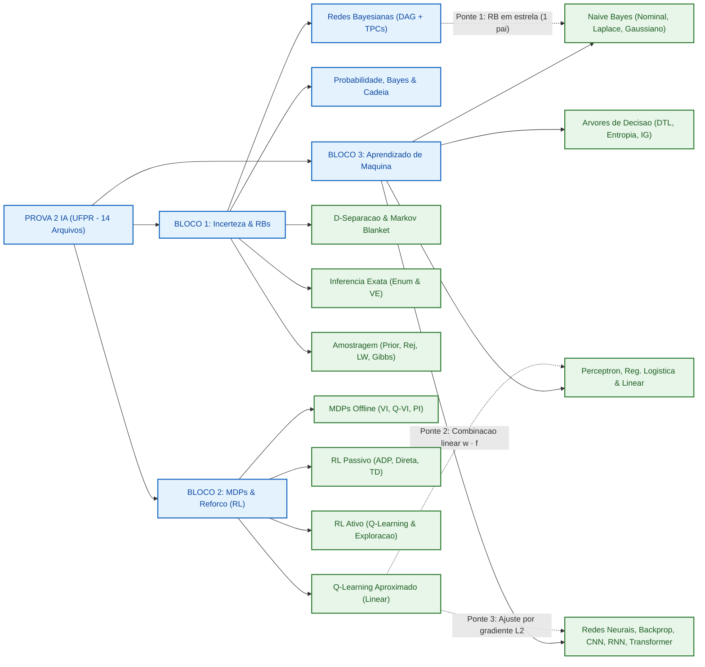
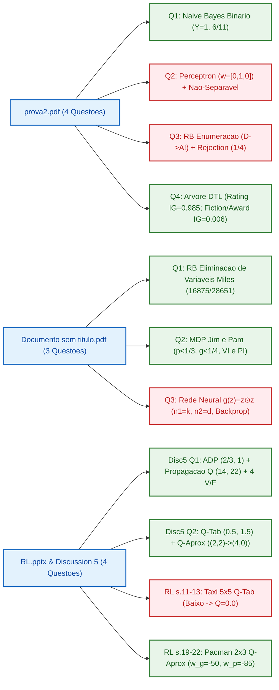

# Mapa Mental 00 — Visão Geral da Prova 2 (Arquitetura Global, Pontes, Decisão & Colisões)

> **Modo Cognitivo de Revisão:** Zero prosa longa · `**[Conceito]** → [Equação LaTeX] | [Gatilho / Complexidade] | ⚠️ [Armadilha]`

---

## 1. Arquitetura Global & Pontes Conceituais Entre os 3 Blocos

### Árvore das 3 Pontes Conceituais Entre Blocos
- **Ponte 1 — Modelos Gráficos $\leftrightarrow$ Classificação Generativa**
  - **Rede Bayesiana Geral (`Bloco 1`)** → $P(x_1,\dots,x_n) = \prod_{i=1}^n P(x_i \mid \text{Parents}(X_i))$ | DAG arbitrário, $O(n\cdot 2^k)$ params | ⚠️ Arestas codificam independência condicional
  - **Naïve Bayes (`Bloco 3`)** → $\Pr[H \mid E] = \alpha\,\Pr[H]\prod_{j=1}^n \Pr[E_j \mid H]$ | RB em estrela: classe $H$ é único pai de $E_1,\dots,E_n$ | ⚠️ Assume $E_i \perp\!\!\!\perp E_j \mid H$
- **Ponte 2 — Aproximação de Valor em RL $\leftrightarrow$ Classificadores Lineares**
  - **Q-Learning Aproximado (`Bloco 2`)** → $Q(s,a) = \sum_{i=1}^n w_i f_i(s,a) = w \cdot f(s,a)$ | Prediz utilidade contínua de par $(s,a)$ | ⚠️ Sofre aliasing se estados distintos têm mesmo $f$
  - **Perceptron / LogReg (`Bloco 3`)** → $\text{score}(x) = \sum_{i=0}^n w_i f_i(x) = w \cdot f(x)$ | Fronteira linear $w\cdot f(x) = 0$ com $f_0 = 1$ (viés) | ⚠️ Sem não-linearidade, só separa hiperplanos
- **Ponte 3 — Atualização por Erro / Gradiente ($\text{Alvo} - \text{Previsão}$)**
  - **Q-Learning Aproximado (`Bloco 2`)** → $w_i \leftarrow w_i + \alpha\,[r + \gamma\max_{a'} Q(s',a') - Q(s,a)]\,f_i(s,a)$ | Descida de gradiente em $\frac{1}{2}(\text{alvo} - Q)^2$ | ⚠️ Multiplica por $f_i(s,a)$ da **origem**!
  - **Perceptron R&N (`Bloco 3`)** → $\mathbf{w} \leftarrow \mathbf{w} + \alpha\,(y - h_{\mathbf{w}}(\mathbf{x}))\,\mathbf{x}$ | Passo discreto proporcional ao erro $(y-h) \in \{+1,-1,0\}$ | ⚠️ Não converge se dados não-separáveis
  - **Neurônio $L_2$ / Backprop (`Bloco 3`)** → $w_i \leftarrow w_i - \alpha\frac{\partial \mathcal{L}}{\partial w_i}$ vs. $w_i \leftarrow w_i + \alpha\frac{\partial ll}{\partial w_i}$ | Minimiza perda $\mathcal{L}$ ($-$) ou maximiza log-likelihood $ll$ ($+$) | ⚠️ Sinal depende de min vs. max!

---

## 2. Árvore Global de Decisão Rápida ("O Que a Prova Pede $\to$ Qual Método Usar?")

```mermaid
flowchart TD
    classDef base fill:#e3f2fd,stroke:#1565c0,stroke-width:2px,color:#0d47a1
    classDef algo fill:#e8f5e9,stroke:#2e7d32,stroke-width:2px,color:#1b5e20
    classDef fail fill:#fff3e0,stroke:#ef6c00,stroke-width:2px,color:#e65100
    classDef trap fill:#ffebee,stroke:#c62828,stroke-width:2px,color:#b71c1c

    Q["Qual e o tipo do problema na questao?"]:::base --> G1["Grafo DAG com CPTs (Rede Bayesiana)"]:::base
    Q --> G2["Estados, Acoes, Recompensas e Desconto gamma"]:::base
    Q --> G3["Tabela de Exemplos Rotulados (X -> Y)"]:::base
    Q --> G4["Equacoes Matriciais / Grafo com Pesos W1, W2"]:::base

    G1 --> G1A["Pede independencia pelo grafo? -> D-Separacao"]:::algo
    G1 --> G1B["Pede equacao de P(Q|e)? -> Enumeracao"]:::algo
    G1 --> G1C["Pede valor exato de P(Q|e)? -> Eliminacao de Variaveis"]:::algo
    G1 --> G1D["Da lista de amostras sorteadas? -> Rejection ou LW"]:::algo

    G2 --> G2A["Da T e R (MDP)? -> Serie Geometrica, VI ou PI"]:::algo
    G2 --> G2B["Da episodios fixos e pede T_hat, R_hat? -> ADP"]:::algo
    G2 --> G2C["Da episodios fixos e pede V(s)? -> Direta ou TD"]:::algo
    G2 --> G2D["Pede Q(s,a) ou novos pesos w_i? -> Q-Learning Tabular/Aprox"]:::algo

    G3 --> G3A["Pede melhor/pior atributo p/ raiz? -> Entropia & IG"]:::algo
    G3 --> G3B["Pede classificar novo X via probabilidades? -> Naive Bayes"]:::algo
    G3 --> G3C["Da vetor w inicial e pede iteracoes? -> Perceptron"]:::algo

    G4 --> G4A["Pede dimensoes n1, n2 e derivadas dL/dW? -> Regra da Cadeia / Backprop"]:::algo
```

### Árvore de Gatilhos Operacionais (1 Linha por Método)
- **Grafo de Rede Bayesiana (`Bloco 1`)**
  - **Gatilho "Calcule $P(Q \mid e)$ por enumeração"** → $P(Q\mid \mathbf{e}) = \frac{\sum_{\mathbf{h}} \prod_i P(x_i\mid \text{Pa}(X_i))}{\sum_q \sum_{\mathbf{h}} \prod_i P(x_i\mid \text{Pa}(X_i))}$ | Fatore **todas** as $n$ TPCs do grafo | ⚠️ Verifique a ponta de cada seta (`D -> A` em `prova2` Q3!)
  - **Gatilho "Calcule $P(Q \mid e)$ por eliminação de variáveis"** → `Select e` $\to$ loop $H$(`Join todos c/ H` $\to$ `Sum out H`) $\to$ `Join` $\to$ `Normalize` | Elimine 1 variável oculta por vez | ⚠️ Nunca drope priori $P(Z)$ nem some $H$ antes de juntar todos os fatores com $H$
  - **Gatilho "Calcule $P(Q \mid e)$ com *rejection sampling*"** → $\hat{P}(q\mid \mathbf{e}) = \frac{\text{count}(q, \mathbf{e})}{\text{count}(\mathbf{e})}$ | Risque amostras incompatíveis com $\mathbf{e}$ | ⚠️ Divida pelo nº de amostras **aceitas**, não pelo total!
  - **Gatilho "$X \perp\!\!\!\perp Y \mid E$?"** → Teste **todos** os caminhos não-direcionados entre $X$ e $Y$ | Cadeia/Causa comum: $B \in E$ bloqueia; V-estrutura ($A\to B\leftarrow C$): $B$ ou descendente $\in E$ **ativa** | ⚠️ 1 única tripla inativa bloqueia o caminho!
- **Decisão Sequencial — MDP & RL (`Bloco 2`)**
  - **Gatilho "Compare Política 1 vs. Política 2 ($\gamma$ dado)"** → $V^\pi(s) = \sum_{s'} T(s,\pi(s),s')[R + \gamma V^\pi(s')]$ e $S = \frac{a}{1-\gamma}$ | Resolva o valor infinito de descanso primeiro | ⚠️ No lookahead de 1 passo, use $V_{\text{inf}}(s')$, não $R(s')$!
  - **Gatilho "Faça $k$ iterações de Iteração de Valor"** → $V_{k+1}(s) = \max_a \sum_{s'} T(s,a,s')[R(s,a,s') + \gamma V_k(s')]$ | Inicialize $V_0(s)=0$ | ⚠️ Atualização síncrona: $V_{k+1}$ usa exclusivamente a linha $V_k$!
  - **Gatilho "Faça $k$ iterações de Iteração de Política"** → (1) $V^{\pi_i}(s)$ **exato** até $\infty$; (2) $\pi_{i+1}(s) = \arg\max_a \sum_{s'} T[R + \gamma V^{\pi_i}(s')]$ | Sem $\max$ no passo 1 (sistema linear) | ⚠️ Não faça apenas 1 passo no passo 1 — resolva até o infinito!
  - **Gatilho "Atualize Q-Table / Q-Learning"** → $\text{sample} = r + \gamma\max_{a'} Q(s',a')$; $\;Q(s,a) \leftarrow (1-\alpha)Q(s,a) + \alpha\cdot\text{sample}$ | Olhe $\max_{a'}$ no estado **seguinte** $s'$ | ⚠️ Respeite a ordem temporal das amostras (`disc5` Q2a)!
  - **Gatilho "Atualize pesos $w_i$ (Q-Learning Aproximado)"** → $\text{diff} = [r + \gamma\max_{a'} Q(s',a')] - Q(s,a)$; $\;w_i \leftarrow w_i + \alpha\cdot\text{diff}\cdot f_i(s,a)$ | $Q(s,a) = \sum_i w_i f_i(s,a)$ | ⚠️ Multiplique por $f_i(s,a)$ da **origem** e recalcule $\max Q(s',a')$ com os **novos pesos** na amostra 2!
- **Aprendizado de Máquina & Redes Neurais (`Bloco 3`)**
  - **Gatilho "Melhor / pior atributo para raiz da árvore"** → $IG(A) = I(\frac{p}{p+n},\frac{n}{p+n}) - \sum_{i=1}^v \frac{p_i+n_i}{p+n} I(\frac{p_i}{p_i+n_i},\frac{n_i}{p_i+n_i})$ | Melhor = máx $IG$ (mín `remainder`); Pior = mín $IG$ | ⚠️ Ramo puro tem $I=0$; ramo 50/50 tem $I=1$; use $\log_2$!
  - **Gatilho "Classifique novo exemplo com Naïve Bayes"** → $\Pr[H=h\mid E] = \frac{\Pr[h]\prod_j \Pr[E_j\mid h]}{\sum_{h'} \Pr[h']\prod_j \Pr[E_j\mid h']}$ | Condicional divide por $\text{count}(H=h)$ | ⚠️ Nunca esqueça a priori $\Pr[h]$; se contagem $=0$, use Laplace $\frac{c+1}{N_h+v}$!
  - **Gatilho "Execute Perceptron + discuta separabilidade"** → Prediz $+1$ se $w\cdot f(x) \ge 0$, senão $-1$; erro $\implies w \leftarrow w + y^* f(x)$ | Confira posição do bias (`[1,x1,x2]` vs `[x1,x2,1]`) | ⚠️ Se ponto `+` é combinação convexa de pontos `-`, **não** é linearmente separável!
  - **Gatilho "Dimensões de $W_1, W_2$ e derivadas $\partial \mathcal{L}/\partial W_2, \partial \mathcal{L}/\partial x$"** → $z = W_1 x \implies W_1 \in \mathbb{R}^{k\times d}$; aplique Regra da Cadeia | Derive componente a componente e converta p/ matriz | ⚠️ Se o enunciado proíbe $g'$, substitua explicitamente (ex.: $g(z)=z\odot z \implies 2z$)!

---

## 3. Mapa de Incidência nas Provas Anteriores & Lista Resolvida

---

## 4. Matriz Completa de Colisões de Símbolos e Traduções dos Slides

| Símbolo / Termo | Significado no Bloco 1 (RBs) | Significado no Bloco 2 (MDP/RL) | Significado no Bloco 3 (AM/RN) | ⚠️ Regra Anti-Confusão |
| :--- | :--- | :--- | :--- | :--- |
| **$\alpha$** | Constante de normalização $\alpha = \frac{1}{Z} = \frac{1}{P(\mathbf{e})}$ | Taxa de aprendizado $\alpha \in [0,1]$ (TD / Q-Learning) | Taxa de aprendizado $\alpha$ (Perceptron R&N / Gradiente) | Em RB: divide soma; em RL/AM: pondera passo de atualização |
| **$w$ / $\mathbf{w}$** | Peso da amostra $w = \prod P(e_i\mid\text{Pa})$ (*Likelihood Weighting*) | Vetor de pesos $Q(s,a) = \sum w_i f_i(s,a)$ | Vetor de pesos lineares / matrizes $W_1, W_2$ | Em `RB5`: $w$ é escalar por amostra; em RL/AM: parâmetros aprendidos |
| **$H$** | Variáveis ocultas $H_1\dots H_r$ (*Hidden*) | — | Espaço de hipóteses $f \in H$ (`ML I`) **OU** Classe $H$ (`NB`) | Em `naivebayes.pdf` p.5: $\Pr[H\mid E]$ tem $H$ = classe e $E$ = atributos! |
| **$E$** | Variáveis de evidência $E_1\dots E_k$ (*Evidence*) | Estado `E` no gridworld 5-estados | Conjunto de treino $E$ (`DTL`) **OU** Instância $E$ (`NB`) | Em `Bayes.pptx`: $E$ também é *Earthquake* (Terremoto)! |
| **$k$** | Nº máx. de pais ($O(n2^k)$) **OU** nº de vars em fator ($d^k$) | Constante de bônus $f(u,n)=u+\frac{k}{n}$ **OU** passo $V_k$ | Laplace $k$ **OU** margem $\frac{k}{\delta^2}$ **OU** camada $z^{(k)}$ **OU** dim $W_2 \in \mathbb{R}^k$ | Leia a definição local de $k$ no enunciado antes de aplicar fórmula |
| **$\mu$** | — | — | Suavização $\frac{c+\mu/v}{N+\mu}$ (`NB` p.13) **OU** Média $\frac{1}{n}\sum x_i$ (`NB` p.15) **OU** Medida $L^p(\mu)$ (`RN` p.11) | Mesmo PDF (`naivebayes.pdf`) usa $\mu$ em dois sentidos a 2 páginas de distância! |
| **$g(\cdot)$** | — | — | Função de ativação $g(z)$ **OU** Objetivo $g(w)$ **OU** Grafo $g(w_1,w_2,w_3)$ | Em `doc` Q3: $g(z) = z\odot z$ (ativação); em `perc` p.46: $\nabla_w g(w)$ (objetivo) |
| **$Q(s,a)$ vs. $Q(a,s)$** | — | CS188: $Q(s,a)$ · R&N (`ar2` p.23): **$Q(a,s)$** | $Q, K, V$ = *Queries, Keys, Values* no Transformer (`RN` p.25) | Em toda questão prática UFPR/CS188 usa-se $Q(s,a)$ |
| **$W_{i,j}^{(k-1,k)}$ vs. $w_{i,j}$** | — | — | McCulloch–Pitts (`perc` p.22): $i\to j$ · DNN (`RN` p.6): **$j\to i$** | Em forma matricial $z^{(k)} = g(W z^{(k-1)})$, linha $i$ = destino, coluna $j$ = origem |
| **Traduções Literais PT** | *Adesão/Junção* = Join · *Resumir* = Sum out · *Provas* = Evidence · *Articulação* = Joint · *Tubos de raios catódicos* = CPTs · *Condicionamento de corte* = Cutset · *Número de capitais* = Nº maiúsculas | *Aproveitamento / Intensificação / Explotação* = Exploitation · `s e S, p, g, e` (fonte Symbol) = $s\in S, \pi, \gamma, \epsilon$ | *Sobreajuste / Overtraining* = Overfitting · *Os pesos podem ser distorcidos* = Thrashing · *Probabilidade de logaritmo* = Log-likelihood | Reconheça imediatamente nos enunciados traduzidos dos slides CS188! |

---

## 5. Checklist de Reconhecimento em 5 Segundos (Visão Geral da Prova)

| Se a prova mostrar... | Faça imediatamente... | ⚠️ Cuidado com... |
| :--- | :--- | :--- |
| Grafo DAG + pedido de equação de $P(Q \mid e)$ | Escreva $\frac{\sum_{\mathbf{h}} \prod_i P(x_i\mid \text{Pa}(X_i))}{\sum_q \sum_{\mathbf{h}} \prod_i P(x_i\mid \text{Pa}(X_i))}$ usando **todas** as $n$ TPCs | Direção das setas (`D -> A` para cima em `prova2` Q3!) e não inventar condicionais fora das TPCs |
| Grafo DAG + TPCs com frações + "Eliminação de Variáveis" | Instancie evidência $e$, depois repita: `Join todos fatores c/ H` $\to$ `Sum out H`, normalize no fim | Jamais descartar priori $P(A)$ ou $P(C)$ e jamais somar $H$ antes de multiplicar todos os fatores que têm $H$ |
| MDP com $R(d) = 4^{5-d}$ ou políticas fixas vs. $\gamma, p$ | Calcule $V_{\text{rest}}(s) = \frac{R(s)}{1-\gamma}$ primeiro; monte $V^\pi(1)$ com valor esperado do 1º passo | No passo $t=1$, multiplicar $p$ pelo valor **infinito** $V_{\text{rest}}(s')$, nunca pela recompensa de 1 passo $R(s')$! |
| Tabela de Iteração de Valor ($V_1, V_2$) vs. Iteração de Política ($V^{\pi_i}, \pi_{i+1}$) | Em VI: 1 passo síncrono usando $V_k$; em PI: resolva $V^{\pi_i}$ **até o infinito** ($\frac{a}{1-\gamma}$ ou sistema linear) | Confundir avaliação de política (infinita, linear) com 1 passo de VI (finita, tem $\max$) |
| Transições $(s,a,s',r)$ + features $f_i(s,a)$ + pesos $w_i$ | Calcule $Q(s,a)$, $\max_{a'} Q(s',a')$, $\text{diff} = [r+\gamma\max Q(s',a')] - Q(s,a)$, e $w_i \leftarrow w_i + \alpha\cdot\text{diff}\cdot f_i(s,a)$ | Usar $f_i(s,a)$ da **origem** (nunca $s'$) e **recalcular** $\max_{a'} Q(s',a')$ com os **novos pesos** na 2ª amostra! |
| Tabela de exemplos $(X_1, X_2, Y)$ + Naïve Bayes | Calcule $P(Y=y)\prod_j P(X_j=x_j\mid Y=y)$ para cada classe $y$ e normalize pela soma $Z$ | Dividir $P(X_j\mid Y=y)$ pelo total da classe $y$ (não por $N$!) e nunca esquecer de multiplicar pela priori $P(Y=y)$ |
| Tabela $(x_1, x_2, \text{Label})$ + Perceptron + pergunta sobre peso perfeito | Rode $w \leftarrow w + y^* f(x)$ apenas quando errar; plote os pontos 2D para testar separabilidade linear | Posição do bias no vetor $w$ (`[x1,x2,1]` em `prova2` Q2 vs. `[1,f1,f2]` no slide 19) e provar não-separabilidade por combinação convexa |
| Rede Neural matricial $z=W_1 x, \hat{y}=W_2^T g(z)$ + derivadas $\frac{\partial \mathcal{L}}{\partial W_2}, \frac{\partial \mathcal{L}}{\partial x}$ | Case dimensões ($W_1 \in \mathbb{R}^{k\times d}$); aplique cadeia $\frac{\partial \mathcal{L}}{\partial \hat{y}} = (\hat{y}-y)$ componente a componente e vetorize | Respeitar restrição *"NÃO incluir $g'$"* substituindo a derivada explícita (para $g(z)=z\odot z$, $\frac{\partial g(z)_i}{\partial z_i} = 2z_i$)! |
