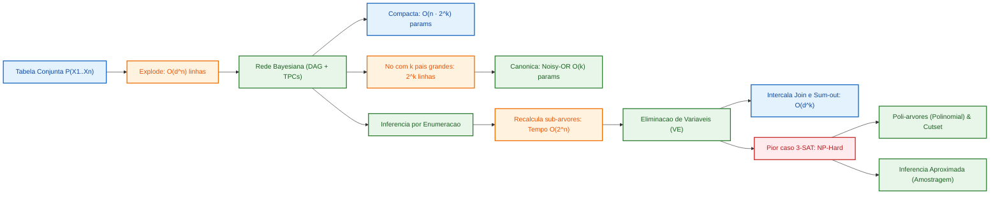
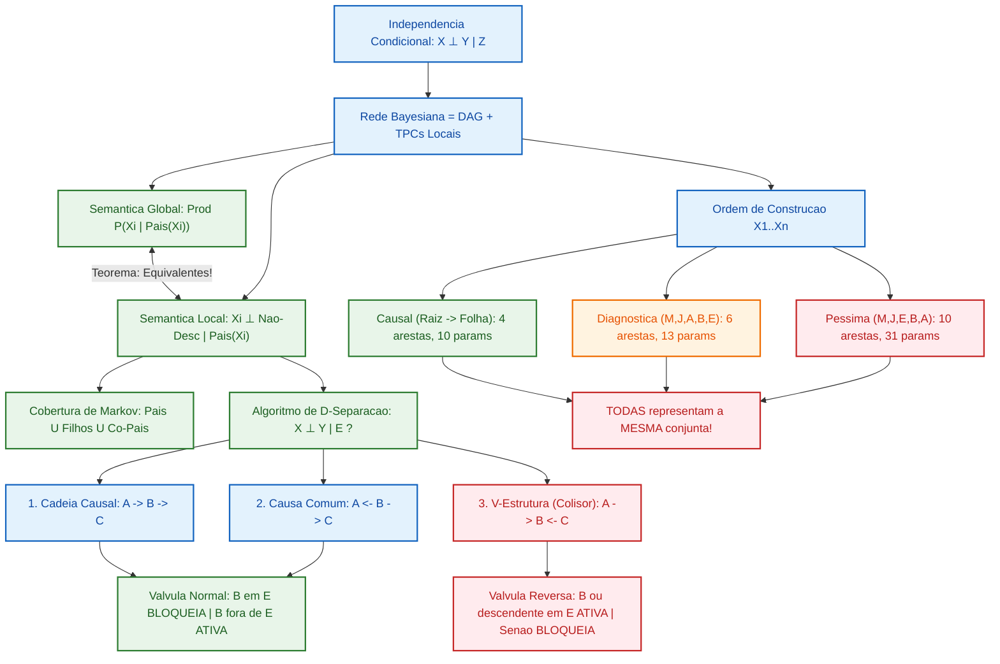
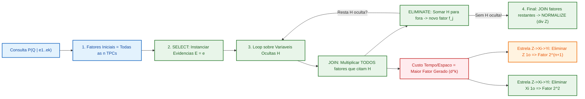

# Mapa Mental 01 — Incerteza, Probabilidade e Redes Bayesianas

> **Fontes 100% Cobertas:** `incerteza.pdf` (30p) · `Bayes.pptx` (44s) · `cs188-fa26-lec13.pdf` (42p) · `naivebayes.pdf` Parte B (pp. 19–52: D-Separação) · `RB4.pptx` (40s, incl. ocultos 18 e 34) · `RB5.pptx` (28s, incl. ocultos 4 e 26).
> **Padrão Cognitivo:** `**[Conceito]** → [Equação LaTeX] | [Gatilho / Complexidade] | ⚠️ [Armadilha ou Errata]`

---

## 1. Cadeia Causal de Evolução — Por Que Cada Método Nasce do Limite do Anterior?

### Árvore de Equações 1.1 — Fundamentos de Probabilidade & Inferência na Conjunta (`incerteza.pdf`, `lec13`)
- **Variáveis Aleatórias & Distribuições**
  - **Convenção Tipográfica** → Maiúscula $X, W, Q$ = variável não observada (tabela) · Minúscula $x, +x, -x$ = valor fixo (escalar) | Booleano: $\{+x,-x\} \equiv \{x,\neg x\} \equiv \{\text{T},\text{F}\}$ | ⚠️ Abreviação $P(\text{hot}) = P(T=\text{hot})$ só vale se domínios forem disjuntos
  - **Axiomas de Probabilidade** → $\forall x:\; P(X = x) \ge 0 \quad \text{e} \quad \sum_{x} P(X = x) = 1$ | Toda distribuição (ou condicional para valor fixo dos pais) soma $1$ | ⚠️ Exemplo `incerteza` p.4 inclui `meteor: 0.0` (válido!)
  - **Distribuição Conjunta (*Joint*)** → $P(X_1=x_1, \dots, X_n=x_n) = P(x_1, \dots, x_n)$ | $n$ variáveis de domínio $d \implies$ **$d^n$ desfechos (*outcomes*)** ($O(d^n)$ tempo e espaço) | ⚠️ Conjunta indica *probabilidade* (soma $1$); CSP indica *possibilidade* (`T`/`F`)
  - **Modelos Probabilísticos (George Box)** → *"All models are wrong; but some are useful"* (`lec13` p.9) | Usos: **Explicação/Diagnóstico** (sintoma $\to$ causa), **Previsão/Causal** (causa $\to$ efeito), **Valor da Informação** | ⚠️ Sempre simplificações do mundo real
  - **Probabilidade de Evento** → $P(E) = \sum_{(x_1 \dots x_n) \in E} P(x_1 \dots x_n)$ | Soma todas as linhas da conjunta compatíveis com a atribuição parcial $E$ | ⚠️ $P(-y \text{ OR } +x) = 1 - P(-x, +y)$
- **As 4 Operações Algébricas Fundamentais**
  - **Marginalização (*Summing Out*)** → $P(X_1 = x_1) = \sum_{x_2} P(X_1 = x_1, X_2 = x_2)$ | Colapsa/elimina variáveis ocultas somando sobre todo o domínio delas | ⚠️ Errata `incerteza` p.10: usa letra $s$ como variável muda para $W \in \{\text{sun},\text{rain}\}$
  - **Probabilidade Condicional** → $P(a \mid b) = \frac{P(a, b)}{P(b)}$ | Razão entre a interseção $P(a,b)$ e a evidência $P(b) > 0$ | ⚠️ Uma família $P(W \mid T)$ contém $|T|$ distribuições separadas (cada uma soma $1$)
  - **Truque da Normalização** → $P(X \mid Y = y) = \frac{1}{Z}\,P(X, y) = \alpha\,P(X, y), \quad Z = \sum_{x} P(x, y) = P(y)$ | Passo 1 (`SELECT`): filtre linhas c/ $Y=y$ · Passo 2 (`NORMALIZE`): divida pela soma $Z$ | ⚠️ Evita calcular $P(y)$ separadamente!
  - **Inferência por Enumeração na Conjunta** → $P(Q \mid e_1 \dots e_k) = \frac{1}{Z} \sum_{h_1 \dots h_r} P(Q, h_1 \dots h_r, e_1 \dots e_k)$ | Partição disjunta: Consulta $Q$, Evidência $E_1\dots E_k$, Ocultas $H_1\dots H_r$ | ⚠️ Complexidade: Tempo $O(d^n)$ e Espaço $O(d^n)$
- **Regra do Produto, Regra da Cadeia & Regra de Bayes**
  - **Regra do Produto** → $P(x, y) = P(y)\,P(x \mid y) = P(x)\,P(y \mid x)$ | Constrói conjunta a partir de marginal + condicional | ⚠️ Errata `incerteza` pp.25,30 / `lec13` p.7: cabeçalho de $P(W)$ impresso como `R` (`0.08, 0.72, 0.14, 0.06`)
  - **Regra da Cadeia (*Chain Rule*)** → $P(x_1, x_2, \dots, x_n) = \prod_{i=1}^{n} P(x_i \mid x_1, \dots, x_{i-1})$ | Sempre exata para **qualquer** distribuição e **qualquer** ordenação de variáveis | ⚠️ Prova: aplicação telescópica repetida da Regra do Produto
  - **Regra de Bayes** → $P(x \mid y) = \frac{P(y \mid x)\,P(x)}{P(y)} = \frac{P(y \mid x)\,P(x)}{\sum_{x'} P(y \mid x')\,P(x')}$ | Inverte condicional: calcula **diagnóstica** $P(\text{causa}\mid\text{efeito})$ via **causal** $P(\text{efeito}\mid\text{causa})$ | ⚠️ Nunca esqueça de multiplicar pelos priors $P(x')$ no denominador!
  - **Exemplos Canônicos de Bayes** → Meningite $P(+m\mid +s) = \frac{0.8 \times 0.0001}{0.8 \times 0.0001 + 0.01 \times 0.9999} \approx 0.00794 \approx 0.008$ · Clima $P(W\mid \text{dry}) = \langle \frac{12}{13}, \frac{1}{13}\rangle$ | Mesmo c/ $P(+m\mid +s) \approx 0.8\%$, risco médico exige ação (utilidade esperada) | ⚠️ Errata `incerteza` p.29: imprime `0.999` em vez de `0.9999`

---

## 2. Sub-Mapa Visual — Redes Bayesianas, Semântica, Construção & D-Separação

### Árvore de Equações 2.1 — Independência, Sintaxe, Semântica & Distribuições Canônicas (`lec13`, `Bayes.pptx`)
- **Independência Absoluta vs. Condicional**
  - **Independência Absoluta ($X \perp\!\!\!\perp Y$)** → $\forall x,y:\; P(x,y) = P(x)\,P(y) \iff \forall x,y:\; P(x \mid y) = P(x)$ | Grafo sem arestas (ex.: $N$ moedas justas $\to N$ tabelas de 2 linhas vs. $2^N$) | ⚠️ Rara no mundo real; teste checando se $P(x,y) = P(x)P(y)$ em cada célula
  - **Independência Condicional ($X \perp\!\!\!\perp Y \mid Z$)** → $\forall x,y,z:\; P(x,y \mid z) = P(x \mid z)\,P(y \mid z) \iff P(x \mid y,z) = P(x \mid z)$ | Forma mais robusta de conhecimento incerto | ⚠️ Exemplos: `Toothache ⊥ Catch | Cavity` · `Traffic ⊥ Umbrella | Rain` · `Fire ⊥ Alarm | Smoke`
  - **Cadeia + Independência Condicional** → $P(T, R, U) = P(R)\,P(T \mid R)\,P(U \mid R)$ (dado $U \perp\!\!\!\perp T \mid R$) | Ghostbusters (`lec13` p.20, $T \perp\!\!\!\perp B \mid G$): $P(T,B,G) = P(G)P(T\mid G)P(B\mid G)$ | ⚠️ Reduz drasticamente o tamanho das tabelas locais
- **Sintaxe, Tamanho & Semântica das Redes Bayesianas**
  - **Sintaxe Formal (`Bayes` s.3)** → (1) Um nó por variável $X_i$; (2) **DAG** (grafo direcionado acíclico); (3) **TPC/CPT** $\mathbf{P}(X_i \mid Pais(X_i))$ por nó | Cada linha da TPC = 1 *caso de condicionamento* (combinação dos pais) | ⚠️ Probabilidades resumem fatores omitidos (*"Preguiça e ignorância"*, `Bayes` s.7)
  - **Complexidade de Espaço** → Conjunta booleana: $2^n$ entradas ($2^n-1$ params) · RB c/ máx. $k$ pais: **$O(n \cdot 2^k)$** params (`Bayes` s.10) / **$O(N \cdot 2^{k+1})$** entradas (`lec13` p.41) | Cresce **linearmente** com $n$! Rede do Alarme ($n=5, k=2$): $1+1+4+2+2 = \mathbf{10}$ params vs. $31$ | ⚠️ $2^k$ guarda só $P(+x\mid \cdot)$; $2^{k+1}$ lista linhas $+x$ e $-x$
  - **Semântica Global (Numérica)** → $P(x_1, \dots, x_n) = \prod_{i=1}^{n} P\big(x_i \mid \text{Parents}(X_i)\big)$ | Indica como **construir** a rede e **calcular** qualquer entrada conjunta | ⚠️ Errata `Bayes` s.12: escreve *"produtório de todas as entradas conjuntas"* (o correto é **soma** das entradas conjuntas, cada uma sendo o produtório das TPCs!)
  - **Prova de Validade da Conjunta (`lec13` p.34)** → Ordene topologicamente $\to$ Regra da Cadeia $\prod_i P(x_i\mid x_1\dots x_{i-1})$ $\to$ aplique $P(x_i\mid x_1\dots x_{i-1}) = P(x_i\mid \text{Parents}(X_i))$ | Garante $P \ge 0$ e $\sum P = 1$ | ⚠️ Exemplos Alarme: $P(j,m,a,\neg b,\neg e) = 0.9(0.7)(0.001)(0.999)(0.998) \approx 0.00063$ · $P(+b,-e,+a,-j,+m) = 0.001(0.998)(0.94)(0.1)(0.7) \approx 0.00006567$
  - **Semântica Local (Topológica)** → $X_i \perp\!\!\!\perp \text{Não-Descendentes}(X_i) \mid \text{Pais}(X_i)$ | Indica como **inferir**; equivalente à Semântica Global (`Bayes` s.18) | ⚠️ Não-descendentes excluem filhos, netos, etc., mas incluem avós, tios e co-pais!
  - **Cobertura de Markov (*Markov Blanket*)** → $\text{MB}(X) = \text{Pais}(X) \cup \text{Filhos}(X) \cup \text{Outros pais dos filhos}(X)$ | $X \perp\!\!\!\perp (\text{toda a rede} \setminus (\{X\}\cup \text{MB}(X))) \mid \text{MB}(X)$ | ⚠️ Base da reamostragem local eficiente no Gibbs Sampling (`RB5` s.26 oculto)!
- **Construção, Ordenação & Distribuições Canônicas**
  - **Algoritmo de Construção (`Bayes` s.19)** → Para $i=1\dots n$: escolha conjunto minimal $Pais(X_i) \subseteq \{X_1,\dots,X_{i-1}\}$ tal que $\mathbf{P}(X_i\mid Pais(X_i)) = \mathbf{P}(X_i\mid X_1,\dots,X_{i-1})$ | Regra de ouro: **causas de raiz $\to$ folhas** | ⚠️ Errata `Bayes` s.19: imprime *"pais para $X_1\dots X_{i-1}$"* (leia *"dentre"*)
  - **Impacto da Ordem (Alarme & Tráfego)** → `B,E,A,J,M` (4 arestas, 10 params) vs. `M,J,A,B,E` (6 arestas, 13 params, força `B->E` por *explaining away*) vs. `M,J,E,B,A` (DAG completo, 10 arestas, 31 params) | Tráfego Causal $R\to T$ e Reverso $T\to R$ geram a mesma conjunta $\langle \frac{3}{16},\frac{1}{16},\frac{6}{16},\frac{6}{16}\rangle$ | ⚠️ **Teorema:** Todas representam a **mesma** conjunta; ordens ruins apenas perdem independências!
  - **Nós Determinísticos (`Bayes` s.35)** → $X = f(Pais(X))$ | Zero incerteza (`1.0` no valor de $f$, `0.0` nos demais); ex.: `NorteAmericano <=> Canadense v EUA v Mexicano`, $\Delta\text{nível} = \text{afluentes} - \text{escoadouros}$ | ⚠️ Símbolo $\Delta$ extraído como `D` em texto puro
  - **Ou-Ruidoso (*Noisy-OR*, `Bayes` ss.36–37)** → $P(\neg y \mid x_1,\dots,x_k) = \prod_{\{i \,:\, x_i = \text{T}\}} q_i, \quad P(y \mid x_1,\dots,x_k) = 1 - \prod_{\{i \,:\, x_i = \text{T}\}} q_i$ | Suposições: (1) todas causas listadas ($P(y\mid \text{todos F})=0$); (2) inibições $q_i = P(\neg y\mid \text{só } x_i=\text{T})$ independentes | ⚠️ Reduz TPC de $O(2^k)$ para **$O(k)$** params! (`Cold=0.6, Flu=0.2, Malaria=0.1 -> Fever`: `(T,T,T)` dá $1 - 0.6(0.2)(0.1) = 0.988$)

### Árvore de Equações 2.2 — D-Separação & Restrições Topológicas (`naivebayes.pdf` Parte B, pp. 19–52)
- **As 3 Triplas Canônicas & Prova Algébrica**
  - **Provar vs. Refutar Independência (`nb` p.31)** → Para provar **SIM**: álgebra ou d-separação · Para provar **NÃO**: basta **1 contraexemplo de TPCs** | Independência garantida é propriedade da topologia | ⚠️ Errata de tradução `nb` pp.35–38: `CPTs` traduzido como *"tubos de raios catódicos"*!
  - **Tripla 1 — Cadeia Causal ($X \to Y \to Z$)** → $P(x,y,z) = P(x)P(y\mid x)P(z\mid y) \implies P(z\mid x,y) = \frac{P(x)P(y\mid x)P(z\mid y)}{P(x)P(y\mid x)} = P(z\mid y)$ | Sem observar $Y$: ativa ($X \not\perp\!\!\!\perp Z$) · **$Y$ observado: bloqueada ($X \perp\!\!\!\perp Z \mid Y$)** | ⚠️ Contraexemplo sem $Y$: TPCs determinísticas `P(+y|+x)=1, P(+z|+y)=1`
  - **Tripla 2 — Causa Comum ($X \leftarrow Y \to Z$)** → $P(x,y,z) = P(y)P(x\mid y)P(z\mid y) \implies P(x,z\mid y) = \frac{P(y)P(x\mid y)P(z\mid y)}{P(y)} = P(x\mid y)P(z\mid y)$ | Sem observar $Y$: ativa ($X \not\perp\!\!\!\perp Z$) · **$Y$ observado: bloqueada ($X \perp\!\!\!\perp Z \mid Y$)** | ⚠️ Ex.: `ProjectDue -> {ForumsBusy, LabFull}`
  - **Tripla 3 — Efeito Comum / V-Estrutura ($X \to Z \leftarrow Y$)** → $P(x,y,z) = P(x)P(y)P(z\mid x,y) \implies \sum_z P(x,y,z) = P(x)P(y)\sum_z P(z\mid x,y) = P(x)P(y)$ | **Sem observar $Z$ (nem descendentes): bloqueada ($X \perp\!\!\!\perp Y$)** · **$Z$ ou descendente observado: ATIVA ($X \not\perp\!\!\!\perp Y \mid Z$)** | ⚠️ *Explaining away*: observar efeito ou descendente coloca causas em competição!
- **Algoritmo Formal de D-Separação & Diagrama de Venn**
  - **Regra de Caminho Ativo (`nb` pp.42–44)** → Um caminho não-direcionado entre $X_i$ e $X_j$ é **ATIVO** $\iff$ **TODAS** as suas triplas são ativas | **Basta 1 única tripla inativa para bloquear o caminho inteiro!** | ⚠️ Todos os caminhos inativos $\implies X_i \perp\!\!\!\perp X_j \mid \{X_{k_1}\dots X_{k_n}\}$ (d-separados)
  - **Diagrama de Venn de Topologias de 3 Nós (`nb` pp.49–50)** → Grafo vazio (0 arestas: 6 indep.) $\subset$ 3 grafos equivalentes de 2 arestas ($X\leftarrow Y\to Z \equiv X\to Y\to Z \equiv X\leftarrow Y\leftarrow Z$: garantem $\{X\perp\!\!\!\perp Z\mid Y\}$; já V-estrutura $X\to Y\leftarrow Z$ garante $\{X\perp\!\!\!\perp Z\}$) $\subset$ 6 DAGs completos (3 arestas: $\{\}$, codificam **qualquer** conjunta) | **Adicionar arestas** expande o conjunto de distribuições representáveis | ⚠️ Uma distribuição específica pode ter independências extras não visíveis só pelo grafo!

---

## 3. Sub-Mapa Visual — Inferência Exata (Enumeração, Factor Zoo, VE & Complexidade)

### Árvore de Equações 3.1 — Enumeração, Factor Zoo, VE & NP-Hardness (`Bayes` ss. 38–44; `RB4.pptx`)
- **Tipos de Consulta & Inferência por Enumeração**
  - **Posterior vs. MAP (`RB4` s.7)** → Posterior: $P(Q \mid E_1=e_1,\dots,E_k=e_k)$ · Explicação Mais Provável (MAP): $\arg\max_q P(Q=q \mid E_1=e_1,\dots)$ | Partição: Consulta $Q$, Evidência $\mathbf{E}=\mathbf{e}$, Ocultas $\mathbf{H}$ | ⚠️ MAP retorna o *valor* $q$, Posterior retorna a *distribuição*
  - **Equação de Enumeração em RB (`Bayes` s.39, `RB4` s.9)** → $P(Q \mid \mathbf{e}) = \alpha \sum_{\mathbf{h}} \prod_{i=1}^{n} P\big(x_i \mid \text{Parents}(X_i)\big) \propto_Q P(Q, \mathbf{e})$ | `ENUMERATION-ASK` / `ENUMERATE-ALL` percorre variáveis em ordem topológica (DFS) | ⚠️ Espaço $O(n)$, Tempo **$O(2^n)$** (repete sub-expressões; erratas `Bayes` s.40 omite $P(e)$ e s.41 repete $P(j\mid a)P(m\mid a)$ sem $\neg a$)
- **Zoológico de Fatores (*Factor Zoo*, `RB4` ss. 12–16)**
  - **Regra de Dimensionalidade** → Fator $P(Y_1\dots Y_N \mid X_1\dots X_M)$: **nº de letras MAIÚSCULAS = dimensão da tabela** | Letras minúsculas = valores fixados (dimensão fatiada/removida) | ⚠️ Após operações, fatores intermediários $f_j$ não precisam ser distribuições normalizadas!
  - **Quanto Somam as Entradas de Cada Fator?** →
    - **I. Conjunta $P(X, Y)$** → $\sum_{x,y} P(x,y) = \mathbf{1}$
    - **I. Conjunta Selecionada $P(x, Y)$** → $\sum_y P(x,y) = \mathbf{P(x)}$
    - **II. Condicional Única $P(Y \mid x)$** → $\sum_y P(y\mid x) = \mathbf{1}$
    - **II. Família de Condicionais $P(X \mid Y)$** → $\sum_{x,y} P(x\mid y) = \mathbf{|Y|}$ (nº de valores de $Y$)
    - **III. Família Especificada $P(y \mid X)$** → $\sum_x P(y\mid x) = \textbf{quem sabe!}$ (ex.: $P(\text{rain}\mid T)$ soma $0.8$)
- **Algoritmo de Eliminação de Variáveis (VE) & Essência Algébrica**
  - **Lei Distributiva (`RB4` s.35)** → $uwy + uwz + uxy + uxz + vwy + vwz + vxy + vxz = (u+v)(w+x)(y+z)$ | Intercala **Join** (produto pontual $\forall r,t: P(r,t)=P(r)P(t\mid r)$) e **Eliminate** (marginalização $\sum_h$) | ⚠️ **Regra de Ouro:** Jamais some $H$ antes de fazer *Join* de **TODOS** os fatores ativos que mencionam $H$ (incluindo priors $P(H)$)!
  - **Exemplos Resolvidos dos Slides (`RB4`)** →
    - Tráfego $R\to T\to L$: $P(L) = \sum_t P(L\mid t)\sum_r P(r)P(t\mid r) \implies f_1(T)=\langle 0.17, 0.83\rangle \implies P(L)=\langle +l:0.134, -l:0.866\rangle$ | Com evidência $+r$: $P(+r,L)=\langle 0.026, 0.074\rangle \xrightarrow{Z=0.10} P(L\mid +r)=\langle 0.26, 0.74\rangle$ | ⚠️ Errata `RB4` s.24 imprime `-l: 0.886` (corrigido p/ `0.866` no s.28)
    - Slide Oculto 34 ($B\to A$, consulta $P(B\mid a)$): $P(B)=\langle 0.1, 0.9\rangle$, $P(a\mid B)=\langle 0.8, 0.1\rangle \xrightarrow{\text{Join}} P(a,B)=\langle 0.08, 0.09\rangle \xrightarrow{Z=0.17} \langle \frac{8}{17}, \frac{9}{17}\rangle$
    - Alarme $P(B\mid j,m)$ (`RB4` ss.32–35): Elimina $A \to f_1(B,E,j,m) = \sum_a P(a\mid B,E)P(j\mid a)P(m\mid a)$ $\to$ Elimina $E \to f_2(B,j,m) = \sum_e P(e)f_1(B,e,j,m)$ $\to$ Join $P(B)f_2(B,j,m)$ & Normaliza
- **Ordem de Eliminação, Redução 3-SAT & Poli-árvores (`RB4` ss. 36–40, `RB5` ss. 3–4)**
  - **Complexidade de VE** → Tempo e espaço determinados pelo **maior fator gerado** ($d^k$ entradas p/ $k$ variáveis livres de domínio $d$) | Na estrela $Z \to X_{1\dots n} \to Y_{1\dots n}$: ordem $Z, X_1\dots X_{n-1}$ gera fator **$2^{n+1}$** (pós-soma **$2^n$**); ordem $X_1\dots X_{n-1}, Z$ gera fator **$2^2$** (pós-soma **$2$**) | ⚠️ Achar ordem de eliminação ótima é **NP-Completo** (`Bayes` s.44)
  - **Redução Polinomial de 3-SAT para RB (`RB4` s.39, `RB5` s.4 oculto)** → Raízes $X_1\dots X_7$ c/ $P(X_i=0)=P(X_i=1)=0.5$ $\to$ Cláusulas $Y_1\dots Y_8$ c/ OR determinístico (3 pais, TPC $2^4=16$) $\to$ Árvore binária AND ($Y_{1,2}\dots \to Z$, 2 pais, TPC $2^3=8$) | 3-SAT é satisfatível $\iff P(Z=1) > 0$ | ⚠️ Prova que inferência exata e aproximada geral em RBs é **NP-Hard (*NP-duro*)**!
  - **Poli-árvores (*Polytrees*) & Cutset Conditioning (`RB4` s.40)** → Poli-árvore = DAG **sem ciclos não-direcionados** (no máx. 1 caminho entre quaisquer 2 nós) $\implies$ **sempre existe ordem polinomial** (elimine das folhas para dentro) | **Condicionamento de Corte (*Cutset Conditioning*):** instancie um conjunto de variáveis que quebra todos os ciclos, deixando uma poli-árvore! | ⚠️ Custo do Cutset é exponencial apenas no tamanho do corte, não em $n$

---

## 4. Sub-Mapa Visual — Inferência Aproximada (Os 4 Métodos de Amostragem)

```mermaid
flowchart LR
    classDef base fill:#e3f2fd,stroke:#1565c0,stroke-width:2px,color:#0d47a1
    classDef algo fill:#e8f5e9,stroke:#2e7d32,stroke-width:2px,color:#1b5e20
    classDef fail fill:#fff3e0,stroke:#ef6c00,stroke-width:2px,color:#e65100
    classDef trap fill:#ffebee,stroke:#c62828,stroke-width:2px,color:#b71c1c

    U["Sorteio Base: u ~ Uniform[0,1)"]:::base --> PS["1. Prior Sampling: sorteia tudo topologicamente"]:::algo
    PS --> F_PS["Problema: P(Q|e) com evidencia rara -> 0 amostras"]:::fail
    F_PS --> RS["2. Rejection Sampling: aborta ciclo se x_i != e_i"]:::algo
    RS --> F_RS["Problema: Rejeita 99.9% se P(e) for minusculo"]:::fail
    F_RS --> LW["3. Likelihood Weighting: fixa E=e e multiplica w *= P(e_i|Pa)"]:::algo
    LW --> F_LW["Problema: Evidencia na folha NAO guia nos UPSTREAM (w -> 0)"]:::fail
    F_LW --> GS["4. Gibbs Sampling (MCMC): reamostra Xi ~ P(Xi | MB(Xi))"]:::algo
    GS --> S_GS["Solucao: Evidencia flui UPSTREAM e DOWNSTREAM com 1 Join local!"]:::base
```

### Árvore de Equações 4.1 — Os 4 Algoritmos de Amostragem & Provas de Consistência (`RB5.pptx`)
- **Amostragem Discreta Base (`RB5` ss. 6–7)**
  - **Inversão de CDF via $u \sim \text{Uniform}[0, 1)$** → Particione $[0,1)$ em intervalos de largura $P(C=c_i)$; devolva o valor cujo intervalo contém $u$ | Ex.: $P(C)=\langle \text{red}:0.6, \text{green}:0.1, \text{blue}:0.3\rangle \implies [0,0.6)\to\text{red}, [0.6,0.7)\to\text{green}, [0.7,1)\to\text{blue}$ ($u=0.83 \to \text{blue}$) | ⚠️ `random()` traduzido literalmente como `aleatório()` no slide
- **1. Amostragem Prévia (*Prior Sampling*, `RB5` ss. 9–13)**
  - **Algoritmo** → Para $i=1\dots n$ (ordem topológica): sorteie $x_i \sim P(X_i \mid \text{Parents}(X_i))$ | Retorna $(x_1,\dots,x_n)$ sem olhar evidência | ⚠️ Só serve para conjunta/marginais ou evidências muito frequentes
  - **Prova de Consistência (`RB5` s.12)** → $S_{PS}(x_1\dots x_n) = \prod_{i=1}^n P(x_i \mid \text{Parents}(X_i)) = P(x_1\dots x_n) \implies \lim_{N\to\infty} \frac{N_{PS}(x_1\dots x_n)}{N} = P(x_1\dots x_n)$ | Exato no limite $N \to \infty$ | ⚠️ Para evento raro $(-r,-w)$ com 0 ocorrências em $N$ amostras, $\hat{P} = 0/0$ (indefinido!)
- **2. Amostragem de Rejeição (*Rejection Sampling*, `RB5` ss. 14–16, 18)**
  - **Algoritmo com Aborto Antecipado** → Para $i=1\dots n$: sorteie $x_i \sim P(X_i\mid \text{Parents}(X_i))$; **se $X_i \in E$ e $x_i \neq e_i$: aborte o ciclo imediatamente!** | Estimativa: $\hat{P}(q \mid \mathbf{e}) = \frac{N_{PS}(q, \mathbf{e})}{N_{PS}(\mathbf{e})}$ (fração dentre as **aceitas**) | ⚠️ Desperdiça quase 100% do tempo se $P(\mathbf{e})$ for pequeno (evidência não é explorada durante o sorteio!)
- **3. Ponderação da Probabilidade (*Likelihood Weighting*, `RB5` ss. 17–22, 24)**
  - **Algoritmo** → Inicie $w = 1.0$; para $i=1\dots n$ (ordem topológica): se $X_i \in E$, **fixe $X_i = e_i$** e faça **$w \leftarrow w \cdot P(e_i \mid \text{Parents}(X_i))$**; senão sorteie $x_i \sim P(X_i \mid \text{Parents}(X_i))$ | Estimativa: $\hat{P}(q \mid \mathbf{e}) = \frac{\sum_{\text{amostras c/ } q} w}{\sum_{\text{todas amostras}} w}$ | ⚠️ Exemplo `C->S,R->W` c/ $+s,+w$ e sorteio $+c,+r$: $w = 1.0 \times P(+s\mid +c) \times P(+w\mid +s,+r) = 1.0 \times 0.1 \times 0.99 = \mathbf{0.099}$
  - **Prova de Consistência (`RB5` s.21)** → Variáveis sorteadas $\mathbf{z}=(z_1\dots z_l)$, evidências fixas $\mathbf{e}=(e_1\dots e_m)$:
    $$S_{WS}(\mathbf{z}, \mathbf{e}) = \prod_{i=1}^{l} P(z_i \mid \text{Parents}(Z_i)), \quad w(\mathbf{z}, \mathbf{e}) = \prod_{i=1}^{m} P(e_i \mid \text{Parents}(E_i)) \implies S_{WS}(\mathbf{z}, \mathbf{e}) \cdot w(\mathbf{z}, \mathbf{e}) = P(\mathbf{z}, \mathbf{e})$$
  - **Limitação Crítica (`RB5` ss. 22, 24)** → Evidência só influencia nós **abaixo (*downstream*)**, **NUNCA nós acima (*upstream*)**! | Se evidência está nas folhas, raízes são sorteadas às cegas $\implies$ pesos $w \approx 0$ (**soma dos pesos $\sum w =$ nº efetivo de amostras**) | ⚠️ Motiva a Amostragem de Gibbs!
- **4. Amostragem de Gibbs (*Gibbs Sampling* — MCMC, `RB5` ss. 23–28)**
  - **Algoritmo em 3 Passos** → (1) Fixe $\mathbf{E} = \mathbf{e}$ permanentemente; (2) Inicialize demais variáveis aleatoriamente; (3) Repita: escolha 1 variável não-evidência $X_i$ e **reamostre $X_i \sim P(X_i \mid \text{todas as outras variáveis})$** | No limite de infinitas iterações, amostras vêm da posterior exata $P(Q, H \mid \mathbf{e})$ | ⚠️ Tanto variáveis *upstream* quanto *downstream* condicionam na evidência!
  - **Prova Algébrica de 5 Linhas da Cobertura de Markov (`RB5` s.26 oculto + s.27 — reamostrando $S$ dado $+c,+r,-w$)** →
    $$P(S \mid +c, +r, -w) = \frac{P(S, +c, +r, -w)}{\sum_s P(s, +c, +r, -w)} = \frac{\cancel{P(+c)\,P(+r \mid +c)}\,P(S \mid +c)\,P(-w \mid S, +r)}{\cancel{P(+c)\,P(+r \mid +c)}\sum_s P(s \mid +c)\,P(-w \mid s, +r)} = \frac{P(S \mid +c)\,P(-w \mid S, +r)}{\sum_s P(s \mid +c)\,P(-w \mid s, +r)}$$
    | **Cancelamento geral:** todas as TPCs que não contêm $X_i$ cancelam! Basta **1 único Join** das TPCs de $X_i$ e dos **filhos de $X_i$** (que dependem apenas da **Cobertura de Markov** $\text{MB}(X_i)$!) | ⚠️ Amostras consecutivas são correlacionadas (exige muitas iterações)

---

## 5. Checklist de Reconhecimento em 5 Segundos (Bloco 1)

| Se a prova mostrar... | Faça imediatamente... | ⚠️ Cuidado com... |
| :--- | :--- | :--- |
| "Calcule $P(+x \mid +y)$" dando $P(X)$ e $P(Y \mid X)$ | Regra de Bayes: $P(+x,+y) = P(+x)P(+y\mid +x)$ e $P(-x,+y) = P(-x)P(+y\mid -x)$, depois divida pela soma $Z$ | Esquecer de multiplicar pelos priors $P(+x)$ e $P(-x)$ no denominador! |
| Nó *Noisy-OR* com inibições $q_1, q_2, \dots$ | Multiplique os $q_i$ **apenas dos pais verdadeiros** para achar $P(\neg y)$, e faça **$1 - \prod q_i$** para $P(y)$ | Esquecer o passo $1 - \prod q_i$ (devolvendo a prob. de **não** ter febre!) |
| "Qual a Cobertura de Markov de $X$?" | Liste $\text{Pais}(X) \cup \text{Filhos}(X) \cup \text{Outros pais dos filhos}(X)$ | Esquecer os **co-pais** (outros pais dos filhos de $X$) ou incluir netos/avós! |
| "$X \perp\!\!\!\perp Y \mid E$?" (D-Separação) | Liste **todos** os caminhos não-direcionados, desenhe as setas reais em cada tripla e cheque as válvulas | Na V-estrutura ($A \to B \leftarrow C$), observar $B$ **ou qualquer descendente de $B$** **ABRE** o caminho! |
| "Equação para $P(+b \mid +e)$ por enumeração" | Escreva $\frac{\sum_{\mathbf{h}} \prod_{i=1}^n P(x_i\mid \text{Pa}(X_i))}{\sum_b \sum_{\mathbf{h}} \prod_{i=1}^n P(x_i\mid \text{Pa}(X_i))}$ | Olhar cada seta com lupa (`D -> A` aponta p/ cima em `prova2` Q3, logo $P(A\mid B,D)$!) |
| "Calcule $P(C=+c \mid T=-t)$ por Eliminação de Variáveis" | Instancie $-t$; a cada passo junte **todos** os fatores que têm $H$, multiplique e some $H$ para fora; normalize no fim | Dropar priori $P(A)$ ou $P(C)$, ou somar $H$ antes de multiplicar todos os fatores que mencionam $H$ |
| Lista de tuplas sorteadas `(+a,-b,+c,...)` + *Rejection Sampling* | Risque todas as tuplas onde a evidência não bate; conte a fração de $+q$ nas tuplas restantes | Dividir pelo total de tuplas originais em vez do total de tuplas **aceitas**! |
| Amostra fixando evidências + *Likelihood Weighting* | Multiplique $w = \prod_{E_i \in E} P(e_i \mid \text{Parents}(E_i))$ **apenas** para as variáveis de evidência | Multiplicar $w$ pelas probabilidades das variáveis sorteadas (não-evidência)! |
