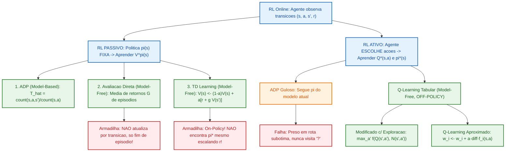
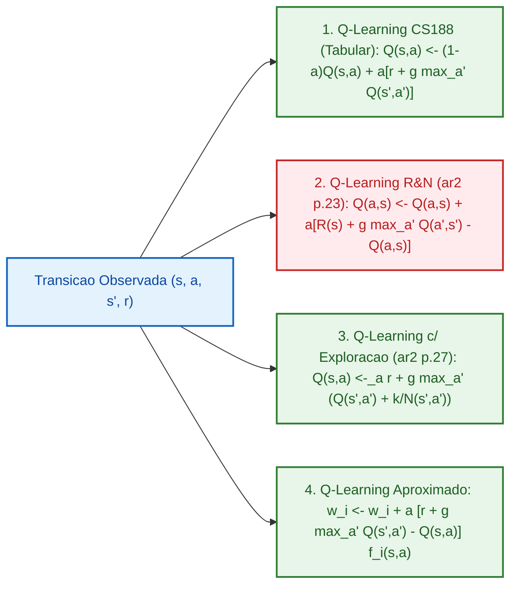

# Mapa Mental 02 — MDPs e Aprendizado por Reforço (RL)

> **Fontes 100% Cobertas:** `RL.pptx` (22s, incl. oculto 16 + questões Táxi 5×5 e Pacman 2×3) · `aprendizado-reforco-2 2.pdf` (32p) · `CS_188_Su26_Discussion_5_SOLUTION.pdf` (5p) · `Documento sem título.pdf` Q2 (Jim e Pam).
> **Padrão Cognitivo:** `**[Conceito]** → [Equação LaTeX] | [Gatilho / Complexidade] | ⚠️ [Armadilha ou Errata]`

---

## 1. Cadeia Causal de Evolução — De MDPs Offline até Q-Learning Aproximado

```mermaid
flowchart LR
    classDef base fill:#e3f2fd,stroke:#1565c0,stroke-width:2px,color:#0d47a1
    classDef algo fill:#e8f5e9,stroke:#2e7d32,stroke-width:2px,color:#1b5e20
    classDef fail fill:#fff3e0,stroke:#ef6c00,stroke-width:2px,color:#e65100
    classDef trap fill:#ffebee,stroke:#c62828,stroke-width:2px,color:#b71c1c

    MDP["MDP Offline (T e R conhecidos)"]:::base --> VI["Iteracao de Valor / Politica"]:::algo
    VI --> F1["Mundo real: T e R DESCONHECIDOS!"]:::fail
    F1 --> ADP["ADP Passivo: estima T_hat, R_hat + DP"]:::algo
    F1 --> DE["Avaliacao Direta: media de episodios"]:::algo
    DE --> F2["Ignora Bellman (B=+8 vs E=-2) e espera fim"]:::fail
    F2 --> SPE["Sample PE: media de n amostras de s"]:::algo
    SPE --> F3["Impossivel online: nao volta no tempo!"]:::fail
    F3 --> TD["TD Learning: EMA a cada passo (1-a)V + a·sample"]:::algo
    TD --> F4["Aprende V^pi, mas NAO extrai pi* sem T e R!"]:::trap
    F4 --> QL["Q-Learning Tabular: aprende Q(s,a) (Off-Policy)"]:::algo
    QL --> EXP["Exploracao: e-greedy & Funcoes f(u,n) = u + k/n"]:::algo
    QL --> F5["Muitos estados: tabela explode e nao generaliza!"]:::fail
    F5 --> AQL["Q-Learning Aproximado: Q(s,a) = sum w_i f_i(s,a)"]:::algo
```

### Árvore de Equações 1.1 — MDPs: Planejamento *Offline* (`RL` s.1, `ar2` pp. 3–5, `doc` Q2)
- **Definição Formal & Série Geométrica**
  - **Tupla do MDP** → $(S, A, T, R, \gamma)$: estados $s\in S$, ações $a\in A$, transição $T(s,a,s') = P(s'\mid s,a)$, recompensa $R(s,a,s')$ (CS188) ou $R(s)$ (R&N), desconto $\gamma \in (0, 1]$ | Planejamento **Offline**: o agente conhece $T$ e $R$ antes de agir | ⚠️ Em `ar2` p.5, fonte Symbol corrompe $\in, \pi, \gamma, \epsilon$ para `e, p, g, e`
  - **Soma de Série Geométrica Infinita** → $S = a + a\gamma + a\gamma^2 + \dots = \sum_{t=0}^{\infty} a\gamma^t = \frac{a}{1 - \gamma}$ ($0 \le \gamma < 1$) | Avalia qualquer estado que recebe recompensa constante $a$ em auto-laço infinito | ⚠️ Em Jim e Pam (`doc` Q2): $R(d) = 4^{5-d}$ c/ $d = 5-s \implies R(s,\text{rest}) = 4^s \implies V_{\text{rest}}(s) = \frac{4^s}{1-\gamma}$
- **Equações de Bellman & Extração de Política**
  - **Valor Ótimo de Estado $V^*(s)$** → $V^*(s) = \max_{a \in A} Q^*(s, a) = \max_{a \in A} \sum_{s'} T(s,a,s')\big[R(s,a,s') + \gamma V^*(s')\big]$ | Utilidade esperada máxima começando em $s$ e agindo otimamente para sempre | ⚠️ Operador $\max$ torna o sistema **não-linear** (exige iteração!)
  - **Valor Q Ótimo $Q^*(s, a)$** → $Q^*(s, a) = \sum_{s'} T(s,a,s')\big[R(s,a,s') + \gamma V^*(s')\big] = \sum_{s'} T(s,a,s')\big[R(s,a,s') + \gamma \max_{a'} Q^*(s',a')\big]$ | Utilidade esperada começando em $s$, comprometendo-se com a ação $a$ agora, e agindo ótimo depois | ⚠️ Em `RL` s.1 (Labirinto 2×3, $\gamma=0.9$): o slide trunca $0.9 \times 81 = 72.9$ para `72`
  - **Extração de Política Ótima $\pi^*(s)$** → $\pi^*(s) = \arg\max_{a \in A} Q^*(s, a) = \arg\max_{a \in A} \sum_{s'} T(s,a,s')\big[R(s,a,s') + \gamma V^*(s')\big]$ | A partir de $Q^*$ não precisa de $T, R$; **a partir de $V^*$ EXIGE conhecer $T$ e $R$**! | ⚠️ Pode haver empate entre ações ótimas ($\pi^*$ não é única no Labirinto 2×3!)
  - **Equação de Bellman para Política Fixa $\pi$** → $V^\pi(s) = \sum_{s'} T(s,\pi(s),s')\big[R(s,\pi(s),s') + \gamma V^\pi(s')\big]$ | Sem operador $\max$ $\implies$ **sistema linear** de $|S|$ equações e $|S|$ incógnitas! | ⚠️ Em R&N escreve-se $U^\pi(s) \equiv V^\pi(s)$
- **Os 3 Algoritmos de Planejamento *Offline***
  - **1. Iteração de Valor (*Value Iteration — VI*)** → $V_0(s) = 0; \quad V_{k+1}(s) \leftarrow \max_{a \in A} \sum_{s'} T(s,a,s')\big[R(s,a,s') + \gamma V_k(s')\big]$ | $V_k(s)$ = valor ótimo com horizonte de **$k$ passos**; complexidade **$O(|S|^2 |A|)$** por iteração | ⚠️ **Atualização síncrona:** para calcular toda a linha $V_{k+1}$, use **apenas** valores da linha anterior $V_k$!
  - **2. Iteração de Valor Q (*Q-Value Iteration — Q-VI*, `RL` s.9)** → $Q_0(s,a) = 0; \quad Q_{k+1}(s,a) \leftarrow \sum_{s'} T(s,a,s')\big[R(s,a,s') + \gamma \max_{a'} Q_k(s',a')\big]$ | Precursor baseado em modelo do Q-Learning | ⚠️ Única diferença p/ VI: o operador **$\max$ move para dentro** do somatório!
  - **3. Iteração de Política (*Policy Iteration — PI*)** → Alterna até $\pi_{i+1} = \pi_i$: (1) **Avaliação:** resolva $V^{\pi_i}(s) = \sum_{s'} T(s,\pi_i(s),s')[R + \gamma V^{\pi_i}(s')]$ **exato até $\infty$**; (2) **Melhoria:** $\pi_{i+1}(s) = \arg\max_a \sum_{s'} T(s,a,s')[R + \gamma V^{\pi_i}(s')]$ | Converge em muito poucas iterações externas ($O(|S|^3)$ por sistema linear ou $O(|S|^2)$/passo iterativo) | ⚠️ **Armadilha #1 de MDP:** No Passo 1 da Iteração de Política, resolva o valor **infinito** $V^{\pi_i}$ (ex.: $V(5)=\frac{1024}{1-0.5}=2048$ em Jim e Pam), NUNCA apenas 1 passo!

---

## 2. Sub-Mapa Visual — Aprendizado por Reforço Passivo vs. Ativo

### Árvore de Equações 2.1 — RL Passivo: ADP, Avaliação Direta & TD Learning (`ar2` pp. 6–18, `RL` ss. 2, 4–7, `disc5` pp. 1–3)
- **1. RL Baseado em Modelo / Programação Dinâmica Adaptativa (ADP)**
  - **Estimação Empírica de $\hat{T}$ e $\hat{R}$** → $\hat{T}(s, a, s') = \frac{\text{count}(s, a, s')}{\text{count}(s, a)}, \quad \hat{R}(s, a, s') = \text{média dos } r \text{ em } (s,a,s')$ | Passo 2: resolva o MDP $(\hat{T}, \hat{R})$ via Avaliação de Política ($\sum_{s'} \hat{T}[\hat{R} + \gamma V^\pi(s')]$) | ⚠️ O denominador de $\hat{T}(s,a,s')$ é $\text{count}(s, a)$ (vezes que tomou $a$ em $s$), não visitas totais a $s$!
  - **Exemplos dos Slides (`ar2` pp. 7, 10, `disc5` Q1a)** → Grid 5-estados (`(C,east)` ocorre 4x: 3 p/ $D$, 1 p/ $A \implies \hat{T}(C,\text{east},D)=0.75, \hat{T}(C,\text{east},A)=0.25 \implies V(C)=+4, V(B)=V(E)=+3$) · Grid 4×3 (`T((1,3),Dir,(2,3)) = 2/3`) | Usa plenamente conexões de Bellman | ⚠️ Custo alto de memória $O(|S|^2|A|)$ e resolução de DP
- **2. Avaliação Direta (*Direct Evaluation / Direct Utility Estimation*)**
  - **Retorno do Episódio & Média** → $G_t = \sum_{k=0}^{T_{\text{fim}}-t} \gamma^k r_{t+k}, \quad V^\pi(s) = \frac{1}{N(s)} \sum_{j=1}^{N(s)} G^{(j)}(s)$ | **Livre de modelo (*Model-Free*)** e **On-Policy**; soma todas as recompensas **a partir da visita a $s$ até o fim do episódio** | ⚠️ **Pegadinha `disc5` Q1c-iii:** Calcula a partir de **episódios completos**, NUNCA após cada transição individual!
  - **Paradoxo de $B$ e $E$ (`ar2` pp. 14–15)** → Nos 4 episódios do Grid A–E ($\gamma=1$): $V(A)=-10, V(D)=+10, V(C)=\frac{9+9+9-11}{4}=+4$, mas **$V(B)=\frac{8+8}{2}=+8$ e $V(E)=\frac{8-12}{2}=-2$**! | Embora $B$ e $E$ façam a **mesma** transição determinística para $C$ ($r=-1$), têm valores diferentes porque a Avaliação Direta **ignora conexões de Bellman** e aprende cada estado isoladamente! | ⚠️ Errata `ar2` p.8 (Grid 4×3): imprime `(0.72+0.72+(-1.16)) = 0.28/3` omitindo `/3` no meio
- **3. Avaliação por Amostras $\to$ Diferença Temporal (*TD Learning*)**
  - **Tentativa por Amostras (`RL` s.4, `ar2` p.17)** → $\text{sample}_i = R(s,\pi(s),s'_i) + \gamma V_k^\pi(s'_i), \quad V_{k+1}^\pi(s) \leftarrow \frac{1}{n}\sum_{i=1}^n \text{sample}_i$ | Falha no RL online: ***"Almost! But we can't rewind time to get sample after sample from state $s$"*** (legenda oculta sob robô mago) | ⚠️ Ao agir no mundo real, o agente já saiu de $s$ e foi para $s'$!
  - **Equação do TD Learning (`RL` s.6, `ar2` p.18, `disc5` p.1)** → $\text{sample} = R(s, \pi(s), s') + \gamma V^\pi(s'), \quad V^\pi(s) \leftarrow (1 - \alpha)\,V^\pi(s) + \alpha \cdot \text{sample} \;\equiv\; V^\pi(s) + \alpha\big(\text{sample} - V^\pi(s)\big)$ | Atualiza **a cada transição individual**; taxa de aprendizado $0 \le \alpha \le 1$ (típico: começa em $\alpha=1$ e encolhe p/ $0$) | ⚠️ `sample` usa o valor do **próximo estado $V^\pi(s')$**, nunca $V^\pi(s)$!
  - **Expansão da Média Móvel Exponencial (EMA, `ar2` p.18, `disc5` p.1)** →
    $$V_k^\pi(s) = (1-\alpha)^k V_0^\pi(s) + \alpha\Big[\underbrace{(1-\alpha)^{k-1}}_{\text{peso decai exp.!}}\cdot\text{sample}_1 + \dots + (1-\alpha)\cdot\text{sample}_{k-1} + \text{sample}_k\Big]$$
    | 3 Vantagens do TD sobre Direta (`disc5` p.2): (1) aprende a cada passo de tempo; (2) dá **peso exponencialmente menor a amostras antigas** (calculadas c/ $V^\pi(s')$ antigos e ruins!); (3) converge em muito menos episódios | ⚠️ **Limitação fatal (`RL` s.7, `disc5` p.2, Q1c-ii):** TD é **on-policy** (só avalia $\pi$ fixa, **não** acha $\pi^*$) e **não consegue extrair nova política** sem conhecer $T$ e $R$!

---

## 3. Sub-Mapa Visual — Anatomia Comparada das 4 Atualizações de Q-Learning

### Árvore de Equações 3.1 — RL Ativo: Q-Learning, Exploração & Q-Learning Aproximado (`ar2` pp. 19–32, `RL` ss. 3, 8–22, `disc5` pp. 2–5)
- **Falha do ADP Guloso & Q-Learning Tabular**
  - **ADP Ativo Guloso (`ar2` pp. 19–21)** → Estima $\hat{T}, \hat{R}$, resolve VI e segue sempre a política ótima do modelo atual | No Grid 4×3, descobre rota subótima por baixo e **repete-a para sempre**, deixando `(1,3)` e `(2,3)` como `?` (inexplorados) | ⚠️ Sem exploração de **todos** os estados e ações, nunca aprende o verdadeiro $\pi^*$!
  - **Q-Learning Tabular (CS188 EMA & TD-Error, `RL` ss. 10, 13, 18, `ar2` p. 22)** →
    $$\text{sample} = R(s, a, s') + \gamma \max_{a'} Q(s', a'), \qquad Q(s, a) \leftarrow (1 - \alpha)\,Q(s, a) + \alpha \cdot \text{sample} \;\equiv\; Q(s, a) + \alpha\big[\text{sample} - Q(s, a)\big]$$
    | Extrai política sem modelo: $\pi(s) = \arg\max_a Q(s,a)$; se $s'$ é terminal $\implies \max_{a'} Q(s',a') = 0$ | ⚠️ Sinônimos nos slides da UFPR: `sample` $\equiv$ `amostra` (`RL` s.13) $\equiv Q_{\mathbf{new}}(s,a)$ (`RL` ss.21–22)
  - **Variantes R&N e Tom Mitchell (`ar2` p. 23, `RL` s. 3)** → R&N: $U(s) = \max_a Q(a,s)$, $Q(a,s) \leftarrow Q(a,s) + \alpha[R(s) + \gamma\max_{a'} Q(a',s') - Q(a,s)]$ · Mitchell Determinístico ($\alpha=1$): $Q(s_t,a_t) \leftarrow r + \gamma\max_{a'} Q(s_{t+1},a')$ | No Labirinto 2×3 (`RL` s.3): $Q(s_1, a_{\text{right}}) = 0 + 0.9\max\{63,81,100\} = 90$ | ⚠️ Cuidado com a **ordem invertida $Q(a,s)$** exclusiva do slide 23 de `ar2`!
  - **Propriedade *Off-Policy* & 3 Condições de Convergência (`ar2` p. 24, `disc5` pp. 2–3)** → **Off-Policy:** converge para $Q^*$ e $\pi^*$ **mesmo agindo subótimo ou aleatoriamente** (pois usa $\max_{a'} Q(s',a')$ no alvo!) | **3 Ressalvas obrigatórias:** (1) explorar o suficiente; (2) tornar $\alpha$ pequeno o suficiente eventualmente; (3) **não** diminuir $\alpha$ rápido demais | ⚠️ No limite, não importa como seleciona ações, desde que explore tudo!
  - **Propagação Temporal & Táxi 5×5 (`disc5` Q1b, Q2a; `RL` ss. 11–13)** → Um valor $Q > 0$ propaga **1 passo para trás por transição** (`disc5` Q1b: $Q(C,\to)>0$ na iter 9 $\to Q(B,\to)>0$ na iter 11 $\to Q(A,\to)>0$ na **iter 14** $\to Q(B,\leftarrow)>0$ na **iter 22**) | Táxi 5×5 ($\gamma=0.5,\alpha=0.5$): escolhe `Baixo` ($Q=1$) $\to \text{amostra} = -2 + 0.5(2.0) = -1 \to Q(S_0,\text{Baixo}) \leftarrow 0.5(1)+0.5(-1) = \mathbf{0.0}$ | ⚠️ **Errata `RL` s.13:** gabarito vermelho escreve `$s'=S_2$` por engano, mas usa os números de **$S_1$** ($\max Q(S_1,a')=2.0$; em $S_2$ seria $20$)
- **Exploração vs. Explotação (`RL` ss. 14–15, `ar2` pp. 21, 25–27)**
  - **$\epsilon$-Greedy (`e-greedy`)** → Com prob. $\epsilon$: ação **aleatória** (exploração) · Com prob. $1-\epsilon$: ação **gulosa atual** $\arg\max_a Q(s,a)$ (explotação) | Problema do $\epsilon$ fixo: continua fazendo movimentos ruins após convergir | ⚠️ Solução 1: **decrescer $\epsilon$ ao longo do tempo**
  - **Funções de Exploração (`ar2` p. 27 — exclusivo do PDF!)** → $f(u, n) = u + \frac{k}{n} \iff f(s, a) = Q(s, a) + \frac{k}{N(s, a)}$ | Atualização modificada (atalho $x \leftarrow_\alpha y \equiv (1-\alpha)x + \alpha y$):
    $$Q(s, a) \leftarrow_\alpha R(s, a, s') + \gamma \max_{a'} f\big(Q(s', a'),\; N(s', a')\big)$$
    | $u=Q(s,a)$ (utilidade), $n=N(s,a)$ (contagem de visitas), $k>0$ (bônus otimista) | ⚠️ Colocar $f$ **dentro do $\max_{a'}$ propaga o bônus para trás** até estados que levam a regiões novas, e $\frac{k}{N} \to 0$ automaticamente quando visitado!
- **Generalização & Q-Learning Aproximado (`RL` ss. 16–22, `ar2` pp. 28–32, `disc5` pp. 4–5)**
  - **Representação Baseada em Características (*Feature-Based*)** → $V(s) = \sum_{i=1}^n w_i f_i(s), \quad Q(s, a) = w_1 f_1(s, a) + w_2 f_2(s, a) + \dots + w_n f_n(s, a)$ | Resume toda experiência em $n$ pesos ($O(n)$ espaço vs. $O(|S||A|)$); generaliza p/ estados nunca vistos | ⚠️ **Desvantagem (`ar2` p.30):** estados muito diferentes podem ter mesmas features $\implies$ mesmo valor (**aliasing de estados**)
  - **Regra de Atualização dos Pesos $w_i$** → Dada $\text{transition} = (s, a, r, s')$:
    $$\text{difference} = \Big[ r + \gamma \max_{a'} Q(s', a') \Big] - Q(s, a) = Q_{\mathbf{new}}(s,a) - Q(s,a)$$
    $$w_i \leftarrow w_i + \alpha \cdot [\text{difference}] \cdot f_i(s, a) \qquad \forall i \in \{1, \dots, n\}$$
    | Interpretação: ajusta pesos das **features ativas em $(s,a)$** ("culpa" features se $\text{diff} < 0$); justificativa formal: **mínimo erro** (*least squares*) | ⚠️ **3 Regras de Ouro:** (1) use $f_i(s,a)$ da **origem** (nunca $s'$!); (2) atualize todos os $w_i$ simultaneamente c/ o mesmo `difference`; (3) na transição seguinte, **recalcule** $Q$ e $\max_{a'} Q(s',a')$ com os **novos pesos**!
  - **Exemplos Resolvidos dos Slides** →
    - **Q-Pacman CS188 (`ar2` p.32):** $Q = 4.0 f_{\text{DOT}} - 1.0 f_{\text{GST}}$; em $(s,\text{NORTH})$ c/ $f_{\text{DOT}}=0.5, f_{\text{GST}}=1.0 \implies Q = +1$; morre ($r=-500, s'$ terminal) $\implies \text{diff} = -500 - 1 = -501 \implies w_{\text{DOT}} \leftarrow 4.0 + \alpha(-501)(0.5)=3.0,\; w_{\text{GST}} \leftarrow -1.0 + \alpha(-501)(1.0) = -3.0$
    - **Pacman 2×3 UFPR (`RL` ss.19–22):** $w_g=100, w_p=-10, \gamma=0.5, \alpha=0.5$; em $s$: $F_g=2, F_p=1 \implies Q(s,a) = 100(2)-10(1) = \mathbf{190}$; vai p/ $s'$ ($F_g=0, F_p=2, r=50$) $\implies Q_{\mathbf{new}} = 50 + 0.5(100(0)-10(2)) = \mathbf{40} \implies \text{diff} = 40 - 190 = -150 \implies w_g \leftarrow 100 + 0.5(-150)(2) = \mathbf{-50},\; w_p \leftarrow -10 + 0.5(-150)(1) = \mathbf{-85}$

---

## 4. Checklist de Reconhecimento em 5 Segundos (Bloco 2)

| Se a prova mostrar... | Faça imediatamente... | ⚠️ Cuidado com... |
| :--- | :--- | :--- |
| "Política 1 vs. Política 2 em MDP de horizonte infinito" | Use $S = \frac{a}{1-\gamma}$ para achar o valor infinito dos estados estacionários, depois equacione $V^{\pi_1}(s_0) > V^{\pi_2}(s_0)$ | Multiplicar $p$ pela recompensa de 1 passo $R(s')$ em vez do valor **infinito** $V_{\text{rest}}(s')$! |
| Tabela vazia $V_0, V_1, V_2$ ("Iteração de Valor") | Para cada estado $s$, calcule $Q_{k+1}(s,a) = \sum_{s'} T[R + \gamma V_k(s')]$ para cada ação e tome o $\max_a$ | Usar valores recém-calculados de $V_{k+1}$ na mesma linha (use **sempre** a linha anterior $V_k$!) e cuidar da borda ($s=5 \xrightarrow{\text{right}} 5$) |
| Tabela $\pi_i, V^{\pi_i}, \pi_{i+1}, V^{\pi_{i+1}}, \pi_{i+2}$ ("Iteração de Política") | (1) Resolva $V^{\pi_i}$ **exato até o infinito** ($\frac{R}{1-\gamma}$ ou de trás p/ frente); (2) Escolha $\pi_{i+1}(s) = \arg\max_a Q(s,a)$ | Fazer apenas 1 iteração de soma no passo $V^{\pi_i}$ (avaliação de política é sempre de horizonte infinito!) |
| Episódio de transições + pedido de $\hat{T}(s,a,s')$ e $\hat{R}(s,a,s')$ | Conte quantas vezes $(s,a)$ ocorreu no total (denominador) e quantas foram para $s'$ (numerador) | Dividir pelo nº de vezes que visitou o estado $s$ com *outras* ações! |
| Episódio ciclado + "Em qual iteração $Q(s,a)$ fica $\neq 0$?" | Rastreie de trás p/ frente a partir da única transição c/ $r \neq 0$: a cada passagem, o sinal positivo avança 1 estado p/ trás | Lembrar que $(s,a)$ só atualiza na iteração exata em que a tupla $(s,a,s',r)$ é executada na tabela! |
| Lista de amostras $(s,a,s',r)$ + Q-Learning Tabular | Atualize sequencialmente de cima p/ baixo: $\text{sample} = r + \gamma\max_{a'} Q(s',a')$, $Q \leftarrow (1-\alpha)Q + \alpha\cdot\text{sample}$ | Amostras posteriores (como a 6ª amostra em `disc5` Q2a) **não** alteram retroativamente valores já calculados antes! |
| Features $f_i(s,a)$, pesos $w_i$ e amostras $(s,a,s',r)$ | Calcule $Q(s,a)$, $\max_{a'} Q(s',a')$, $\text{diff}$, e atualize $w_i \leftarrow w_i + \alpha\cdot\text{diff}\cdot f_i(s,a)$ | (1) Multiplicar por $f_i(s,a)$ da **origem**; (2) na 2ª amostra, **recalcular** $\max_{a'} Q(s',a')$ usando os **novos** pesos! |
