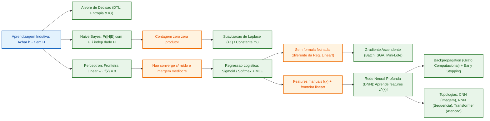
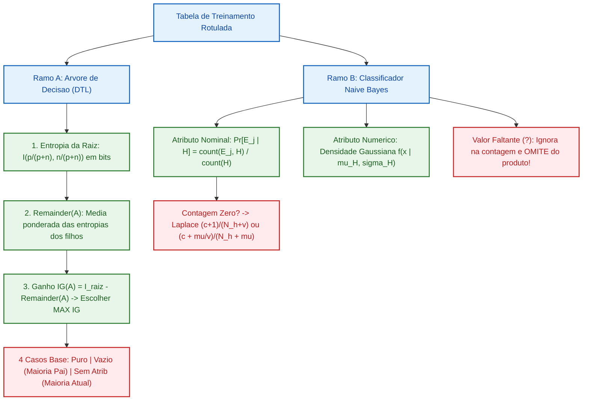
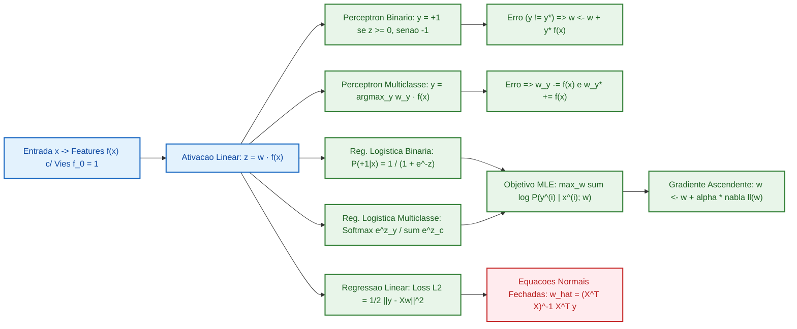
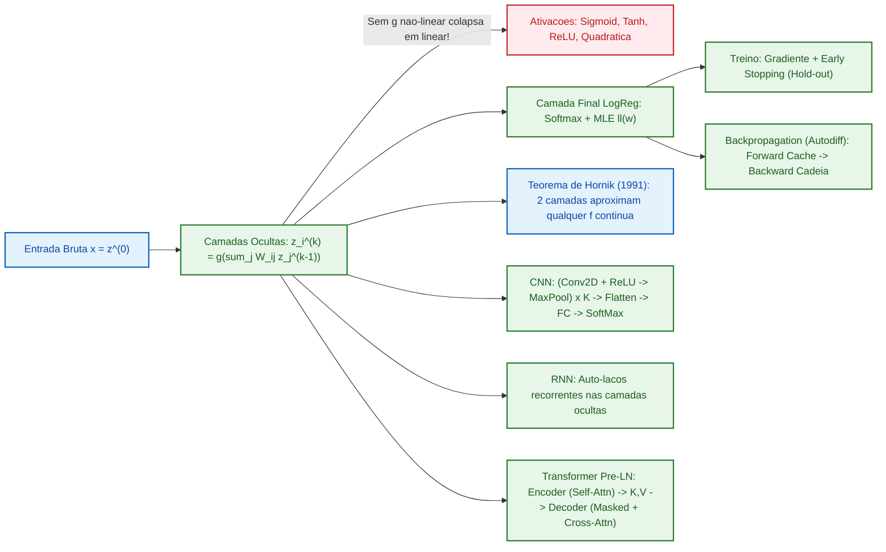

# Mapa Mental 03 — Aprendizado de Máquina: Árvores, Naïve Bayes, Perceptrons, Regressão & Redes Neurais

> **Fontes 100% Cobertas:** `CS 188 - Aprendizado de Máquina I.pdf` (64p) · `naivebayes.pdf` Parte A (pp. 1–18) · `perceptrons.pdf` (54p) · `redesneurais.pdf` (25p) · `prova2.pdf` (Q1, Q2, Q4) · `Documento sem título.pdf` (Q3).
> **Padrão Cognitivo:** `**[Conceito]** → [Equação LaTeX] | [Gatilho / Complexidade] | ⚠️ [Armadilha ou Errata]`

---

## 1. Cadeia Causal de Evolução — De Aprendizagem Indutiva até Transformers

### Árvore de Equações 1.1 — Fundamentos de AM, Overfitting, Ockham & Validação (`CS 188 ML I` pp. 1–40, 63–64; `perceptrons` pp. 3–5)
- **Definição, Histórico & Paradigmas**
  - **O Que é Aprender (`ML I` p.3)** → *"Melhorar o desempenho em tarefas futuras após observar o mundo"* | 3 Pilares: **Desempenho** + **Experiência/Dados** + **Generalização** (quando falta onisciência ou regras são tácitas) | ⚠️ Marcos: William James (1890), Alan Turing (1950, *"caderno c/ mecanismo reduzido e folhas em branco"*), Skinner (condicionamento operante), **Frank Rosenblatt (1957, hardware do Perceptron c/ potenciômetros motorizados)**
  - **5 Perguntas de Projeto de Agente (`ML I` p.12)** → (1) Design do agente; (2) Qual componente melhorar/representação; (3) Dados disponíveis; (4) Conhecemos respostas corretas?; (5) Conhecimento prévio | Define o paradigma de aprendizado | ⚠️ Aplicações: Spam (200 bi/dia), MNIST (60k dígitos `Label, yhat`), Diagnóstico, Ensaios, Fraude, Roteamento, Proteínas
  - **3 Paradigmas (`ML I` p.13, `perc` p.3)** → **Supervisionado:** pares $(x_j, y_j)$ c/ rótulo $y_j = f(x_j)$ (**Classificação** = saída discreta; **Regressão** = saída contínua) · **Reforço:** sequência de recompensas · **Não Supervisionado:** sem rótulos, descobre estrutura (*clustering*)
- **Aprendizagem Indutiva, Ajuste de Curva, Navalha de Ockham & Validação**
  - **Hipótese Consistente & Realizabilidade (`ML I` pp.14–22, 38, 40)** → Dado conjunto de treino $(x_j, f(x_j))$, achar **hipótese** $h \in H$ (**espaço de hipóteses**) tal que $h \approx f$ | **Consistente:** $\forall j,\; h(x_j) = f(x_j)$ · **Realizável:** $f \in H$ | ⚠️ Não dá para saber se é realizável a priori pois $f$ é desconhecida
  - **Progressão de Ajuste de Curva (`ML I` pp.17–27)** → Reta $y = ax + b$ (simples, alto viés/*underfitting*) $\to$ Parábola quadrática (bom equilíbrio) $\to$ Polinômio de grau alto / curva dente-de-serra (100% consistente c/ treino e *outlier*, mas **Sobreajuste / *Overfitting*** em novos dados!) | Balanço **ajuste vs. complexidade** | ⚠️ Infinitas hipóteses consistentes existem
  - **Navalha de Ockham (*Ockham's Razor*, `ML I` pp.22, 29)** → *"Prefira a hipótese mais simples que seja consistente com os dados"* | Hipóteses mais complexas que os dados deixam de extrair padrão! | ⚠️ Em árvores de decisão, justifica buscar a **árvore mais compacta**
  - **Divisão de Dados & Curva de Aprendizagem (`ML I` pp.63–64, `perc` p.4)** → **(a) Treinamento** (aprende $w$/árvore) · **(b) Validação / *Held-out*** (ajusta hiperparâmetros / *early stopping* — *"simulado"*) · **(c) Teste** (avaliação final — *"prova final"*) | **Curva de Aprendizagem:** `% de acerto no teste` em função do `tamanho do conjunto de treino` | ⚠️ No Restaurante DTL (`ML I` p.64), sobe de $\sim 0.50$ (tam. 1) para $\sim 0.95+$ (tam. 100)

---

## 2. Sub-Mapa Visual — Árvores de Decisão (DTL) & Classificador Naïve Bayes

### Árvore de Equações 2.1 — Árvores de Decisão (*DTL*, `CS 188 ML I` pp. 36–37, 41–62; `prova2` Q4)
- **Estrutura, Expressividade & Algoritmo DTL**
  - **Semântica & Expressividade (`ML I` pp.41, 45–46)** → Nó interno = teste de 1 atributo · Ramo = valor do atributo · Folha = decisão (`T`/`F`) | **Qualquer função booleana** pode ser escrita como árvore de decisão (ex.: `A xor B` com 3 nós internos) | ⚠️ Árvore trivial (1 caminho por exemplo) tem tamanho exponencial $O(2^n)$ e não generaliza!
  - **Os 4 Casos Recursivos do Algoritmo DTL (`ML I` pp.47–48)** →
    1. **Exemplos mistos e há atributos:** escolha atributo $A = \arg\max_A IG(A)$ e ramifique
    2. **Nó puro (todos $+$ ou todos $-$):** retorne folha com essa classe
    3. **Nenhum exemplo resta no ramo ($E_i = \emptyset$):** retorne o **valor majoritário do nó PAI** (ex.: `Type=French` sob `Full+Hungry` no Restaurante)
    4. **Nenhum atributo resta, mas exemplos continuam mistos:** causado por **ruído**, **atributos insuficientes** ou **domínio não-determinístico** $\implies$ retorne **votação pela maioria atual**
- **Teoria da Informação: Entropia, Remainder & Ganho de Informação (`ML I` pp. 49–62)**
  - **Entropia Geral ($I$, medida em bits)** → $I\big(P(v_1), \dots, P(v_n)\big) = \sum_{i=1}^{n} -P(v_i)\log_2 P(v_i)$ | Moeda justa: $I(\frac{1}{2},\frac{1}{2}) = 1\text{ bit}$ · Nó puro: $I(1,0) = I(0,1) = \mathbf{0\text{ bits}}$ | ⚠️ Sempre base $2$ ($\log_2 x = \frac{\ln x}{\ln 2}$) e $0\log_2 0 = 0$!
  - **Entropia de Conjunto Binário ($p$ positivos, $n$ negativos)** →
    $$I\!\left(\frac{p}{p+n},\, \frac{n}{p+n}\right) = -\frac{p}{p+n}\log_2\frac{p}{p+n} - \frac{n}{p+n}\log_2\frac{n}{p+n}$$
  - **Informação Restante Esperada ($\text{remainder}(A)$)** → Atributo $A$ com $v$ valores divide $E$ em $E_1,\dots,E_v$ (cada $E_i$ tem $p_i$ positivos e $n_i$ negativos):
    $$\text{remainder}(A) = \sum_{i=1}^{v} \underbrace{\frac{p_i + n_i}{p + n}}_{\text{peso do ramo } i}\, I\!\left(\frac{p_i}{p_i + n_i},\, \frac{n_i}{p_i + n_i}\right)$$
  - **Ganho de Informação ($IG(A)$)** → $IG(A) = I\!\left(\frac{p}{p+n},\, \frac{n}{p+n}\right) - \text{remainder}(A)$ | Melhor atributo = **Maior $IG(A)$** $\iff$ **Menor $\text{remainder}(A)$** | ⚠️ **Errata `ML I` p.60 (Restaurante 12 ex., $p=6, n=6 \implies I=1$):** `Patrons` (`None:(0,2), Some:(4,0), Full:(2,4)`) tem $IG = 1 - [\frac{2}{12}(0) + \frac{4}{12}(0) + \frac{6}{12}I(\frac{2}{6},\frac{4}{6})] = \mathbf{0.541\text{ bits}}$ (o slide imprime `.0541` por erro de digitação!), enquanto `Type` tem $IG = 1 - 1 = \mathbf{0\text{ bits}}$

### Árvore de Equações 2.2 — Classificador Naïve Bayes (`naivebayes.pdf` Parte A, pp. 1–18; `prova2` Q1)
- **Formulação Nominal, Suavização & Valores Faltantes**
  - **Equação de Classificação Naïve Bayes (`nb` pp.3, 5, 7)** → Para instância $E = (E_1, \dots, E_n)$ e classe $H \in \{h_1, \dots, h_C\}$:
    $$\Pr[H \mid E] = \frac{\Pr[E_1 \mid H]\,\Pr[E_2 \mid H]\cdots \Pr[E_n \mid H]\,\Pr[H]}{\Pr[E]}$$
    | Calcula numerador $L(h) = \Pr[h]\prod_{j=1}^n \Pr[E_j \mid h]$ para cada classe e **normaliza**: $P(h\mid E) = \frac{L(h)}{\sum_{h'} L(h')}$ | ⚠️ **Errata `nb` p.4 (Meningite):** $\Pr(M\mid S) = \frac{0.5\times (1/50000)}{1/20} = \mathbf{0.0002} = 0.02\% = 1/5000$ (slide imprime `=0,002` antes de escrever certo `0,02%`)
  - **Teste Empírico da Suposição Naïve (`nb` pp.9–11, Base Tempo 14 dias: 9 `yes`, 5 `no`)** → Grafo em estrela `play -> {outlook, temp, humidity, windy}`; nos 9 dias `yes`: $\Pr(\text{Sunny}\mid \text{Windy=true}, \text{yes}) = \frac{1}{3} \neq \frac{2}{9} = \Pr(\text{Sunny}\mid \text{yes})$ | A suposição de independência condicional **NÃO é satisfeita** nos dados, mas o classificador continua muito eficaz | ⚠️ Consulta `(Sunny,Cool,High,True)`: `yes` $= \frac{2}{9}\frac{3}{9}\frac{3}{9}\frac{3}{9}\frac{9}{14} \approx 0.0053$ (20.5%) vs. `no` $= \frac{3}{5}\frac{1}{5}\frac{4}{5}\frac{3}{5}\frac{5}{14} \approx 0.0206$ (79.5%)
  - **Problema da Frequência Zero & Suavização (`nb` pp.12–13)** → Se $\text{count}(E_j=a, H=h) = 0$ (ex.: `Overcast` em `no` é $0/5$), $\Pr[E_j=a\mid h] = 0$ **zera todo o produto**!
    - **Estimador de Laplace (+1, `nb` p.12):** $\Pr[E_j = a \mid H = h] = \frac{c + 1}{N_h + v}$ (onde $v =$ nº de valores possíveis do atributo $E_j$; geral c/ peso $k$: $\frac{c+k}{N_h + k\cdot v}$)
    - **Estimativa Modificada c/ Constante $\mu$ (`nb` p.13):** $\Pr[E_j = a \mid H = h] = \frac{c + \mu / v}{N_h + \mu}$ (ex. `Outlook|yes` c/ $v=3, N_{\text{yes}}=9$: $\frac{2+\mu/3}{9+\mu}, \frac{4+\mu/3}{9+\mu}, \frac{3+\mu/3}{9+\mu}$; para $\mu=v=3$ recupera Laplace $+1$)
  - **Valores Faltantes (*Missing Values*, `nb` pp.14, 17)** → **No Treino:** instância não entra na contagem nem no denominador daquele atributo (e é excluída de $\mu, \sigma$ se numérico) · **Na Classificação:** atributo com `?` é simplesmente **omitido do produto**! | Ex. `(?, Cool, High, True)`: `yes` $= \frac{3}{9}\frac{3}{9}\frac{3}{9}\frac{9}{14}=0.0238$ (41%) vs. `no` $= \frac{1}{5}\frac{4}{5}\frac{3}{5}\frac{5}{14}=0.0343$ (59%) | ⚠️ Não substitua `?` por zero nem pela média!
- **Atributos Numéricos — Naïve Bayes Gaussiano (`nb` pp. 15–18)**
  - **Parâmetros & Função de Densidade (PDF) Normal por Classe** →
    $$\mu = \frac{1}{n}\sum_{i=1}^{n} x_i, \qquad \sigma = \sqrt{\frac{1}{n - 1}\sum_{i=1}^{n} (x_i - \mu)^2}, \qquad f(x) = \frac{1}{\sqrt{2\pi}\,\sigma}\, e^{-\frac{(x - \mu)^2}{2\sigma^2}}$$
    | Substitui $\Pr[E_j=x \mid H]$ pela densidade $f(x \mid \mu_H, \sigma_H)$ no produto | ⚠️ **Duas Erratas em `nb` pp.15–17:** (1) p.15 omite $\sqrt{\cdot}$ na fórmula impressa de $\sigma$ (mostra variância $\sigma^2$, mas usa $\sigma$ com raiz nas contas!); (2) p.17 imprime `0.0291` para $f(\text{temp}=66\mid \text{no})$ ($\mu=74.6,\sigma=7.9 \implies$ exato `0.0279`), mas o produto impresso `0.000136` usa o valor correto `0.0279`!

---

## 3. Sub-Mapa Visual — Classificadores Lineares, Perceptrons, Regressão & Gradiente

### Árvore de Equações 3.1 — Perceptrons, Geometria & Limitações (`perceptrons.pdf` pp. 1–31; `prova2` Q2)
- **Geometria do Classificador Linear & Papel do Viés (*Bias*)**
  - **Produto Escalar & Ângulo (`perc` pp.7–15)** → $h_{\mathbf{w}}(\mathbf{x}) = \mathbf{w} \cdot \mathbf{f}(\mathbf{x}) = \sum_i w_i f_i(\mathbf{x}) = \|\mathbf{w}\|\,\|\mathbf{f}(\mathbf{x})\|\,\cos(\theta)$ | Hiperplano de decisão $\mathbf{w}^T\mathbf{f}(\mathbf{x}) = 0$ é **ortogonal a $\mathbf{w}$**; $\theta < \frac{\pi}{2}$ (agudo, $\cos\theta > 0$) $\implies +1$; $\theta > \frac{\pi}{2}$ (obtuso, $\cos\theta < 0$) $\implies -1$ | ⚠️ Exemplo `perc` p.10: `VIÉS:-3, livre:4, dinheiro:2` $\implies 4\cdot\text{livre} + 2\cdot\text{dinheiro} - 3 = 0$
  - **Viés (*Bias*, `perc` p.18)** → Sem viés: $w^T f(x) = 0$ é **forçado a passar pela origem $(0,0)$** · Com viés: $w^T f(x) + b = 0$ translada o hiperplano | Implementação homogênea: adicione coordenada fixa $1$ ao vetor $f(x)$ com peso $w_0 = b$ | ⚠️ Confira no enunciado se o bias $1$ é a **1ª coordenada** (`[1, f1, f2]`, `perc` p.19) ou a **última coordenada** (`[x1, x2, 1]`, `prova2` Q2)!
- **Regras de Aprendizado do Perceptron (Binário CS188, Binário R&N, McCulloch–Pitts & Multiclasse)**
  - **Perceptron Binário CS188 ($y^* \in \{+1, -1\}$, `perc` pp.12, 16, 19–20)** →
    $$y = \begin{cases} +1 & \text{se } w \cdot f(x) \ge 0 \\ -1 & \text{se } w \cdot f(x) < 0 \end{cases}, \qquad \text{Se } y \neq y^*:\;\; w \leftarrow w + y^* \cdot f(x)$$
    | Empate $w\cdot f(x) = 0$ classifica como **$+1$**! Se $y=y^*$, pesos não mudam; somar $+y^* f$ gira $w$ na direção de $f$ (se $y^*=+1$) ou afasta de $f$ (se $y^*=-1$) | ⚠️ Traço `perc` p.20: `[-1,0,0]` $\to$ `[-1,1,-1]`; em `prova2` Q2: `[-1,1,0]` $\to$ `[-2,-2,-1]` $\to$ `[0,1,0]`
  - **Perceptron Binário R&N ($y, h_{\mathbf{w}}(\mathbf{x}) \in \{0, 1\}$, `perc` p.21)** → $\mathbf{w} \leftarrow \mathbf{w} + \alpha\big(y - h_{\mathbf{w}}(\mathbf{x})\big)\mathbf{x}$ | Falso Negativo ($y=1, h=0 \implies +1$): soma $\alpha\mathbf{x}$ · Falso Positivo ($y=0, h=1 \implies -1$): subtrai $\alpha\mathbf{x}$ | ⚠️ Inclui taxa de aprendizado $\alpha$
  - **Neurônio de McCulloch & Pitts (1943) & Treino $L_2$ (`perc` pp.22, 24)** → Entrada fixa $a_0=1$ c/ peso $w_{0,j}$; $\text{in}_j = \sum_i w_{i,j} a_i$; saída $a_j = g(\text{in}_j) = g(\mathbf{w}\cdot\mathbf{a})$ | Treino de 1 neurônio c/ perda quadrática $L_2$: $\text{Loss}(\mathbf{w}) = (y - g(\mathbf{w}\cdot\mathbf{x}))^2 \implies w_i \leftarrow w_i - \alpha\frac{\partial \text{Loss}}{\partial w_i}$ | ⚠️ Usa **Descida** de Gradiente ($-$) pois minimiza Loss!
  - **Perceptron Multiclasse (`perc` pp.26–29)** → Um vetor $w_y$ para cada classe $y$ (caso binário equivale a fixar $w_{-1} = \mathbf{0}$!):
    $$y = \arg\max_{y} \; w_y \cdot f(x), \qquad \text{Se } y \neq y^*:\;\; w_y \leftarrow w_y - f(x) \quad \text{e} \quad w_{y^*} \leftarrow w_{y^*} + f(x)$$
    | Diminui o vetor da classe **prevista errada** $y$, aumenta o da classe **verdadeira** $y^*$, e **não altera** as demais classes! | ⚠️ Ex. `perc` pp.28–29 ($f=[-2,3,1]$): scores $[11, 13, 8]^T \to$ prevê $y=1$ ($y^*=2$) $\implies w_1 \leftarrow [0,3,4]-[-2,3,1]=[2,0,3]$ e $w_2 \leftarrow [1,4,-2]+[-2,3,1]=[-1,7,-1]$
- **Propriedades Teóricas & 3 Problemas Clássicos (`perc` pp. 30–31)**
  - **Separabilidade, Convergência & Limite de Erros (`perc` p.30)** → Se dados são **linearmente separáveis** com margem geométrica $\delta$, o Perceptron Binário **converge em no máximo** $\text{mistakes} < \frac{k}{\delta^2}$ erros | Para provar que dados **NÃO** são separáveis (`prova2` Q2b): mostre que um ponto `+` está dentro do envoltório convexo dos pontos `-` (ex.: $(2,3) = \frac{2}{5}(2,4)+\frac{2}{5}(1,3)+\frac{1}{5}(4,1)$)! | ⚠️ Quanto menor a margem $\delta$, mais iterações até convergir
  - **3 Problemas do Perceptron (`perc` p.31)** → (1) **Ruído (*Thrashing*):** se não-separável, pesos oscilam infinitamente $\to$ mitigar c/ **Perceptron Médio (*Averaged Perceptron*)**; (2) **Generalização medíocre:** para na 1ª fronteira que separa, c/ margem minúscula; (3) **Overtraining (= Overfitting):** acurácia de teste cai se treinar por épocas demais

### Árvore de Equações 3.2 — Regressão Logística, Regressão Linear & Gradiente (`perceptrons.pdf` pp. 32–54)
- **Regressão Logística Binária & Multiclasse (Softmax) via MLE**
  - **Vantagem Probabilística (`perc` pp.33–38)** → Atribui probabilidades suaves (`0.9|0.1`, `0.7|0.3`, `0.5|0.5`) e, mesmo no caso separável, **prefere claramente a fronteira centralizada com maior margem** (maior verossimilhança!) | Corrige a generalização medíocre do Perceptron | ⚠️ Fronteira de decisão $P=0.5$ ocorre onde $z = w\cdot f(x) = 0$
  - **Sigmoide & LogReg Binária (`perc` pp.35–36)** → $\phi(z) = \frac{1}{1 + e^{-z}}; \quad P(y^{(i)}=+1 \mid x^{(i)}; w) = \frac{1}{1 + e^{-w \cdot f(x^{(i)})}}, \quad P(y^{(i)}=-1 \mid x^{(i)}; w) = 1 - P(+1 \mid x^{(i)}; w)$ | $\phi(0)=0.5,\; \phi(+\infty)\to 1,\; \phi(-\infty)\to 0$ | ⚠️ Rótulos em `{+1, -1}`
  - **Softmax & LogReg Multiclasse (`perc` pp.39–40)** → Converte logits $z_y = w_y \cdot f(x)$ em distribuição válida:
    $$P\big(y^{(i)} \mid x^{(i)}; w\big) = \frac{e^{w_{y^{(i)}} \cdot f(x^{(i)})}}{\sum_{y} e^{w_y \cdot f(x^{(i)})}}, \qquad \max_{w}\; ll(w) = \max_{w} \sum_{i} \log P\big(y^{(i)} \mid x^{(i)}; w\big)$$
- **Regressão Linear & Equações Normais em Forma Fechada (`perc` p. 41)**
  - **Derivação Matricial Completa da Perda $L_2$** → Hipótese $h_{\mathbf{w}}(\mathbf{x}) = w_0 + w_1 x^1 + \dots + w_n x^n$:
    $$\text{Loss}(h_{\mathbf{w}}) = \frac{1}{2}\sum_{j=1}^{N}\big(y^j - h_{\mathbf{w}}(\mathbf{x}^j)\big)^2 = \frac{1}{2}\|\mathbf{y} - \mathbf{X}\mathbf{w}\|_2^2 = \frac{1}{2}\big(\mathbf{y}^T\mathbf{y} - 2\mathbf{w}^T\mathbf{X}^T\mathbf{y} + \mathbf{w}^T\mathbf{X}^T\mathbf{X}\mathbf{w}\big)$$
    $$\nabla_{\mathbf{w}}\text{Loss} = -\mathbf{X}^T\mathbf{y} + \mathbf{X}^T\mathbf{X}\mathbf{w} = 0 \implies \mathbf{\hat{\mathbf{w}} = (\mathbf{X}^T\mathbf{X})^{-1}\mathbf{X}^T\mathbf{y}}$$
    | **Regressão Linear tem fórmula fechada**; Regressão Logística e Redes Neurais **NÃO** têm $\implies$ exigem otimização por gradiente! | ⚠️ Exige $\mathbf{X}^T\mathbf{X}$ invertível
- **Otimização Contínua: Gradiente Ascendente, Prova & Variantes (`perc` pp. 42–54)**
  - **Derivada 1-D & Gradiente $n$-D (`perc` pp.44, 46, 49)** → $\frac{\partial g(w_0)}{\partial w} = \lim_{h\to 0}\frac{g(w_0+h)-g(w_0-h)}{2h}$; $\quad \nabla_w g(w) = \big[\frac{\partial g}{\partial w_1}, \dots, \frac{\partial g}{\partial w_n}\big]^T$; $\quad w \leftarrow w + \alpha \cdot \nabla_w g(w)$ | Em espaço contínuo, Hill Climbing tem infinitos vizinhos; o gradiente aponta para cima perpendicular às curvas de nível | ⚠️ Regra prática (`perc` p.50): cada passo deve alterar $w$ em **0.1% a 1%**
  - **Prova: Por Que o Gradiente é a Direção Mais Íngreme? (`perc` p.48)** → Queremos $\max_{\|\Delta\|\le \varepsilon} g(w + \Delta)$:
    $$g(w + \Delta) \approx g(w) + \frac{\partial g}{\partial w_1}\Delta_1 + \frac{\partial g}{\partial w_2}\Delta_2 = g(w) + \Delta^\top \nabla g \quad (\text{Taylor 1ª ordem})$$
    $$\text{Lema de Cauchy–Schwarz: } \max_{\|\Delta\|\le \varepsilon} \Delta^\top a \implies \Delta = \varepsilon \frac{a}{\|a\|} \quad \Longrightarrow \quad \mathbf{\Delta = \varepsilon \frac{\nabla g}{\|\nabla g\|}}$$
    | Errata `perc` p.48: topo escreve $\Delta_1^2+\Delta_2^2 \le \varepsilon$ enquanto lema usa $\|\Delta\|\le \varepsilon$; ambos dão a mesma direção $\frac{\nabla g}{\|\nabla g\|}$
  - **Batch vs. Estocástico (SGA) vs. Mini-Lote (`perc` pp.51–53) & LR Finder (p.54)** →
    - **Batch (*em lote*):** $w \leftarrow w + \alpha \sum_{i} \nabla \log P(y^{(i)}\mid x^{(i)}; w)$ (gradiente exato sobre todos os dados, lento por passo)
    - **SGA (*estocástico*):** sorteia **1 exemplo** $j$: $w \leftarrow w + \alpha \nabla \log P(y^{(j)}\mid x^{(j)}; w)$ (atualiza imediatamente após 1 exemplo)
    - **Mini-Batch (*mini-lote*):** sorteia **subconjunto $J$**: $w \leftarrow w + \alpha \sum_{j\in J} \nabla \log P(y^{(j)}\mid x^{(j)}; w)$ (**computado em paralelo na GPU** — melhor na prática!)
    - **Learning Rate Finder (`perc` p.54):** plota `Train Loss` vs. $\alpha$ em escala log ($10^{-7}$ a $10^{-3}$); escolhe $\alpha$ onde a perda **cai mais rápido antes do mínimo** (ex.: $5\cdot 10^{-5} - 3\cdot 10^{-4}$)

---

## 4. Sub-Mapa Visual — Redes Neurais Profundas, Backpropagation & Topologias (CNN, RNN, Transformer)

### Árvore de Equações 4.1 — DNNs, Ativações, Hornik, Backprop & Topologias (`redesneurais.pdf` pp. 1–25; `doc` Q3)
- **Arquitetura Feedforward Profunda, Ativações & Teorema de Hornik**
  - **Equação de Camada (`RN` pp.6–7)** → $z_i^{(k)} = g\!\left(\sum_{j} W_{i,j}^{(k-1, k)}\, z_j^{(k-1)}\right)$ com $z^{(0)} = x$, seguida por Softmax na saída $z^{(\text{OUT})}$ | Camadas ocultas $z^{(1)}\dots z^{(n)}$ **aprendem as features automaticamente**! | ⚠️ **Não-linearidade $g$ é obrigatória:** sem $g$, $W^{(2)}(W^{(1)}x) = (W^{(2)}W^{(1)})x$ colapsa em 1 única camada linear!
  - **Funções de Ativação & Suas Derivadas Exatas (`RN` p.8, `perc` p.23, `doc` Q3)** →
    - **Sigmoid:** $g(z) = \frac{1}{1+e^{-z}} \implies g'(z) = g(z)\big(1 - g(z)\big) \in (0, 0.25]$ (satura p/ $|z|\gg 0$)
    - **Tanh:** $g(z) = \frac{e^z - e^{-z}}{e^z + e^{-z}} \implies g'(z) = 1 - g(z)^2 \in (0, 1]$ (centrada em $0$; ⚠️ **Errata `perc` p.23:** imprime fração invertida $\frac{e^{2x}+1}{e^{2x}-1}$!)
    - **ReLU:** $g(z) = \max(0, z) \implies g'(z) = \begin{cases} 1 & z > 0 \\ 0 & z \le 0 \end{cases}$ (não satura p/ $z > 0$)
    - **Softplus (`perc` p.23):** $g(z) = \log(1 + e^z) \implies g'(z) = \frac{1}{1+e^{-z}}$
    - **Quadrática (`doc` Q3):** $g(z) = z \odot z \implies \frac{\partial g(z)_i}{\partial z_i} = 2 z_i$
  - **Treinamento & *Early Stopping* (`RN` pp.9–10, 20)** → Maximiza $\max_w ll(w) = \sum_i \log P(y^{(i)}\mid x^{(i)}; w)$ via Gradiente Ascendente | Muitos neurônios $\implies$ alto risco de overfitting $\implies$ **Early Stopping:** pare o treino assim que log-likelihood/acurácia em **hold-out (validação)** começar a cair!
  - **Teorema da Aproximação Universal (`RN` pp.10–12; Cybenko 1989, Hornik 1991, Leshno & Schocken 1991)** →
    - *Informal (p.10):* Rede de **2 camadas** (1 oculta + 1 saída) com neurônios suficientes aproxima **qualquer função contínua** com qualquer precisão
    - *Hornik Teorema 1 (p.11):* $g$ **limitada e não-constante** $\implies$ aproxima qualquer função em $L^p(\mu)$ ($\int_{\mathbb{R}^k} |f(x)|^p d\mu(x) < \infty$)
    - *Hornik Teorema 2 (p.11):* $g$ **contínua, limitada e não-constante** $\implies$ aproxima uniformemente qualquer função contínua em compacto $X \subseteq \mathbb{R}^k$
- **Tabela de 22 Derivadas, Regra da Cadeia & Backpropagation (`RN` pp. 14–19; `doc` Q3)**
  - **As 22 Regras de Derivação (`RN` p.14)** → $\frac{d}{dx}(a)=0$ · $\frac{d}{dx}(x)=1$ · $\frac{d}{dx}(au)=a\frac{du}{dx}$ · $\frac{d}{dx}(u+v-w)=\frac{du}{dx}+\frac{dv}{dx}-\frac{dw}{dx}$ · $\frac{d}{dx}(uv)=u\frac{dv}{dx}+v\frac{du}{dx}$ · $\frac{d}{dx}(\frac{u}{v})=\frac{1}{v}\frac{du}{dx}-\frac{u}{v^2}\frac{dv}{dx}$ · $\frac{d}{dx}(u^n)=nu^{n-1}\frac{du}{dx}$ · $\frac{d}{dx}(\sqrt{u})=\frac{1}{2\sqrt{u}}\frac{du}{dx}$ · $\frac{d}{dx}(\frac{1}{u})=-\frac{1}{u^2}\frac{du}{dx}$ · $\frac{d}{dx}(\frac{1}{u^n})=-\frac{n}{u^{n+1}}\frac{du}{dx}$ · $\frac{d}{dx}[f(u)]=\frac{df}{du}\frac{du}{dx}$ · $\frac{d}{dx}[\ln u]=\frac{1}{u}\frac{du}{dx}$ · $\frac{d}{dx}[\log_a u]=\log_a e\frac{1}{u}\frac{du}{dx}$ · $\frac{d}{dx}e^u=e^u\frac{du}{dx}$ · $\frac{d}{dx}a^u=a^u\ln a\frac{du}{dx}$ · $\frac{d}{dx}(u^v)=vu^{v-1}\frac{du}{dx}+\ln u\cdot u^v\frac{dv}{dx}$ · $\frac{d}{dx}\sin u=\cos u\frac{du}{dx}$ · $\frac{d}{dx}\cos u=-\sin u\frac{du}{dx}$ · $\frac{d}{dx}\tan u=\sec^2 u\frac{du}{dx}$ · $\frac{d}{dx}\cot u=-\csc^2 u\frac{du}{dx}$ · $\frac{d}{dx}\sec u=\sec u\tan u\frac{du}{dx}$ · $\frac{d}{dx}\csc u=-\csc u\cot u\frac{du}{dx}$
  - **Regra da Cadeia & Autodiff (`RN` pp.15–16)** → $f(x) = g(h(x)) \implies f'(x) = g'(h(x))\,h'(x)$ | Frameworks (*Theano, TensorFlow, PyTorch, Chainer*): **Passagem Forward** calcula e guarda valores intermediários em cache; **Passagem Backward (Backpropagation)** propaga derivadas da saída p/ as entradas com **custo computacional comparável ao forward pass**!
  - **Grafo Computacional Resolvido (`RN` p.17): $g(w_1,w_2,w_3) = w_1^4 w_2 + 5w_3$ em $(2,3,2)$** →
    - *Forward:* $a = w_1^4 = 16 \to b = a w_2 = 48$; $\;c = 5w_3 = 10$ *(⚠️ errata slide escreve `c=5w_1`)* $\to g = b + c = 58$
    - *Backward:* $\frac{\partial g}{\partial b}=\frac{\partial g}{\partial c}=1 \implies \frac{\partial g}{\partial a}=w_2=3,\; \frac{\partial g}{\partial w_2}=a=\mathbf{16} \implies \frac{\partial g}{\partial w_1}=3(4w_1^3)=3(32)=\mathbf{96}$; $\;\frac{\partial g}{\partial w_3}=1(5)=\mathbf{5} \implies \nabla g = \mathbf{[96, 16, 5]^T}$
  - **Exemplos PyTorch (`RN` pp.18–19) & Prova Anterior (`doc` Q3)** →
    - PyTorch escalar: $z = xy + x^2$ em $(2,3) \implies \nabla z = [y+2x, x]^T = [7, 2]^T$ · Matricial: $z = y^T M^{-1} x$
    - **Questão 3 `Documento sem título.pdf`:** $x\in\mathbb{R}^d, W_1\in\mathbb{R}^{n_1\times n_2}, W_2\in\mathbb{R}^k, z=W_1 x, \hat{y}=W_2^T(z\odot z), \mathcal{L}=\frac{1}{2}(y-\hat{y})^2 \implies$ **(a)** $n_1 = k,\; n_2 = d$; **(b)** $\frac{\partial \mathcal{L}}{\partial W_2} = (\hat{y}-y)(z\odot z) \in \mathbb{R}^k$ e $\frac{\partial \mathcal{L}}{\partial x} = 2(\hat{y}-y)\,W_1^T(W_2\odot z) \in \mathbb{R}^d$
- **Outras Topologias: CNN, RNN & Transformer (`RN` pp. 21–25)**
  - **CNN (`RN` pp.21, 23–24)** → Estágio 1 (*Extração de Features*): `[Convolução + ReLU -> Pooling] × K` $\to$ *Feature Maps* · Estágio 2 (*Classificação*): `Flatten -> Fully-Connected -> SoftMax`
    - **Convolução 2D (`RN` p.23):** desliza filtro $3\times 3$ sobre imagem $5\times 5$, multiplica elemento a elemento e soma: $\sum_{u,v} I_{i+u, j+v} K_{u,v}$ (topo-esquerdo $= 1+0+1+0+1+0+0+0+1 = \mathbf{4}$)
    - **Max Pooling (`RN` p.24, `MaxPool2D(pool_size=(2,2), strides=2)`):** toma o máximo de cada quadrante $2\times 2$ ($\begin{bmatrix}1&1&2&4\\5&6&7&8\\3&2&1&0\\1&2&3&4\end{bmatrix} \to \begin{bmatrix}6&8\\3&4\end{bmatrix}$); benefícios: **reduz dimensionalidade** + **invariância espacial** (alternativas: average pooling, strided conv)
  - **RNN (`RN` p.22)** → Camadas ocultas possuem **auto-laços recorrentes (*feedback self-loops*)** propagando memória/estado ao longo de passos sequenciais
  - **Transformer Pre-LN Encoder–Decoder (`RN` p.25)** →
    - **Encoder ($N\times$):** `Source -> Embeddings + Positional Encoding` $\to N\times$ (`[Norm -> Multi-Head Self-Attention (Q,K,V) + res]` $\to$ `[Norm -> FFN + res]`) $\to$ `Norm final` (exporta **$K, V$** para o Decoder!)
    - **Decoder ($N\times$):** `Shifted Target -> Embeddings + Positional Encoding` $\to N\times$ (`[Norm -> Masked Self-Attention + res]` $\to$ `[Norm -> Multi-Head Cross-Attention (recebe K,V do Encoder e Q do Decoder) + res]` $\to$ `[Norm -> FFN + res]`) $\to$ `Norm -> Linear -> Predictions`

---

## 5. Checklist de Reconhecimento em 5 Segundos (Bloco 3)

| Se a prova mostrar... | Faça imediatamente... | ⚠️ Cuidado com... |
| :--- | :--- | :--- |
| Tabela categórica + "Melhor/pior atributo para a raiz da árvore" | Calcule $I(\frac{p}{p+n},\frac{n}{p+n})$ da raiz; para cada atributo calcule $\text{remainder}(A) = \sum \frac{p_i+n_i}{p+n} I_i$ e $IG(A) = I - \text{remainder}(A)$ | Ramo puro ($0$ de uma classe) tem $I=0$ imediato; ramo empatado ($p_i=n_i$) tem $I=1$ imediato; "atributo binário" restringe a atributos com 2 valores (`Fiction`, `Award`)! |
| Tabela de treino + classificar novo exemplo c/ Naïve Bayes | Para cada classe $y$, multiplique $P(Y=y)\prod_j P(X_j=x_j\mid Y=y)$ e normalize dividindo pela soma | (1) Dividir $P(X_j\mid Y=y)$ pelo total da classe $y$; (2) incluir priori $P(Y=y)$; (3) se houver contagem $0$, aplicar Laplace $\frac{c+1}{N_y+v}$; (4) se houver `?`, omitir atributo! |
| Atributo contínuo no Naïve Bayes ($\mu$ e $\sigma$ dados) | Calcule a densidade Gaussiana $f(x) = \frac{1}{\sqrt{2\pi}\sigma} e^{-\frac{(x-\mu)^2}{2\sigma^2}}$ para cada classe e multiplique pelas demais condicionais e pela priori | Lembrar que $\sigma$ é o desvio padrão (com raiz quadrada!), apesar da errata sem raiz no slide 15 de `naivebayes.pdf` |
| Vetor $w$ inicial + "Execute 1 iteração do Perceptron nos $k$ primeiros dados" | Para cada dado, calcule $w\cdot f(x)$: se $\ge 0 \to +1$, se $<0 \to -1$. **Só atualize se errar:** $w \leftarrow w + y^* f(x)$ | Conferir a posição do bias no enunciado (`[x1,x2,1]` em `prova2` Q2 vs. `[1,f1,f2]` no slide 19) e usar o $w$ recém-atualizado no exemplo seguinte! |
| "Discuta a existência de um vetor de pesos que classifique perfeitamente" | Plote os pontos $(x_1, x_2)$ no plano 2D; verifique se uma reta separa `+` de `-` ou se há ponto `+` entre pontos `-` | Para resposta formal nota 10: escreva o ponto `+` como combinação convexa de pontos `-` (ex.: $(2,3) = \frac{2}{5}(2,4)+\frac{2}{5}(1,3)+\frac{1}{5}(4,1)$) provando impossibilidade por linearidade! |
| Perceptron Multiclasse com vetores $w_0, w_1, w_2$ e exemplo $(f(x), y^*)$ | Calcule scores $s_c = w_c\cdot f(x)$, preveja $y = \arg\max_c s_c$; se $y \neq y^*$, faça $w_y \leftarrow w_y - f(x)$ e $w_{y^*} \leftarrow w_{y^*} + f(x)$ | **Não** alterar os vetores das outras classes $c \notin \{y, y^*\}$! |
| Rede Neural matricial $z = W_1 x,\; \hat{y} = W_2^T g(z),\; \mathcal{L} = \frac{1}{2}(y-\hat{y})^2$ | Ache dimensões igualando colunas com linhas ($W_1 \in \mathbb{R}^{k\times d}$); derive $\frac{\partial \mathcal{L}}{\partial \hat{y}} = (\hat{y}-y)$ e propague via regra da cadeia | Se proibir escrever $g'$, substitua a derivada explícita da ativação (para $g(z)=z\odot z$, $\frac{\partial g(z)_i}{\partial z_i} = 2z_i \implies \frac{\partial \mathcal{L}}{\partial x} = 2(\hat{y}-y)W_1^T(W_2\odot z)$)! |
| Matriz de imagem + filtro $3\times 3$ (Convolução) ou janela $2\times 2$ (MaxPool) | Na Convolução: multiplique elemento a elemento na janela e some tudo; no MaxPool stride 2: pegue o maior valor de cada bloco $2\times 2$ disjunto | Conferir o *stride* (passo da janela) e a dimensão de saída ($(N - F)/\text{stride} + 1$) |
